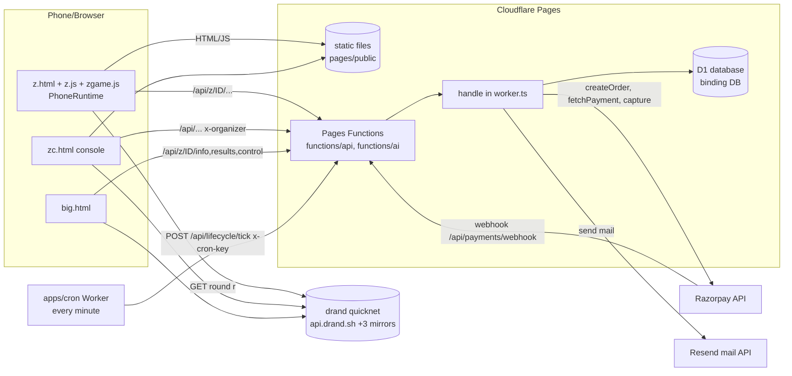
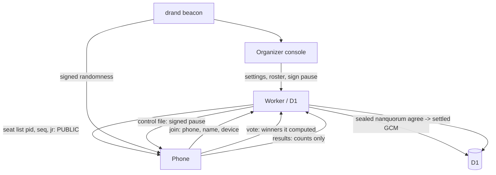
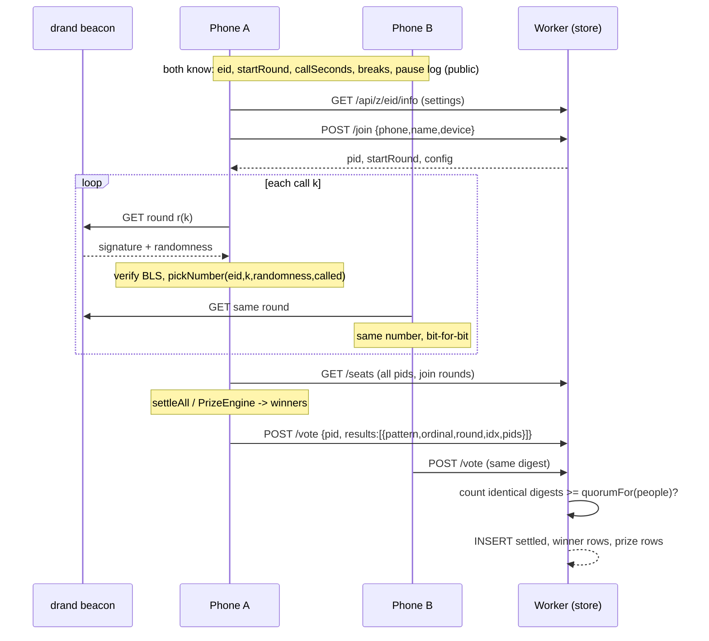

# 01 - Architecture

## 1. Components

```
Corporate Tambola (repo root C:\ct\tambola, Bun workspaces: packages/*, apps/*, tools/*)
|
|-- apps/web/public/        STATIC SITE + all browser code (vanilla JS, no framework, no build except 3 bundles)
|-- pages/                  Cloudflare Pages project "corporate-tambola"
|     |-- build.mjs         copies a WHITELIST of apps/web/public into pages/public + writes _headers (CSP) + _routes.json
|     |-- functions/api/[[path]].ts   Pages Function: ALL /api/* -> handle() in apps/edge/src/worker.ts
|     |-- functions/api/telemetry.ts  Pages Function: first-party monitoring (own D1 table, own key)
|     |-- functions/ai/[[path]].ts    Pages Function: /ai/* -> handle()
|     |-- wrangler.toml     Pages config: D1 binding DB, vars (PUBLIC_ORIGIN, MAIL_FROM, COMPANY_JSON, DAILY_WRITE_BUDGET)
|     |-- launch.py         one-shot creation of Pages project + D1 + schema + secrets (Cloudflare REST API)
|-- apps/edge/              THE BACKEND: one handler (src/worker.ts) + helpers; also deployable as a standalone Worker (wrangler.toml)
|     |-- migrations/       D1 migrations 0001..0014 (must equal SCHEMA in worker.ts; test enforces)
|-- apps/cron/              Worker with a 1-minute cron that POSTs /api/lifecycle/tick (key CRON_KEY)
|-- apps/server/            LEGACY server-driven mode (Bun + WebSocket + in-memory engine). NOT deployed; kept beside the new mode
|-- packages/beacon/        SHARED GAME LOGIC (pure, deterministic): beacon client, calls, tickets, winners, control file, phone runtime, config validation
|-- packages/shared/        ticket generator, phone normalisation, pricing (PACKS), upload parsing, audio phrases
|-- packages/billing/       Razorpay client, signatures, GST invoices, company details
|-- packages/engine/        LEGACY server engine used only by apps/server
|-- tools/                  sims, seeding, generators (trust page, legal pages, sitemap), control-worker (R2 variant, undeployed)
|-- tests/e2e/              Playwright + time-travel suites
|-- docs/                   product docs; docs/dev = this developer documentation
```

### 1.1 Request path (production)



- `apps/web/public/_headers` is a **legacy** hand-written header file; the deployed one is generated by `pages/build.mjs:10-25` into `pages/public/_headers`.
- `pages/functions/*` import `handle` from `apps/edge/src/worker.ts` by relative path (`../../../apps/edge/src/worker`), so Pages bundles the worker code into the function. The Worker deployment in `apps/edge/wrangler.toml` ("NOT deployed yet", placeholder `database_id`) is an alternative that serves the same code with `export default { fetch, scheduled }` (`worker.ts:1351`).
- `_routes.json` (`pages/build.mjs:26`) includes only `/api/*` and `/ai/*`, so static files never invoke a function.

### 1.2 What each tier does

| Tier | Does | Never does |
|---|---|---|
| **Phone** (`PhoneRuntime`, `packages/beacon/src/phone-runtime.ts`) | Fetches beacon rounds, verifies BLS signatures (`@noble/curves`), derives every number, builds its own ticket from its seat, detects its own wins, works out *all* winners from the public seat list, reports winners (`/vote`), verifies the signed pause file, plays brand moments, speaks numbers | Trust the server for numbers |
| **Worker** (`apps/edge/src/worker.ts`) | Stores who joined (seats, sealed names), accepts/serves the signed pause file, counts agreeing votes, runs payments, mail, lifecycle, audit | Draw numbers, verify BLS (a free Worker has ~10 ms CPU; one verification costs ~60 ms), post winners, show participants others' data |
| **Organizer console** (`zc.js`) | Builds settings, signs pause/resume/stop with a non-extractable key held in IndexedDB (`control.js`), reads names a few at a time, opens the report | Pick winners |
| **drand beacon** | Publishes signed randomness every 3 s | - |
| **cron Worker** | Wakes `lifecycleTick` each minute | Holds any logic |

### 1.3 `packages/beacon` (the shared brain)

| File | Role |
|---|---|
| `src/index.ts` | drand `QUICKNET` constants (chain hash, public key, genesis, 3 s period, mirrors), `verifyRound`, `fetchRound`, `scheduleFor`, `pickNumber` (sha256 of `CT1|eid|k|randomness` mod remaining numbers), `deriveCalls`, `syncCalls`, re-exports `control.ts` |
| `src/config.ts` | `EngagementCfg` types and `validateCfg()`: the single validator used by Worker, console and phones; constants `GRACE_ROUNDS=40`, `LATE_LAG_ROUNDS=30`, `INTERMISSION_ROUNDS=30`, `quorumFor`, `votersFor`, brand-moment allowance functions |
| `src/game.ts` | `ticketFor/ticketsFor`, `settleAll`, `completionIndex*`, `luckyWinners`, schedule math with breaks and pauses (`callRoundR`, `callRoundFull`, `unshiftedRound`), `RoundStore`, `logFrom` |
| `src/unique-ticket.ts` | Collision-free ticket list: ticket for seat s and ticket index w is `ticketAt(eid, 2*(s-1)+w)`; keyed permutation over about 880,000 row shapes x 2^29 number sets |
| `src/house-rules.ts` | What each house asks of one ticket (`ruleOf`): shared by the engine, `settleAll`, claims and the page |
| `src/prize-engine.ts` | Incremental winner engine (one unit per ticket) that equals `settleAll` (proved by test) |
| `src/control.ts` | Signed control messages, `acceptLog`, `resolveControl`, safety profiles (`SAFETY_STANDARD/FAST/LEAN30/LEAN60`), `PAUSE_MAX_PARTICIPANTS=2000`, `safetyForCap`, `registerKey/publishControl/readPublished` (KV interface), `ControlTracker` |
| `src/phone-runtime.ts` | The whole phone loop without UI: `PhoneRuntime` class (Phase `boot|missing|join|play|ended`) |
| `src/demo-script.ts` | Scripted free-demo game (ticket for seat 1 of engagement `DEMO`, six numbers, 15 s break) |
| `src/zgame-browser.ts` | Entry of the `zgame.js` bundle (`window.ZG`) |
| `src/control-browser.ts` | Entry of the `control.js` bundle (`window.TBControl`, IndexedDB key) |

### 1.4 Legacy (do not extend, still in the repo)

`apps/server`, `packages/engine`, `apps/web/public/{play,screen,console,confirm}.{html,js,css}`, `sw.js`, `tools/seed`, `tools/sim/{run,rounds}.ts`, `docs/RUNNING.md`, `docs/IMPLEMENTATION.md` describe the **older server-driven design** (WebSocket, Durable-Object-style engine, `/api/e/CODE` routes). `pages/build.mjs` deliberately leaves those pages out ("the older server-driven pages ... need a server", `pages/build.mjs:1`). `docs/GO_LIVE_ZERO_COST.md` section 5 says the legacy mode is "kept until the new one is accepted".

## 2. Data flow diagrams

### 2.1 Who knows what



### 2.2 Number and winner derivation (no server in the loop)



## 3. Trust model

| Question | Answer | Where enforced |
|---|---|---|
| Who draws numbers? | Nobody. Number for call k = `sha256("CT1|eid|k|randomness") mod remaining` with the randomness of a *future* beacon round fixed by the schedule. Unpredictable until the round is published, re-checkable forever. | `beacon/src/index.ts:116` |
| Can the Worker lie about numbers? | It never sends numbers. Phones verify each round's BLS signature against the hard-coded drand public key. | `index.ts:42` `verifyRound` |
| Who decides winners? | Software on phones. A result is accepted only if `quorumFor(people)` different phones report the identical result (digest of pattern, ordinal, round, idx, sorted pids). Organizer, Host, Co-host, AI, and we have **no route to post, change or remove a winner** (`POST .../settle` always returns 403; `.../won` is a stub). | `winners.ts:31`, `worker.ts:1213-1215`, `lifecycle.ts:88` |
| Tickets unique? | Yes, by construction: seat -> distinct position in a huge shuffled list. One ticket per phone (device hash). | `unique-ticket.ts`, `worker.ts:953`, `seat_dev` index |
| Can the organizer pause to peek? | A pause is an Ed25519-signed message with a mandatory lead time (`leadRounds`) derived so a pause can never reveal-then-hide a number. Only the organizer's own browser holds the signing key (non-extractable CryptoKey). Not available above 2,000 participants. | `control.ts:210-243`, `control-browser.ts` |
| Honest limit | "Very hard, not impossible": enough colluding phones could in theory agree on a false result, and **known weakness F-01** (votes authorised by ticket id only; ticket ids are public via `/seats`) is documented in `docs/E2E_FINDINGS.md`; still present in code (`winners.ts:32-35` checks only that `pid` is a participant). | `ai-facts.ts` fact 6 |

## 4. Security and privacy design

| Mechanism | Detail | File |
|---|---|---|
| **Sealed personal data** | Name+mobile sealed with AES-256-GCM; key = HKDF-SHA-256(`"k|"+DATA_KEY`, salt `corporate-tambola/salt/v1`, info `pii-aes-256-gcm`); random 12-byte nonce each; format `v1.<iv>.<ct>`; AAD `corporate-tambola/pii/v1`. Fallback to `ORGANIZER_SECRET` if `DATA_KEY` missing (`STRICT_KEYS=1` in production refuses to run without `DATA_KEY`, `PHONE_SALT`, `ORGANIZER_SECRET`, `CRON_KEY`, `INBOUND_SECRET`). | `pii.ts:1-40`, `worker.ts:275` |
| **Hashed keys** | Organizer/Host/Co-host/AI keys stored as `sha256("key|"+key)`; partner keys as `sha256("partner|"+key)`; e-mails as `sha256("email|"+e)`; mobile numbers as `sha256(PHONE_SALT|last10digits)`; device ids as `sha256("dev|eid|device")[:32]`; network addresses as `sha256("jip|"+ip)[:16]` etc. | `worker.ts:387-391,945-948,982` |
| **Never stored in clear** | participant names/numbers, the plain phone number, keys, sign-in codes (hash only), card data (never touched; Razorpay hosted checkout) | tests `privacy.test.ts`, `keys.test.ts` |
| **Audit trail** | Two layers: `ai_audit` (every AI/Host-link call, readable by the organizer) and the internal **hash-chained, append-only `audit_log`** (trigger refuses UPDATE; owner-only reads, each logged in `audit_access`). Participants' personal part lives in `audit_pii` sealed under a **per-engagement key** (`eng_key.salt`). | `winners.ts:138`, `audit.ts:1-31` |
| **Crypto-shredding** | 23 h after the game ends the `eng_key` salt and `audit_pii` blobs are deleted and a `shred` marker written; the chain still verifies because the chain covers only the non-personal core plus `pdig`. | `audit.ts:397`, `lifecycle.ts:313-320`, test `shred.test.ts` |
| **Deletion clocks** | Report link closes at **22 h**; participants' data deleted at **23 h** (`PURGE_AFTER_MS`); engagement + organizer-side records deleted at **00:00 IST at the end of day 365** (`fullDeleteAt`); unpublished draft after **30 days**; backups roll off within **7 days** (Cloudflare D1). | `lifecycle.ts:20-24,38`, `worker.ts:64,1333` |
| **Transport / headers** | CSP per page class, `X-Frame-Options: DENY`, `Referrer-Policy: no-referrer`, `nosniff`, `Permissions-Policy` locked; AI link responses carry `x-robots-tag: noindex`, `referrer-policy: no-referrer`, `cache-control: no-store` | `pages/build.mjs:10-25`, `worker.ts:284` |
| **Abuse limits** | per-address join caps (1500/day, 200/min), 10 new accounts/day/address, partner enrol limits, sign-in code limits (5/h/address, 5 wrong tries), daily D1 write budget | `worker.ts:66,182-190`, `partners.ts:94` |
| **Least privilege** | Role matrix in `05-ROLES-AND-PERMISSIONS.md`; cron key can call only the tick; AI keys cannot pay/publish/erase/pause; owner routes return the same 404 as unknown addresses | `worker.ts:394-399,929-933` |
| **No ad trackers** | Only first-party monitoring (`rum.js` -> `/api/telemetry`) and visit tracking on public pages (`v.js` -> `/api/v/b`), both privacy-safe and never inside the game | `visits.ts:1-14`, `rum.js` |
| **Free-plan write guard** | Every write path calls `spend(n)`; above `DAILY_WRITE_BUDGET` (default 80,000) the Worker answers 503 politely and writes nothing | `worker.ts:171` |

### 4.1 Free-plan load design

- Phones fetch randomness from drand mirrors directly (about 160 requests per phone per game) - not our requests.
- The only polled Worker route is the pause file `GET /api/z/{id}/control`; the poll interval scales with size (`SAFETY_*`), and above 2,000 participants no pause is registered so phones stop asking. Optional R2 static copy via `CONTROL_R2` + `CONTROL_BASE` (`mirrorControl`, `worker.ts:58`).
- The seat list is saved once as one text row in `kv` (`seats-base/<eid>`) so 10,000 phones read one row (`worker.ts:1029-1047`).
- Claims are stored only for engagements of <= 500 (`CLAIM_TRACKING_MAX_CAP`).

## 5. Local run vs production

| | Production | Local (`bun run zlocal`) |
|---|---|---|
| Static | Pages (`pages/public`) | `apps/web/public` served directly with `cache-control: no-store` (`local.ts:34-40`) |
| API | Pages Functions -> `handle()` | `Bun.serve` -> `handle()` |
| DB | D1 | `bun:sqlite` file (`DB_FILE`, default `tambola-local.sqlite`) with `SCHEMA` applied at start (`local.ts:7-9`) |
| Mail | Resend | stays in `outbox` table (no `RESEND_API_KEY`) |
| Payments | Razorpay keys, or `TEST_MODE=1` instant fulfilment | `TEST_MODE=1` |
| Cron | Cloudflare cron | tests call `lifecycleTick`/`purgeOld` with a handed-in clock |

The default local port is 8788 (`local.ts:35`); `docs/GO_LIVE_ZERO_COST.md` uses `PORT=8799`.
