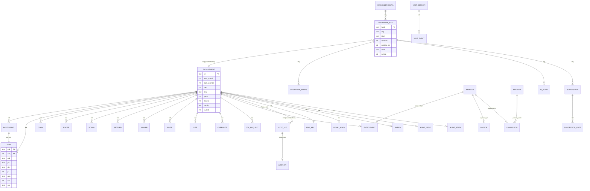

# 03 - Database (Cloudflare D1 / SQLite)

Single database, binding `DB`. The schema is defined **twice on purpose**:

1. In code: the `SCHEMA` array in `apps/edge/src/worker.ts:88` (which spreads `PAY_SCHEMA` from `pay.ts:24`, `PARTNER_SCHEMA` from `partners.ts:19`, `PRIVACY_SCHEMA` at `worker.ts:77`, `WINNERS_SCHEMA` from `winners.ts:14`, `AUDIT_SCHEMA` from `audit.ts:16`, `VISIT_SCHEMA` from `visits.ts:18`, `MODE_SCHEMA` from `mode.ts:18`, plus inline `ALTER TABLE` statements). The local server and every test apply this array.
2. As files in `apps/edge/migrations/` (files 0001 to 0015) (what `wrangler d1 migrations apply` / `d1 execute --file` runs in production).

**They agree.** Verified on 2026-10-07 by running `bun test apps/edge/test/migrations.test.ts` (1 pass): the test concatenates `0001..0015` and compares it, whitespace- and comment-normalised, with `SCHEMA.map(s => s + ";")` (`apps/edge/test/migrations.test.ts`). Because it compares the **concatenation in order**, a new migration file must (a) be appended to the `FILES` list in that test and (b) add its statements at the **end** of `SCHEMA`. The effective schema has **41 tables** (list below) plus one table created at runtime by a different function (`telemetry`).

Differences found between the two definitions: **none**. Differences between *docs* and code are in `KNOWN-DOC-DRIFT.md`.

## 1. Migration history

| File | Adds | Why |
|---|---|---|
| `0001_init.sql` | `engagement, participant(+unique idx), claim, settled, usage, kv, organizer_key, ctl_request, suggestion, suggestion_vote, login_code, payment, invoice, entitlement, organizer_email, outbox, partner, commission` | "Generated from SCHEMA" base. **Do not regenerate** with `apps/edge/tools/gen-migration.ts` any more: it rewrites 0001 from the *whole* current SCHEMA and would then duplicate `0002..0014` (and fail the test). |
| `0002_seat.sql` | `seat` + `seat_phone`, `seat_pid` unique indexes | collision-free tickets, one device per ticket |
| `0003_seat_join_round.sql` | `seat.jr` | late joiners |
| `0004_privacy.sql` | `participant.pii`; `seat.role, inv, cat, src`; `life`, `winner`, `overvote` | sealed personal data, roles, inviter, report/deletion clock |
| `0005_winners.sql` | `rvote, rcand, prize, ai_audit`, index `seat_dev` | software-decided winners, prize records, AI audit trail |
| `0006_link_expiry.sql` | `organizer_key.expires_ms` | 24-hour e-mailed AI/Host keys |
| `0007_login_link.sql` | `login_code.link_hash` | one-click sign-in link |
| `0008_terms.sql` | `organizer_terms` | Terms version accepted |
| `0009_partner_hashes.sql` | `partner.phone_hash, email_hash` | random partner codes; contacts only as hashes |
| `0010_audit.sql` | `audit_log` (+2 indexes, append-only trigger), `audit_access, audit_cert, audit_stats, legal_hold` | internal audit log |
| `0011_participant_shred.sql` | `audit_log.pdig`, `audit_pii`(+idx), `eng_key`, `shred` | crypto-shredding |
| `0012_visits.sql` | `visit_session`(+4 idx), `visit_event`(+2 idx), `visit_agg` | public-page visitor tracking |
| `0013_test_live_mode.sql` | `mode` (+ seeded `LIVE` row), `test_mail_allow`, `mail_event`, `is_test` on `engagement, payment, partner, commission, organizer_key, organizer_email, visit_session` | TEST/LIVE mode. Header says "Apply BEFORE deploying the code that reads them." |
| `0014_roles.sql` | `organizer_key.label` | Host/Co-host labels. Header says "Apply BEFORE deploying the code that reads it." Currently **untracked in git** (new, with the roles work). |
| `0015_cancel_refund.sql` | `engagement.cancelled_ms/cancelled_by`; `organizer_key.email_sealed/eid/pii`; `payment.eid/confirming_ms` + index `payment_eid`; new tables `refund`, `credit_note` | Round 2: cancel a game, refund + GST credit note, Host e-mail (sealed), Co-host bound to one game (name in `label`, mobile sealed in `pii`), "Confirming your payment". **Apply BEFORE deploying the code that reads it** (the new code selects these columns). Statements appended at the end of `SCHEMA` in the same order. |
| `0016_people.sql` | `organizer_key.created_by`; `engagement.cohost_limit`; `seat.blocked`; new tables `person`, `waiting` (+ indexes `person_phone`, `person_token`, `person_inviter`, `waiting_phone`) | Phase 2: one list per inviter, personal links, waiting room, a removed seat stays in the public list |
| `0017_brand_paylink_google.sql` | new tables `paylink`, `host_state`, `host_login`; `organizer_key.host_id`; a one-time backfill of `host_state` for Hosts that already exist (the 7-day window starts at migration time) | Phase 3/4. The brand on the ticket needs no table (it lives in `engagement.config` JSON). Apply BEFORE deploying the code that reads it. |
| `0018_credit_retention_clone.sql` | new tables `credit`, `credit_use` (+ indexes `credit_payment` UNIQUE, `credit_org`, `credit_use_eid`, `credit_use_credit`); `engagement.unplayed_ms` | Spec 5 and 6: NO REFUNDS (a cancelled paid game becomes credit for 365 days), games that did not start close after the erasure of guest data, "Create a new game like this one". The old `refund` and `credit_note` tables stay (nothing writes to them). Header says "Apply BEFORE deploying the code that reads it." |
| `0025_helpdesk.sql` | tables `helpdesk_helper`, `helpdesk_link`, `helpdesk_game`, `helpdesk_pub` (+ indexes `helpdesk_link_token`, `helpdesk_link_partner`, `helpdesk_link_org`): Help Desk (`apps/edge/src/helpdesk.ts`) |
| `0019_legal_party.sql` | table `legal_party` (one permanent record per paid game: organizer name / e-mail / mobile, payer name / organisation / e-mail / mobile / country / GSTIN, payment ids) + index `legal_party_org`. Never deleted by code. `deploy/UPDATE_LIVE_DATABASE.sql` is the ONE file that brings the live database up to date (0019 + back-fill). |

### How to apply (no secrets shown)

```
# NEW database (Cloudflare): create, then run every file IN ORDER
wrangler d1 create corporate-tambola            # prints database_id; put it in the wrangler.toml you deploy with
wrangler d1 migrations apply corporate-tambola --remote    # uses apps/edge/wrangler.toml migrations_dir = "migrations"
#   or file by file:
wrangler d1 execute corporate-tambola --remote --file apps/edge/migrations/0017_brand_paylink_google.sql

# BEFORE deploying code that reads a new column, apply its migration (0013 and 0014 headers say so).
```

Notes:
- `wrangler` auth is by Cloudflare API token in the environment (`CLOUDFLARE_API_TOKEN`; creating a database and loading schema may need a separate token with `Account > D1 > Edit`, called `CLOUDFLARE_D1_TOKEN` in `pages/launch.py:6`). Values live on the owner's laptop, never in the repo. Do not paste them anywhere.
- `pages/launch.py:36` loads **only `0001_init.sql`** when it creates a database. A database made that way is missing `0002..0014`; run the rest manually (this is a trap, listed in `KNOWN-DOC-DRIFT.md`).
- `ALTER TABLE ... ADD COLUMN` is not idempotent. `sqliteD1()` in `apps/edge/src/local.ts:7-9` runs every `SCHEMA` statement each time it opens a file. **Verified 2026-10-07** with a scratch script: opening the same SQLite file a second time fails with `duplicate column name: jr`. So `bun run zlocal` works on a fresh `DB_FILE` (or `:memory:`) but **cannot restart on the file it created**; delete the file (or the old `tambola-local.sqlite*`) between runs. Tests use fresh in-memory databases (`apps/edge/test/d1-sqlite.ts`), so they never hit it. A fix would be to run each statement inside a try/catch that ignores `duplicate column name` (not done; documentation only).
- Rollback: D1 Time Travel / `wrangler d1 export corporate-tambola --remote --output backup.sql` (see `docs/CONTINUITY.md`). There are no down-migrations.

## 2. Entity-relationship diagram

Relationships are logical (D1 has no foreign keys here). `org` is a random 16-hex organizer id.



## 3. Tables (all 50), columns, writers, readers, retention

Types as SQLite reports them (`pragma table_info` on a fresh `SCHEMA`). `NN` = NOT NULL, `PK` = primary key, `D=` default.

### 3.1 Engagements, people, game results

| Table | Columns | Written by | Read by | Retention / deletion |
|---|---|---|---|---|
| **engagement** | `id TEXT PK`, `start_round INT NN`, `call_seconds INT NN`, `cap INT NN`, `created_ms INT NN`, `org TEXT`, `closed INT NN D=0` (invite-only), `pack INT` (0 = unpaid/draft, else paid size), `tickets INT NN D=1`, `config TEXT` (JSON: rewards, breaks, rounds, invites, opening, closing, name), `is_test INT NN D=0`, `cancelled_ms INT` (set when cancelled), `cancelled_by TEXT` (`master`/`host`/`platform`) | `POST /api/z` (`worker.ts:876`); settings `UPDATE` (`:1295`); publish/pay set `pack` (`:1159`, `pay.ts:123`); restart sets `start_round` (`pay.ts:131`) | almost every route (`SELECT * FROM engagement WHERE id=?`, `worker.ts:942`), lifecycle, history | Deleted by `eraseEverything` at 00:00 IST end of day 365 after the game ended; unpublished draft after 30 days (`DRAFT_DAYS`); all of an account's on "Close my organizer account" (`worker.ts:717`); TEST data by purge (`test-data.ts`) | **0018 adds `unplayed_ms INTEGER`** (set by `unplayedPass` when a published unpaid game is closed after the erasure of its guest data).
| **participant** | `eid NN PK1`, `pid NN PK2`, `phone_hash NN`, `name TEXT` (always NULL now; legacy), `joined_ms NN`, `pii TEXT` (sealed `{phone,name}`); unique index `participant_phone (eid, phone_hash)` | `addSeat` (`worker.ts:958`) on join/roster/reuse; `UPDATE participant SET pii` when a late device adds a name (`:993`) | participants list, names, report, prizes, join duplicate check | **23 h after the game ends** (`erasePersonal`, `lifecycle.ts:114`) or earlier on erase/forget |
| **seat** | `eid NN PK1`, `seq NN PK2`, `pid NN`, `ph NN` (phone hash), `dev TEXT` (device hash, one ticket per phone), `jr INT` (join round, NULL/0 = in time), `role TEXT` (`organizer`/`host`/`co-host`), `inv INT` (inviter's seat), `cat TEXT` (invite category), `src TEXT` (`link`/`roster`/`reuse`/`co:<7 hex>`); unique `seat_phone (eid, ph)`, `seat_pid (eid, pid)`; index `seat_dev (eid, dev)` | `addSeat` (insert), `unbind` (`dev=NULL`), `mark` (`role`), device bind (`:991`) | `/seats` (public pid+seq+jr), join, invites, report, brought-by counts | 23 h after game end (with participants) |
| **claim** | `eid, pid, pattern, round D=1` (PK together), `idx NN`, `at_ms NN` | `POST /claims` (`worker.ts:1094`), **only for cap <= 500** | `GET /claims` (organizer/AI) | with participants (`erasePersonal`) |
| **settled** | `eid, pattern, ordinal D=1, round D=1` (PK), `idx NN`, `pids TEXT NN` (JSON array, <= 500) | `acceptVotes` when quorum reached (`winners.ts:55`) | `GET /results`, summary, big screen, phones | with participants (23 h). The *winners* survive in `winner` |
| **rvote** | `eid, round, pattern, ordinal, seat` (PK), `digest NN` | `acceptVotes` (`winners.ts:49`) | quorum counting | 23 h |
| **rcand** | `eid, round, pattern, ordinal, digest` (PK), `idx NN`, `pids NN` | `acceptVotes` (`:52`) | none besides storage (candidate result) | 23 h |
| **winner** | `eid, round, pattern, ordinal, seat` (PK), `idx`, `at_ms`, `src NN` (`phones`/`console`) | `recordWinners` (`lifecycle.ts:70`) | report (`baseData`), `prizes` | **365 days** (with the engagement); keeps seat only, never names |
| **prize** | `eid, round, pattern, ordinal, seat` (PK), `pii` (sealed current name+number), `orig` (sealed as joined), `trail` (sealed change history), `confirmed_ms`, `given_ms`, `given_by` | `makePrizeRows` (`winners.ts:65`), `confirmPrize` (`:77`), `markGiven` (`:129`); `forget` blanks pii (`worker.ts:1066`) | `GET /prizes`, `myprizes`, report | **365 days** (hand-over details kept on purpose) |
| **overvote** | `eid, seat` (PK), `at_ms NN` | `acceptOver` (`lifecycle.ts:101`) | counts toward early end | 23 h |
| **life** | `eid PK`, `end_ms NN`, `end_src NN` (`schedule`/`phones`/`organizer`), `report_ms`, `report_state`, `purged_ms`, `tries D=0`, `notified D=0` (**never written**) | `lifecycleTick` (`lifecycle.ts:303`), `acceptOver` (`:107`), `erasePersonal` (`:119`) | `GET /life`, tick, report | with the engagement (365 d) |
| **ctl_request** | `id PK AUTOINCREMENT`, `eid NN`, `action NN` (`pause`/`resume`/`stop`/`erase`), `note`, `at_ms NN`, `open D=1` | `POST /control/request` (`worker.ts:785,788`) | `GET /control/request`, console | with the engagement |

Phase 2 additions to this group (`people.ts`, migration 0016):

| Table | Columns | Written by | Read by | Retention |
|---|---|---|---|---|
| **person** | `eid, id` (PK, 12 hex), `ph NN` (phone hash, UNIQUE per game: first list wins), `pii NN` (sealed name + number), `inviter NN` (`o` Organizer, `h:<7 hex>` Host, `c:<7 hex>` Co-host, `s:<seat>` level-1 guest), `role` (`organizer`/`host`/`co-host` for a team member's own play seat), `status NN` (`invited`/`joined`/`removed`), `tok_hash` (UNIQUE: hash of the personal-link token), `tok_sealed` (the token, sealed so the inviter can be shown the link again), `approved_by`/`approved_ms` (who let them in from the waiting room), `added_ms`, `joined_ms`, `removed_ms`, `removed_by` | `/people*`, `join`, `/waiting*` | the people routes, report | erased with the guests' data (`erasePersonal`, the 23-hour rule) |
| **waiting** | `eid, id` (PK), `ph NN` (UNIQUE per game: one request per number), `pii NN` (sealed), `via NN` (`personal-link`/`common-link`/`direct`), `inviter NN` (link owner), `chain NN` (",id,id," of the owner and the people above them: who may answer), `overlimit` (0/1: came over the owner's limit, only Organizer/Host see it), `status NN` (`waiting`/`admitted`/`declined`), `at_ms`, `decided_by`, `decided_ms` | `join`, `/waiting*`, `/people` (listing a waiting number admits it) | the waiting routes, `/me?wid=` | same as `person` |

Phase 3/4 additions (`paylink.ts`, `hostsetup.ts`, migration 0017):

| Table | Columns | Written by | Read by | Retention |
|---|---|---|---|---|
| **paylink** | `hash PK` (sha-256 of `paylink\|<token>`; the token itself is never stored), `eid NN`, `org NN`, `created_ms NN`, `exp_ms NN` (created + 7 days), `revoked D=0` (1 when a newer link replaced it), `created_by` (`master`/`host`/`cohost`); index `paylink_eid` | `POST /api/z/{id}/paylink` | `GET /api/paylink/{token}`, `POST /api/paylink/{token}/checkout` | deleted with the account (`/api/org/close`) and by the test purge |
| **host_state** | `host_id PK` (the hash of the Host's identity key row), `org NN`, `email_hash` (confirmed e-mail), `verified_ms`, `pend_hash`/`pend_sealed` (the address a code was sent to, sealed), `link_exp_ms NN` (link valid until, 7 days), `spent D=0` (1 once the link key is used up by confirming the e-mail), `mobile_ok D=0` | `POST /api/org/host`, `/api/org/host/link`, `/api/host/setup/*`, `/api/auth/google` (host) | `authOfKey` (every Host request: usable? ready?), `GET /api/org/team` | deleted when the Host is retired and with the account |
| **host_login** | `(email_hash, host_id)` PK, `org NN`, `created_ms NN` | confirming a Host's e-mail (code or Google) | `/api/auth/email`, `/verify`, `/google` (finding a Host by e-mail) | deleted when the Host is retired and with the account |

`organizer_key.host_id` is NULL for every key except a Host's **device keys**: when a Host confirms an e-mail (or signs in later by code or Google) a new `organizer_key` row (kind `host`, same label, sealed e-mail and mobile) is minted whose `host_id` points at the Host's identity row. The team list, the Host count and the Host's people list use the identity row only (`host_id IS NULL OR host_id = hash`).

`seat.blocked=1` marks a person removed DURING the game: the seat stays in the public seat list (winners stay identical on every phone), the phone stops (`join` and `claims` answer 403 `removed`), the prize is shown `notGiven: "removed"`. `organizer_key.created_by` records who made a Host (`o`) or Co-host (`o` or `h:<7 hex>`). `engagement.cohost_limit` is the per-game Co-host list limit (NULL = 100). `engagement.closed` is still the one switch behind `whoCanJoin` (`1` = `list`).

### 3.2 Accounts, keys, sign-in

| Table | Columns | Written by | Read by | Retention |
|---|---|---|---|---|
| **organizer_key** | `hash TEXT PK` (sha256 of `"key|"+key`), `org NN`, `kind NN` (`master`/`ai`/`host`/`cohost`), `revoked D=0`, `created_ms NN`, `expires_ms` (NULL = lasting; set for e-mailed 24 h keys), `is_test D=0`, `label TEXT` (Host/Co-host name, max 40 chars; set NULL when a Co-host is erased), `email_sealed TEXT` (a Host's e-mail, sealed `v1.`; NULL when retired), `eid TEXT` (the one game a Co-host is bound to), `pii TEXT` (a Co-host's sealed `{phone, name}`; NULL when erased) | `/api/start` (master + ai), `/api/auth/verify` and `/link` (new master), `/api/org` (platform), `/api/org/host`, `/cohost`, `mailTempLink`, `replaceAiLink`, fulfil (`pay.ts:116`), revoke routes | **every authenticated request** (`authOfKey`, `worker.ts:387`) | revoked rows 90 days; e-mailed keys 7 days after expiry (`retentionSweep`, `worker.ts:1329-1330`); all with account close |
| **organizer_email** | `email_hash PK`, `org NN`, `is_test` | `/api/start`, fulfil | sign-in lookup | with the account |
| **organizer_terms** | `org, version` (PK), `at_ms NN`, `via NN` (`start`/`engagement`/`signin-code`/`signin-link`) | `recordTerms` (`worker.ts:198`) | none (record) | account close |
| **login_code** | `email_hash PK`, `code_hash NN`, `expires_ms NN`, `attempts D=0`, `win_start NN`, `sent D=0`, `link_hash` | `/api/auth/email`; deleted on use | `/api/auth/verify`, `/api/auth/link` | 10 min validity; row deleted 1 day after expiry (`worker.ts:1323`) |
| **suggestion** | `id PK AUTOINCREMENT`, `org NN`, `kind NN`, `title NN`, `body NN`, `status D='new'`, `note`, `votes D=1`, `created_ms NN`, `title_hash NN`; `UNIQUE(org, title_hash)` | `POST /api/z/suggestions` | `GET /api/z/suggestions` (authors hidden from other orgs) | not deleted by code |
| **suggestion_vote** | `sid, org` (PK) | `.../vote` | counting | not deleted |

### 3.3 Money and partners

| Table | Columns | Written by | Read by | Retention |
|---|---|---|---|---|
| **payment** | `id PK` (`pay_<16hex>`), `org`, `email NN`, `pack NN`, `currency NN`, `amount REAL NN`, `tax REAL NN`, `rzp_order_id UNIQUE`, `rzp_payment_id`, `status NN` (`created`/`paid`), `created_ms NN`, `paid_ms`, `meta NN` (JSON: org name, country, GSTIN, origin, and for a bound draft `orgId, eid, paidBy`), `result` (JSON returned to the buyer), `ref` (partner code), `buyer_phone_hash`, `is_test`, `eid` (the game it was made for), `confirming_ms` (set from a correctly signed browser report until the gateway confirms; shown as "Confirming your payment" for 30 min) | `/api/checkout` (`pay.ts:211`), webhook/verify update, `fulfil` (`:157`) | verify, webhook, commission | **kept** (tax records; "owner decision" - `docs/RETENTION.md`) |
| **refund** | `payment_id PK` (one refund per payment: this key is the idempotency guard), `eid`, `org`, `currency NN`, `paid/fee/refund REAL NN`, `refund_status NN` (`requested`/`processed`/`failed`), `rzp_refund_id`, `is_test D=0`, `note`, `requested_ms NN`, `updated_ms NN` | **no longer written** (spec 6: no refunds); kept so migration 0015 stays valid and old rows stay readable | - | kept |
| **credit_note** | `token PK` (`cn_<32hex>`), `payment_id UNIQUE NN`, `brand`, `fy`, `seq`, `number`, `issued_ms`, `data` (JSON `InvoiceData` with `kind:"credit_note"`, `originalNumber`); `UNIQUE (brand, fy, seq)` | **no longer written** (spec 6: no refunds, so no new credit notes; none for lapsed credit) | `GET /api/credit-note/<token>` (old notes) | kept |
| **credit** | `id PK` (`cr_<20hex>`), `org NN`, `payment_id` (UNIQUE: one credit per payment), `eid` (the game it came from), `kind D='cancel'` (`cancel` / `late` = a payment that arrived after a cancel or after the game closed), `total_inr NN`, `remaining_inr NN`, `lapsed_inr D=0`, `currency D='INR'`, `created_ms NN` (the date of the ORIGINAL payment), `expires_ms NN` (the instant it lapses: 00:00 IST after day 365), `status D='active'` (`active`/`used`/`expired`), `is_test`, `mail_created_ms`, `mail30_ms`, `mail3_ms`, `mail_lapse_ms` (each mail is claimed with an `UPDATE ... WHERE flag IS NULL`, so it goes out once); index `credit_org (org,status,expires_ms)` | `creditFromPayment` (`apps/edge/src/credit.ts`; called by `cancelGame` and `fulfil`), `applyCreditToGame` (remaining), `restoreCreditUses`, `creditTick` (lapse, mail flags) | `GET /api/org/credit`, `info`/`summary`, checkout, `pay-with-credit` | 365 days after it lapses (`retentionSweep`); TEST credit removed by the TEST purge; closing the account forfeits unused credit |
| **credit_use** | `id PK AUTOINCREMENT`, `credit_id NN`, `eid NN` (the game the credit paid for), `amount_inr NN`, `at_ms NN`, `status D='applied'` (`applied` / `restored` when the game was cancelled and the money went back to the same credit), `restored_ms`; indexes `credit_use_eid (eid,status)`, `credit_use_credit` | `applyCreditToGame`, `restoreCreditUses` | `listCredits`, invoice note, checkout | same as `credit` |
| **invoice** | `token PK` (`inv_<32hex>`), `payment_id UNIQUE NN`, `brand`, `fy`, `seq`, `number`, `issued_ms`, `data` (JSON `InvoiceData`); `UNIQUE (brand, fy, seq)` | `fulfil` (`pay.ts:147`) | `GET /api/invoice/<token>` | kept. TEST invoices use negative `seq` and `TEST-` numbers |
| **entitlement** | `id PK` (`ent_<paymentid>`), `org NN`, `pack NN`, `payment_id NN`, `eid` (NULL = unused credit), `created_ms` | `fulfil` (`pay.ts:120`); attached at create/publish (`worker.ts:877,1160`) | `/api/z` create, publish | kept |
| **outbox** | `id PK AUTOINCREMENT`, `to_addr`, `subject`, `body`, `at_ms`, `sent D=0` | `sendMail` (`pay.ts:60,62`) | `retryOutbox` | sent mails keep no body; unsent without keys 3 days; with a link no body; all rows deleted after 3 days (`pay.ts:97`) |
| **partner** | `code PK` (8-char random), `key_hash NN`, `name`, `source`, `enrolled_ms NN`, `consent_ms NN`, `state D='active'` (`active`/`blocked`), `phone_hash`, `email_hash`, `is_test` | `/api/partner/enroll/verify` (`partners.ts:130`) | commission attribution, `/me` | row deleted on `/api/partner/close`; commissions stay |
| **commission** | `id PK AUTOINCREMENT`, `payment_id UNIQUE NN`, `partner_code NN`, `base REAL NN`, `currency NN`, `rate`, `amount`, `status NN` (`accrued`/`pending_rate`/`paid`/`blocked`/`void`), `reason`, `created_ms NN`, `paid_ref`, `paid_ms`, `is_test` | `recordCommission` (`partners.ts:58`); rate/payout/void routes | `/api/partner/me`, owner lists | kept as accounting records |

| **helpdesk_helper** | `partner_code PK`, `email_sealed NN` (the helper's e-mail, sealed), `joined_ms NN`, `state D='active'` | `/api/helpdesk/join` | `/api/helpdesk/me`, helper mails | deleted when the partner closes their account |
| **helpdesk_link** | `id PK` (16 hex), `partner_code NN`, `org_email_sealed NN`, `org_email_hash NN` (same hash the sign-in uses), `org`, `state NN` (`invited`/`active`/`stopped`), `token_hash NN UNIQUE`, `ai_key_hash`, `ai_key_sealed`, `host_hash`, `consent_ms`, `consent_text_hash` (HD1), `created_ms NN`, `accepted_ms`, `stopped_ms` | invite, accept, stop | every Help Desk route | the AI key is sealed so the helper can reopen their console; stopping clears it; deleted with the partner or the organizer account |
| **helpdesk_game** | `eid PK`, `link_id NN`, `partner_code NN`, `created_ms NN` | game creation by a helper's AI key (`noteHelperGame`) | request-publish, checkout (`helperRefFor`: the payment's `ref` is this partner) | kept so the commission follows the game; deleted with the organizer account |
| **helpdesk_pub** | `token_hash PK`, `link_id NN`, `eid NN`, `org NN`, `created_ms NN`, `exp_ms NN` (7 days), `used_ms`, `tmp_key_hash` (the 30-minute key) | request-publish | `/api/helpdesk/approve/*` | one open approval per game; single use |

### 3.4 Operations, mode, audit, visits

| Table | Columns | Written by | Read by | Retention |
|---|---|---|---|---|
| **usage** | `day PK` (UTC date), `writes NN` | `spend()` (`worker.ts:176`) | `spend()` | rows older than 90 days deleted (`worker.ts:1331`) |
| **kv** | `k PK`, `v NN` | everywhere (see section 4) | everywhere | per key family |
| **ai_audit** | `id PK AUTOINCREMENT`, `org NN`, `eid`, `at_ms NN`, `key_id` (first 10 hex of key hash), `method NN`, `path NN`, `status`, `ip`, `ua`, `country` | `auditAi` (`winners.ts:138`) for every AI-key or Host-via-link call | `GET /api/org/ai/audit` | 365 days (`worker.ts:1338`), account close |
| **mode** | `id INT PK CHECK(id=1)`, `mode D='LIVE'`, `changed_ms`, `reason` | `setMode` (`mode.ts:54`); seeded `LIVE` | `getMode` (cached 5 s per DB handle) | single row |
| **test_mail_allow** | `email PK`, `added_ms NN` | `POST /api/owner/test-mail` | TEST-mode mail gate | until removed |
| **mail_event** | `id PK AUTOINCREMENT`, `at_ms`, `to_hash`, `subject`, `outcome` (`sent_test_allowlist`/`suppressed_test_mode`) | `logMail` | none besides storage | **not purged by code** |
| **audit_log** | `id PK AUTOINCREMENT`, `chain NN` (`eid` or `org:<org>` or `sys`), `seq NN`, `eid`, `org`, `at_ms NN`, `actor NN` (`organizer`/`host`/`cohost`/`participant`/`ai_key`/`system`/`owner`), `event NN`, `target`, `corr NN`, `status`, `country`, `asn`, `ai_vendor`, `key_id`, `proof`, `mismatch D=0`, `sealed NN` (AES-GCM blob of everything identifying), `prev_hash NN`, `row_hash NN`, `pdig`; unique `audit_chain_seq (chain, seq)`, `audit_at (at_ms)`; **trigger `audit_log_no_update`** aborts any UPDATE | `appendAudit` (`audit.ts:182`) from `auditRequest` on every route | owner routes only (`/api/owner/audit/...`) | deleted with the engagement at 365 d (`closeAuditFor`, writes `audit_stats` + `audit_cert` first); a `legal_hold` stops it |
| **audit_access** | `id PK AUTOINCREMENT`, `at_ms`, `action`, `eid`, `fmt`, `row_count D=0`, `ok D=1`, `note` | `logAccess` for every owner read, denied attempt, mode switch | `GET /api/owner/audit/access` | kept (no personal data) |
| **audit_cert** | `eid PK`, `deleted_ms`, `row_count`, `final_hash`, `first_ms`, `last_ms` | `closeAuditFor` | evidence of deletion | kept |
| **audit_stats** | `eid PK`, `deleted_ms`, `stats` (JSON, masked aggregate) | `closeAuditFor` | analytics | kept |
| **legal_hold** | `eid PK`, `at_ms`, `note` | `POST /api/owner/audit/<chain>/hold` | tick, `eraseEverything` | until lifted |
| **audit_pii** | `chain, seq` (PK), `eid NN`, `sealed NN`; index `audit_pii_eid` | `appendAudit` for participant rows | owner download (`loadRows`) | destroyed 23 h after game end (`shredParticipantAudit`) |
| **eng_key** | `eid PK`, `salt NN` (hex), `made_ms` | first participant audit row of an engagement | opening `audit_pii` | **deleted at 23 h** - this is the shred |
| **shred** | `eid PK`, `shredded_ms`, `row_count` | `shredParticipantAudit` | marks "shredded" so later rows keep only the core | deleted with the engagement |
| **visit_session** | `sid PK`, `vid`, `iph` (HMAC of address), `ipshort` (v4 last octet zeroed / v6 /48), `first_ms NN`, `last_ms NN`, `landing`, `src`, `ref_host`, `utm_source/medium/campaign`, `partner`, `device`, `browser`, `os`, `lang`, `country`, `city`, `is_bot D=0`, `visit_no D=1`, `ip_visit_no D=1`, `pages D=0`, `n_events D=0`, `exit_path/section/ms/scroll`, `stage D=0`, `org`, `eh`, `is_test D=0`; indexes on `first_ms, vid, iph, org` | `beaconRoute` (`visits.ts:160`), `linkVisitor` | owner reports | 365 days then rolled into `visit_agg` (`sweepVisits`, daily from the tick) |
| **visit_event** | `id PK AUTOINCREMENT`, `sid NN`, `at_ms NN`, `kind NN` (`pv`/`sec`/`act`/`exit`), `path`, `name`, `val`, `n`; indexes `sid`, `at_ms` | `beaconRoute` | owner reports | 365 days |
| **visit_agg** | `day, dim, k` (PK), `n D=0`, `ms D=0` | beacon (GPC/DNT counters `gpc_*`), `recordFunnelForOrg`, `sweepVisits` | summary | kept (anonymous totals) |

### 3.5 Created outside `SCHEMA`

| Table | Where | Notes |
|---|---|---|
| **telemetry** | `pages/functions/api/telemetry.ts:10-14`: `id PK AUTOINCREMENT, ts NN, kind NN (pv/vital/err/api/res), path, name, value REAL, detail, device, country` + index `telemetry_ts (ts, kind)`; created on first use with `CREATE TABLE IF NOT EXISTS` ("kept out of the product migration on purpose") | no cookies, no IP; 5,000 events/day cap; 1% of POSTs delete rows older than 90 days |

## 4. The `kv` table: key families

`kv(k TEXT PRIMARY KEY, v TEXT NOT NULL)` is a general key-value store. Keys (prefix = family):

| Key | Value | Purpose | Deleted |
|---|---|---|---|
| `pub/<eid>` | ms | engagement is **published** (draft vs published) | with engagement |
| `contact/<eid>` | JSON `{email, phone}` (organizer's confirmed contact, **not sealed**) | report e-mail, nudges, deletion e-mail match | with engagement |
| `paidby/<eid>` | `{by: organizer|host|co-host, ms}` | who paid | with engagement |
| `ann/<eid>` | `{id, text, at}` | latest announcement | with engagement |
| `control/<eid>.json` | signed pause file (public key, safety profile, messages) | pause/resume/stop | with engagement |
| `seats-base/<eid>` | saved seat list JSON text with `"upto"` | one-row seat list for 10,000 phones | 23 h erase |
| `rpt/<eid>`, `rptc/<eid>/<i>`, `rptopen/`, `rptremind/`, `rptsalt/<eid>` | report state (aggregates), sealed people chunks, flags, link salt | report | 23 h erase; `rptsalt` with engagement |
| `lockmail/<eid>`, `remind/<eid>` | ms | one-time nudge flags | with engagement |
| `orgmail/<org>` | sealed organizer e-mail | dedicated AI-link mails | account close |
| `aikey/<org>` | sealed lasting AI key | "Show my AI work link" | account close / AI revoke |
| `seen/<keyid10>`, `alert/<keyid10>` | JSON of countries/prefixes/programs seen; last alert ms | "new place" alerts for AI/Host keys | when key no longer live |
| `start/<day>/<ipshort16>` | counter | max 10 new accounts per address per day | 2 days |
| `linkfail/<day>/<ip16>` | counter | max 20 bad sign-in-link tries | 2 days |
| `plim/<kind>/<day>/<ip16>` | counter | partner endpoint limits | 2 days |
| `jlim/<day>/<ip16>`, `jbm/<minute>/<ip16>` | counter | join caps per address | 2 days |
| `penr/<emailhash>` | `{t, n, c, x, ph, nm, src, a}` | partner enrolment code state | 1 day |
| `delreq/<eid>` | `{c, x, t}` | e-mailed deletion confirmation (30 min) | 1 day |
| `notices` | JSON array | public news list | overwritten |
| `housekeeping_day`, `visit_sweep_day` | UTC date | run-once-a-day claims | - |

## 5. Retention summary (quick)

| Data | When it goes | Code |
|---|---|---|
| Report link | 22 h after game end | `REPORT_LINK_MS` `lifecycle.ts:21` |
| Participants' names/numbers/seats/votes/claims/results/working report + their audit part | 23 h after game end | `PURGE_AFTER_MS` `:20`, `erasePersonal` `:114` |
| Winners, prize hand-over details, engagement, organizer-side audit, `ai_audit`, contacts | 00:00 IST end of day 365 | `fullDeleteAt` `:38`, `purgeOld` `worker.ts:1333` |
| Unpublished draft | 30 days (`DRAFT_DAYS`) | `worker.ts:64` |
| Address-hash counters | 2 days | `retentionSweep` |
| Sign-in codes | expiry + 1 day | |
| E-mailed 24 h keys | expiry + 7 days; revoked keys 90 days | |
| `usage` | 90 days | |
| Visits | 365 days, then anonymous totals | |
| Payments, invoices, commissions, suggestions, `mail_event` | not deleted by code | |
| Backups | roll off within 7 days of a deletion (Cloudflare) | |

`docs/RETENTION.md` says participants' data goes at "22 hours" - the code is **23 hours**; see `KNOWN-DOC-DRIFT.md`.
