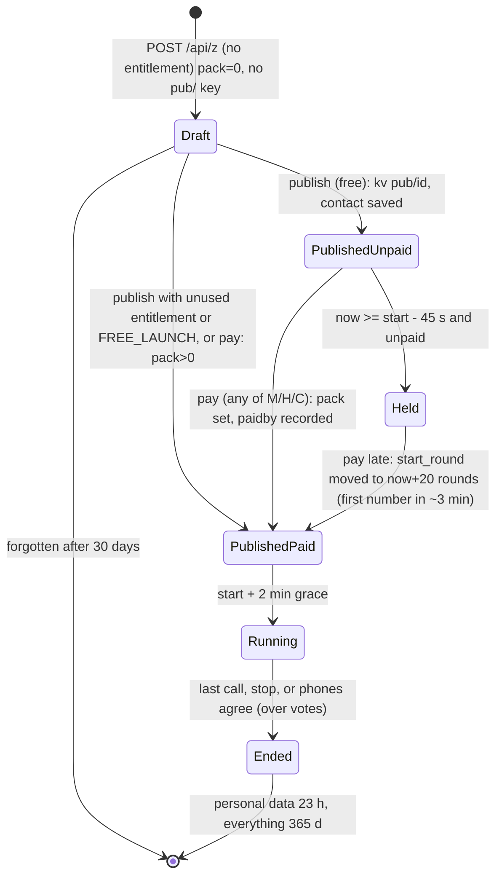

# 06 - Business logic: every rule, why it exists, where it lives, which test proves it

Format per rule: **Rule** / **Why** / **Where** (`file:line`) / **Test**. Test names are file + a fragment of the test title (grep it). "UC-n" ids refer to `docs/USE_CASES.md`; the tests carry the same id in their names.

## 1. Pricing and GST

| # | Rule | Why | Where | Test |
|---|---|---|---|---|
| P1 | Eight packs by max participants: 100, 250, 500, 750, 1000, 2500, 5000, 10000 at INR 1,999 / 2,999 / 3,999 / 4,999 / 5,999 / 9,999 / 14,999 / 24,999 **excluding** GST; INR total = base + 18%, rounded to 2 decimals. USD is a flat all-inclusive amount (34, 51, 67, 84, 101, 169, 253, 421), no GST. | One price per engagement, owner decision CR-02 | `packages/shared/src/pricing.ts:2-17` | `packages/shared/test/shared.test.ts`; `apps/edge/test/branding.test.ts` "structured data prices equal the real packs" |
| P2 | The charged pack is the **smallest pack >= the engagement's cap**. `cap` need not match a pack size. > 10,000 needs "a custom arrangement". | Simple packs, no per-person billing | `pay.ts:190-191`, `worker.ts:1135` (summary) | `pay.test.ts` "a draft that is too big for any pack needs a custom arrangement"; UC-20 |
| P3 | After payment the cap may be raised only up to the paid pack (402), never below the people already on the list (409). Before payment the cap is free. | You cannot get a bigger game than you paid for | `worker.ts:1292-1293` | UC-21; `worker.test.ts` "the limit cannot be set below..." |
| P4 | GST: INR amounts are GST-inclusive; taxable = total/1.18. If supplier state code equals the first two digits of the buyer's GSTIN: CGST 9% + SGST 9%; otherwise IGST 18%. USD = export, no GST. | Indian GST invoice rules | `packages/billing/src/index.ts` `splitGst` | `packages/billing/test/billing.test.ts`; `pay.test.ts` "with the company details filled in, the invoice is not a draft and splits GST" |
| P5 | GSTIN, if given for an Indian buyer, must match `^\d{2}[A-Z]{5}\d{4}[A-Z][1-9A-Z]Z[0-9A-Z]$`; empty is allowed (unregistered buyer); abroad needs none. | Reject typos before money moves | `pay.ts:198` | UC-22 |
| P6 | Currency: USD is refused with a polite message unless `RAZORPAY_INTERNATIONAL=1`. | Gateway not enabled for international cards yet | `pay.ts:199` | `pay.test.ts` "dollar payments are refused until international is switched on" |
| P7 | We do not give refunds. A cancelled paid game becomes credit for 365 days (section 3c). Unused places are not credited once the game has started. | Policy shown on every price card | `apps/edge/src/worker.ts` (AI_MANIFEST.payment_faq), `apps/web/public/site.js` | text only; `credit.test.ts` |

## 2. Payment flow (checkout, verify, webhook, idempotency, TEST/LIVE, FREE_LAUNCH)

```mermaid
sequenceDiagram
  participant B as Browser (pay.js / site.js)
  participant W as Worker pay.ts
  participant R as Razorpay
  B->>W: POST /api/checkout {name,email (required); org?,country?,taxId?,phone?,phoneCode?, pack|eid?, x-organizer?}
  W->>W: validate, if key+eid: bind org + draft, pack = smallest fitting cap
  W->>R: create order (amount in paise, receipt = pay_id)
  W-->>B: {mode:"razorpay", razorpay:{keyId, orderId, amount...}}
  B->>R: Razorpay Checkout (hosted, card data never touches us)
  R-->>B: razorpay_payment_id + signature
  B->>W: POST /api/payments/verify
  W->>W: HMAC(order|payment) == signature
  W->>R: GET payment (order id, amount, status)
  alt authorized
    W->>R: capture exact amount
  end
  W->>W: fulfil(): entitlement, publish+restart draft, invoice, mails, commission
  W-->>B: result {invoiceUrl, published, eid, restartedAtMs}
  R-->>W: POST /api/payments/webhook (payment.captured | order.paid) - same fulfil, idempotent
```

| # | Rule | Why | Where | Test |
|---|---|---|---|---|
| M1 | A payment row is `created` at checkout and `paid` only inside `fulfil`; `fulfil` returns the stored `result` when already paid (**idempotent**). Verify and webhook may race: second one returns the same result. | Browser closed, double click, webhook retries | `pay.ts:101-106,216-247` | `pay.test.ts` "paying again for the same order changes nothing", "the browser verify arriving after the webhook returns the same result without a second grant"; UC-14 |
| M2 | Never fulfil unless the HMAC signature verifies AND Razorpay itself says the payment belongs to that order with exactly that amount; `authorized` is captured for the exact amount; any other status = 402 and nothing granted. | Forged signatures, short payments | `pay.ts:222-227` | `pay.test.ts` "a wrong signature is refused...", "a valid signature for the wrong amount..."; UC-18 |
| M3 | Webhook ignores unrelated events, unknown orders and amount mismatches; refuses a bad signature or missing secret (503). | Never trust an unsigned body | `pay.ts:233-247` | `pay.test.ts` webhook cases |
| M4 | Amounts go to Razorpay in paise (`toMinor`); an order is made server-side only. | No client-side price | `pay.ts:206`, `billing` | `pay.test.ts` "creates one Razorpay order for the right amount in paise" |
| M5 | A first purchase by an unknown e-mail creates the organizer (master key shown **once**, also mailed); a returning buyer (same e-mail) gets another entitlement on the same organizer and no second key. | Buying doubles as sign-up | `pay.ts:109-120` | `pay.test.ts` "a returning buyer...", "another e-mail is another organizer" |
| M6 | A signed-in key + `eid` binds the payment to that org and draft; the pack is forced to the smallest that fits; foreign or published drafts are refused; AI keys cannot pay. | Nobody can pay for/publish someone else's game | `pay.ts:181-193` | `pay.test.ts` "the payment is bound to the signed-in organizer and publishes their draft", "nobody can pay for, or publish, someone else's draft"; UC-16, UC-17 |
| M7 | **Any of Organizer, Host, Co-host may pay; one payment is enough** (second attempt 409). `paidBy` recorded. | Whoever has the card pays | `pay.ts:164,185-186`; `worker.ts:403` | `roles.test.ts` "the ... can pay and the game shows Paid by ...", "one payment is enough" |
| M8 | Two payments racing for one draft: the second becomes an unattached entitlement (credit) for the next game; paying for a draft that was forgotten also becomes a credit. | Never lose money | `pay.ts:120-125` | UC-15, UC-19 |
| M9 | **TEST mode** (`mode` table = TEST): `POST /api/checkout` and `/api/payments/test` create a labelled test payment (`is_test=1`), no Razorpay order, fulfilled at once, invoice number `TEST-<fy>-n` with negative `seq` and `draft:true`. **LIVE** refuses `/api/payments/test` (403). | Owner can walk the whole product without money or real mail | `pay.ts:174-178,141-145`, `mode.ts` | `mode.test.ts`; `pay.test.ts` "fulfils at once with no Razorpay, and says so" |
| M10 | `TEST_MODE=1` env (older local-only switch) behaves like no-gateway fulfilment and also echoes sign-in codes in answers; **never set in production** (`payMode()` says `test`). | Local development | `pay.ts:43`, `worker.ts:549` | `pay.test.ts` "production never reveals the code in the response" |
| M11 | `FREE_LAUNCH=1`: engagements up to `FREE_CAP = 100` participants publish already paid (no purchase). Building a draft is always free. | Optional promo while the gateway is off | `pay.ts:41-42`, `worker.ts:1154` | `free-launch.test.ts` "optional free-publish switch lets small engagements go out already paid" |
| M12 | The invoice: `CT/<FY>/<6-digit seq>` per brand per Indian financial year (Apr-Mar); real series uses `seq > 0`, TEST uses negative; a supplier missing GSTIN/state/address/SAC makes the invoice a **DRAFT** (never a fake valid one); viewed at `/api/invoice/<token>` (private token). | GST compliance | `pay.ts:135-148`, `billing` `financialYear`, `formatInvoiceNumber` | `pay.test.ts` "numbers run in sequence per brand and financial year...", "missing company details make the invoice a DRAFT" |
| M13 | Mail failure never fails a purchase; sent mail keeps no body; unsent mail without a key is retried daily and dropped after 3 days. | Reliability + no keys at rest | `pay.ts:54-99` | `pay.test.ts` mail cases; UC-45 |
| M14 | A write budget protects fulfilment: if the budget cannot cover 6 rows, answer 503 "Your payment is safe; this will complete shortly" and take no half-step (the webhook completes later). | Daily D1 guard | `pay.ts:106` | `pay.test.ts` "the write budget protects a fulfilment"; UC-46 |

## 3. Draft, publish, lock and late-payment rules



| # | Rule | Why | Where | Test |
|---|---|---|---|---|
| D1 | **Creating** an engagement needs no payment. Without a purchased entitlement big enough it is a **draft** (`pack=0`), invisible: joining is 403, `info`/`seats` 403 for strangers. At most **10** unpublished drafts per organizer. | Build first, pay later | `worker.ts:866-873,976`, `pay.ts:41` | `free-launch.test.ts` "an organizer builds an engagement with no payment: it is a draft", "ten unpublished drafts at most"; UC-7, UC-8, UC-28 |
| D2 | **Publishing is free**, done by the Organizer (or Host in the console): confirms a valid e-mail and a 10-15 digit mobile, start must be in the future. It writes `kv contact/<id>` and `kv pub/<id>`, mails the organizer the guest link, big-screen link and pay link (and a pay-before time). Publishing twice (or from two tabs) is one publish and one mail. The AI can never publish: it gets a hand-over link (`consoleUrl ... &do=publish`). | The organizer takes responsibility for contact data | `worker.ts:1139-1167` | `free-launch.test.ts` "publishing is free...", "publishing first asks the organizer to confirm...", "a published engagement cannot be published again..."; UC-9, UC-13, UC-24 |
| D3 | A published, **unpaid** engagement is open to guests (everyone can join) but: from **45 s before start** (`LOCK_LEAD_MS`) it is **held**: `info.locked:true`, the control answer carries `locked:true`, phones show a waiting screen, **no number is shown**, and the held message never mentions money; the organizer is e-mailed once (`lockmail/<id>`). | Unpaid games must not begin; 45 s lead lets every phone's poll notice before the first number could show | `worker.ts:145,749-750,975-977` | `free-launch.test.ts` "not paid by the start time..."; UC-10, UC-11, UC-35, UC-39, UC-41 |
| D4 | **Late payment restart**: paying a held (or any) unpaid game whose start has passed sets `start_round` to the next round (`+ LATE_PAY_LEAD_ROUNDS - GRACE_ROUNDS` = 0) so the first number comes **2 minutes** after the payment is confirmed (the 2-minute setup window `GRACE_ROUNDS` = 40 is all of it), for everyone already waiting. A cancelled game is never published by a late payment. | Rescue a game with waiting guests | `pay.ts:129-133` | UC-12; `tests/e2e/timetravel/11-lifecycle-money-mode.test.ts` |
| D5 | An unpaid engagement may be moved to a new start time **even after its old start passed** (settings need a future `startRound`); a paid one cannot be changed once it started (409). | Let the organizer recover | `worker.ts:1283,1290` | UC-25 |
| D6 | One **reminder** e-mail (daily housekeeping) for published unpaid engagements starting within 36 hours (`kv remind/<id>` once). | Nudge, not a requirement | `worker.ts:264-269` | UC-26; `free-launch.test.ts` reminder case |
| D7 | Unpublished drafts are forgotten after **30 days** (`DRAFT_DAYS`), with flags and contact; unpaid published ones after 365 days like the rest. | Retention | `worker.ts:64,1337-1342` | `free-launch.test.ts` "an unpaid engagement is forgotten after 30 days" |
| D8 | Publishing consumes an unused **entitlement** (oldest smallest pack >= cap) so a pre-bought pack makes publishing paid at once. | Prepaid packs | `worker.ts:1153,1159-1160` | `free-launch.test.ts` "after a pack is bought, publishing counts as paid at once"; UC-27 |
| D9 | Settings (`PATCH`) are allowed only before the first number could be called: `409` if paid and `start <= now`; lists (`rewards`, `breaks`, `opening`, `closing`) **replace**, never merge; invalid input changes nothing. | Phones already have the settings | `worker.ts:1281-1304`, `config.ts validateCfg` | `worker.test.ts` "settings can change before the start and never after"; UC-64 |
| D10 | When the cap changes to another pause-safety profile before any pause was signed, the unused registered signing key is deleted so the console registers the right profile. | Profile depends on size | `worker.ts:1296-1303` | UC-72 |

## 3b. Cancel, confirming, Host e-mail, Co-host (round 2, `cancel.ts`; money rules rewritten by spec 6: NO REFUNDS)

| # | Rule | Where | Test |
|---|---|---|---|
| X1 | **Who may cancel**: Organizer (M), Host (H, console only), platform. Not the AI key, not a Co-host. `POST /cancel` needs `confirmations` exactly `3` (the console asks three times, each more serious). | `apps/edge/src/worker.ts` cancel block | `cancel.test.ts` "only the Organizer and a Host...", "confirmations: 3" |
| X2 | **When**: unpaid game any time; paid game only before the start time. Paid and started -> 409 "use End the game". A game that already closed as "did not start" cannot be cancelled either. | `cancelPreview` | "a paid game cannot be cancelled once its start time has passed" |
| X3 | **After a cancel**: `engagement.cancelled_ms`. Guests see "This game was cancelled by the organizer" (`info`, `control`); join 403; every other write 409 (except erase/forget/person/clone); publish/pay refused; Co-hosts erased at once; guests' names and numbers (and people lists, waiting requests) erased **23 h after the cancel time** (`lifecycleTick`, `life.end_src='cancel'`, no report). | `apps/edge/src/worker.ts`, `apps/edge/src/lifecycle.ts` | "guests see 'cancelled by the organizer'...", "erased 20 hours after the CANCEL time" |
| X4 | **NO REFUNDS (spec 6).** There is no refund calculation, no refund fee setting, no Razorpay refund call (the refund function is deleted from `packages/billing`), no refund e-mail to the owner and no new GST credit note. The tables `refund` and `credit_note` and `GET /api/credit-note/{token}` stay only so old migrations and old notes remain valid; nothing writes to them. The partner's commission on the sale **stays as earned** (nothing is voided). | `apps/edge/src/cancel.ts`, `apps/edge/src/credit.ts` | `cancel.test.ts` "no refund machinery is left" (a source scan fails if the refund call or the fee setting return) |
| X5 | **Cancelling a PAID game before its start turns what was paid into credit** for the Organizer's account (section 3c). The response is `credit: {id, amountInr, expiresMs}`; the preview is `credit: {amountInr, expiresMs}`. Credit that had been applied to the game comes back to the same credit (same expiry). Cancelling an unpaid game moves no money (`credit: null`) but gives back any credit that had been applied to it. | `cancelGame`, `cancelPreview` | `credit.test.ts` "cancel: a paid game becomes credit, never a refund" |
| X6 | **Cancel is idempotent**: the second and later cancels (also by a Host, also at the same moment) change nothing and answer `already: true` with the same credit; one credit per payment (unique index on `credit.payment_id`), one mail per person. | `cancelGame` | "cancelling twice..." |
| X7 | **Mails**: cancel -> Organizer and each Host (deduplicated; says "cancelled by a Host" when a Host did it; contains the credit amount and the last day, and the sentence of the rule). The payer is not mailed any more. Automatic deletion -> Organizer and each Host with the exact IST time ("Your guests' personal data has been deleted"). **Only the Organizer and Hosts ever have an e-mail**; Co-hosts and guests give name + mobile. | `cancelGame`, `mailDataDeleted` in `apps/edge/src/cancel.ts` | "cancel e-mails", "'your guests' personal data has been deleted' e-mail" |
| X8 | **Confirming your payment**: from a validly signed browser report (or the `payment.authorized` webhook) until Razorpay itself says captured, `payment.status` is `"confirming"` (30 min window); verify answers 202. Never Paid before the gateway confirms (TEST mode excepted, it is paid at once). | `apps/edge/src/pay.ts` verify/webhook, `paymentOf` | "Confirming your payment" tests |
| X9 | **Host e-mail**: `POST /api/org/host` needs a valid `email` or a mobile; sealed on the key row; the Host's own console link is e-mailed to the Host only. **Co-host**: name + mobile (sealed), bound to one game; erased with the game's participant data (23 h rule, also when nobody joined) or at cancel. | `apps/edge/src/worker.ts` team routes, `apps/edge/src/lifecycle.ts` | "Host e-mail", "Co-host: name + mobile..." |

## 3c. Credit instead of refunds (spec 6, `credit.ts`, migration 0018)

The rule in the owner's words, as shown everywhere: *We do not give refunds. If you cancel a paid game before it starts, your payment stays as credit for your next game for 365 days. Unused credit lapses at the end of day 365.*

| # | Rule | Where | Test |
|---|---|---|---|
| C1 | **Table `credit`** (one row per payment that became credit; `total_inr`, `remaining_inr`, `lapsed_inr`, `currency`, `created_ms` = date of the ORIGINAL payment, `expires_ms`, `status` active/used/expired, source `eid`/`payment_id`, `kind` cancel/late, and four mail flags) and **`credit_use`** (credit id, game, amount, time, `status` applied/restored). INR in practice; a USD payment makes USD credit that only pays USD checkouts. | `CREDIT_SCHEMA` in `apps/edge/src/credit.ts` | `credit.test.ts` |
| C2 | **Validity**: 365 days counted from the India-time DATE of the original payment (that date is day 0), until the end of day 365 in India time. `expires_ms` is the instant it lapses = 00:00 IST at the start of day 366 (`creditExpiryMs`); usable while `now < expires_ms`; the date told to people is the last day (`creditLastDay`). Example: paid 1 Oct 2026 15:30 IST -> last day 1 Oct 2027 -> lapses `2027-10-01T18:30:00Z`. | `creditExpiryMs`, `creditLastDay` | "valid to the end of day 365", "validity counts from the date of the ORIGINAL payment" |
| C3 | **Using credit** (`POST /api/z/{id}/pay-with-credit`): oldest-expiring first. Credit >= price: the game is paid with no Razorpay (a `payment` row `paycr_<game>` with amount 0, a normal invoice that says "Paid from credit of invoice N" with no new GST, published, `paidBy` + `paidVia:'credit'`, the late-start rule applies); credit < price: ALL of it is used and the rest is paid by the normal checkout for the same game (`/api/checkout` and the pay link charge price minus the credit already applied to that game; the top-up invoice says "balance after credit"); credit > price: the remainder stays active with the same expiry. | `applyCreditToGame`, `creditRoute`, `payGameFromCredit` in `apps/edge/src/credit.ts`; checkout in `apps/edge/src/pay.ts` | "using credit: pay-with-credit" |
| C4 | **Atomic and idempotent**: a guarded insert into `credit_use` (the total applied to a game can never pass its price), then a guarded update that cannot take a credit below zero (a lost race removes the use row again). Asking twice, or two people at once, uses credit once. Refused for a cancelled or closed game; not allowed while a payment for the game is being confirmed. | `applyCreditToGame` | "asking twice...", "a credit can never go below zero" |
| C5 | **Who**: the Organizer, a Host, and a Co-host of that game may use credit; an AI key, a work link, a stranger and another account may not. `GET /api/org/credit` is for the Organizer and Hosts. Credit is per organizer account (`org`) and never crosses accounts. | `creditRoute` | "who may use it", "credit is isolated per organization" |
| C6 | **An outside pay-link payer never sees or uses credit**: the pay link charges the full price unless its creator applied credit to that game BEFORE making the link (then it charges the difference). No credit amount or word appears in the public answer. | `payRoute` (`/api/paylink/{token}`), checkout | "never visible to, or used by, an outside pay-link payer" |
| C7 | **A payment that arrives after a cancel** (or after the game closed as "did not start") is not refunded: `fulfil` keeps it as `credit` (`kind='late'`), buys no pack, publishes nothing, and tells the Organizer and Hosts once. A second delivery of the same payment changes nothing. | `fulfil` in `apps/edge/src/pay.ts` | "payment after a cancel is credit, not a refund" |
| C8 | **A credit-paid game that is cancelled** gives the credit back to the SAME credit with the SAME expiry (cancelling never stretches 365 days); if that credit lapsed in the meantime it comes back as lapsed. | `restoreCreditUses` | "a credit-paid game that is cancelled gives the credit back..." |
| C9 | **Lapse**: the lifecycle tick marks credit `expired` when `now >= expires_ms` (no refund, no credit note, nothing else moves) and records `lapsed_inr`. `GET /api/org/credit` already shows it as expired before the tick runs. | `creditTick` | "lapse, expiry and the e-mails" |
| C10 | **Five mails**, Organizer + Hosts only, once each per credit: on cancel / on arrival, 30 days before the lapse, 3 days before (replaces the 30-day mail when the tick first sees it that close), on use ("Rs X of credit used for <game>"), on lapse. A credit that is used up is never mailed about lapsing. Each is claimed by an `UPDATE ... WHERE flag IS NULL` before sending, so a repeat tick sends nothing. | `creditTick`, `mailCreditCreated` | "the five mails..." |
| C11 | **Invoices**: the original GST invoice stands (advance). **The owner's CA must confirm the GST treatment of advances and of lapsed credit**; no credit note is raised for lapsed credit. | `fulfil` | text only |
| C12 | **Retention**: credit rows are kept like the payment records they come from and purged 365 days after they lapse; closing the account forfeits unused credit (`creditForfeitedInr` in the answer); the TEST data purge removes test credit. | `retentionSweep` in `apps/edge/src/worker.ts`, `apps/edge/src/test-data.ts` | - |

## 3d. Games that did not start, the 30-day limit, and "Create a new game like this one" (spec 5, `lifecycle.ts`, `clone.ts`)

| # | Rule | Where | Test |
|---|---|---|---|
| U1 | **No separate payment cut-off.** An unpaid published game stays payable until its guest data is erased (scheduled end + 23 h). A late payment starts the game 2 minutes after it is confirmed (`LATE_PAY_LEAD_ROUNDS`). While unpaid and past its start, `info`/`summary`/`cohost` say `waitingFor: "organizer"`; the Organizer and Host see "Payment pending for this game", everyone else "Waiting for the Organizer or Host to start the game." (`z.js`, `big.js`). | `apps/edge/src/worker.ts` (`locked`), `apps/web/public/z.js`, `apps/web/public/big.js` | `unplayed.test.ts` "what each person sees..." |
| U2 | **Erasure of a game that did not start** (`unplayedPass`): 23 h after the scheduled END (`endBoundMs`, the same estimate a played game uses) guest names and numbers, people lists, waiting requests, personal links and Co-host name + mobile are erased. Organizer/Host data, payments, invoices and the game's settings stay. A played game keeps the old rule (23 h after it ends, with a report); a played game with only a people list loses the list at the same time; a cancelled game follows the cancel time. Legal holds stop it as for every game. | `unplayedPass`, `lifecycleTick` in `apps/edge/src/lifecycle.ts` | `unplayed.test.ts` "a game that did not start: guest data is erased..." |
| U3 | **Closed**: a published game is then marked `engagement.unplayed_ms`: nobody can join (403 `did-not-start`, "This game did not start. Your details have been erased."), pay (409), cancel, change or add people; `info`/`control` say `didNotStart`; the pay link status is `closed`; a payment that still arrives becomes credit (C7). A never-published draft is erased the same way but is not closed. | `apps/edge/src/worker.ts`, `apps/edge/src/paylink.ts` | same |
| U4 | **The clock follows the newest time**: a reschedule moves it (the tick re-reads the schedule; `PATCH settings` also drops a stale `life` row). An unplayed game can be rescheduled until the erasure; a started (paid, start passed) game cannot. | `PATCH settings` in `apps/edge/src/worker.ts` | "the clock follows the newest time" |
| U5 | **Mails** (Organizer + Hosts only): a heads-up in the last 6 h before the erasure ("Your game time has passed. Guest data will be erased at <time>. Tap to reschedule and keep it.", once per erasure time, so a reschedule gets a new one) and "Your game did not start. We erased the guest list at <time>." right after. Played and paid games get neither. | `unplayedPass`, `mailErasureHeadsUp`, `mailDataDeleted` | "e-mails: a heads-up 6 hours before and a note after" |
| U6 | **Settings stay 30 days** (`SETTINGS_KEEP_MS`) after the game closed, then `purgeOld` forgets the game like an unpublished draft. | `purgeOld` in `apps/edge/src/worker.ts` | "the settings of a game that did not start stay 30 days" |
| U7 | **A game time is at most 30 days ahead** (`MAX_AHEAD_MS`): `POST /api/z`, `PATCH settings` (when the time changes), `POST /clone`, `GET /api/z/schedule` all answer 400 `code:"too-far"` with "A game can be set at most 30 days ahead. Please pick a day within the next 30 days." Any number of reschedules inside the window. The AI path goes through the same routes. | `apps/edge/src/worker.ts`, `apps/edge/src/clone.ts` | "a game time is at most 30 days ahead" |
| U8 | **Clone** (`POST /api/z/{id}/clone {startRound?, withPeople?}`): Organizer and Host (AI key and Co-host 403) get a NEW DRAFT with a new id and the settings (name, size, tickets, gap, rounds, who can join, invites, Co-host limit, prizes, brand, brand moments, lucky draw); NOT payment, status, guests, waiting requests, Co-hosts or personal links. The date is never copied: without `startRound` the draft is parked at the 30-day edge and marked `kv startpending/<id>` (cannot be published or paid until `PATCH settings {startRound}`; `summary.startPending`). The 10-draft limit applies (unpaid published games count too). `withPeople:true` copies the people list as new un-joined invitations with NEW personal links (`peopleCopied`), only while the old list exists (otherwise `peopleNote`); the old game's copy is erased on its own clock. Works on cancelled and closed games. Audit event `clone`. | `apps/edge/src/clone.ts` | `clone.test.ts` |

## 4. Invoices, Terms and sign-in

| # | Rule | Where | Test |
|---|---|---|---|
| A1 | `POST /api/start` with a new e-mail opens the console at once (no mail needed) and mails the dedicated AI-link mail (24 h key); an existing e-mail must use the **e-mailed 6-digit code** (valid 10 min, 5 wrong tries lock it, max 5 codes per hour per address) or the one-click link (single use). Unknown e-mails get the same answer as known ones on `/api/auth/email`. | `worker.ts:518-605` | `free-launch.test.ts` first three tests; UC-1..UC-6; `pay.test.ts` code cases |
| A2 | Max **10** new accounts per network address per day (`STARTS_PER_DAY`). | `worker.ts:66,526` | `free-launch.test.ts` "a network address can open only a few new organizer accounts a day"; **note `docs/USE_CASES.md` UC-4 says 6** (drift) |
| A3 | The Terms version (`TERMS_VERSION = "2026-10-09"`, `brand.ts:6`) is recorded per organizer at start, engagement creation, and sign-in (no tick box: continuing is the acceptance). The version must equal the date on the Terms page. | `worker.ts:198`, `brand.ts:6` | `terms.test.ts` |

## 5. Refer-and-Earn commission (read `partners.ts`)

| # | Rule | Why | Where | Test |
|---|---|---|---|---|
| R1 | Partner code = 8 random characters from `ABCDEFGHJKLMNPQRSTUVWXYZ23456789` (no I, O, 0, 1); **no mobile number anywhere in it**; phone and e-mail kept only as salted hashes; enrolment needs the e-mailed 6-digit code; the answer is identical for new and existing contacts (no enumeration). Their link is `/?ref=<code>`. | Privacy + no code guessing | `partners.ts:30-33,88-133` | `partners.test.ts` first 8 tests |
| R2 | Attribution: the buyer's browser remembers the code for **30 days** (`ATTRIBUTION_DAYS`, `localStorage ctz-ref`); the server checks only that the code belongs to an `active` partner at purchase time. | No cookies or server tracking | `partners.ts:13`, `site.js:89-100` | `partners.test.ts` "the link check says only whether a code is real" |
| R3 | A commission row exists **only when a referred purchase is paid** (`recordCommission` called from `fulfil`); one row per payment (`payment_id UNIQUE`). | No purchase, no commission | `pay.ts:155`, `partners.ts:39` | `partners.test.ts` "no purchase, no commission..." |
| R4 | **Rate: 50%** of the **taxable value (before GST)** (`COMMISSION_RATE = 0.5`). `PARTNER_COMMISSION_RATE` may *lower* it (0..0.5), never raise it. | Owner decision 2026-10-03 | `partners.ts:15,53-54` | `partners.test.ts` "a paid purchase through the link is attributed; the partner earns 50%", "a customer's first purchase earns the partner half of the software price: 100 = Rs 1,999..." |
| R5 | **Repeat purchases**: a customer (same e-mail, paid) belongs to the partner who first brought them for **365 days** (`REPEAT_WINDOW_DAYS`); each repeat purchase earns that partner `min(REPEAT_COMMISSION_RATE 0.5, first rate)` even without the link. After 12 months a returning customer is new again; a customer who first bought with no partner never earns a partner a repeat. | Owner decision 2026-10-06 | `partners.ts:17-18,41-47,55` | `partners.test.ts` "the same customer buying again within 12 months...", "after 12 months..." |
| R6 | **Self-referral** (buyer phone hash equals the partner's) -> status `blocked`, reason `self_referral`, no amount. | Anti-gaming | `partners.ts:51` | `partners.test.ts` "buying through your own link is blocked with a reason, however the number is typed" |
| R7 | A stopped (`blocked`) partner earns nothing from new sales; rows keep. Owner can set the rate for old `pending_rate` rows (0..0.5, exactly once), record a payout once, void a refunded purchase (pending/accrued only, not paid-out ones). | Accounting control | `partners.ts:167-195` | `partners.test.ts` rate/void/payout cases |
| R8 | A partner sees only their own sales (date, pack, status, amount), never who bought, and cannot see other partners; TEST data (`is_test`) is separate. A partner may close their account: the partner row goes, commission rows stay as accounting records with no link to a person. | Privacy | `partners.ts:135-158` | `partners.test.ts` "their own sales and totals, never who bought", close cases |
| R9 | Payouts are made **outside** the system (KYC/TDS decided elsewhere); the system only records that a payout was made. | Scope | `partners.ts:8` | - |

(Sales partner = Refer & Earn partner; there is no second tier.)

## 6. Invites and the chain

See `05-ROLES-AND-PERMISSIONS.md` section 6 (two-level rule, quota `per` 1-10, Co-host links, categories; Phase 2 lists, personal links and the waiting room are in section 6b). Where: `worker.ts:1002-1020`, `config.ts` `InviteCfg`. Tests: `privacy.test.ts`, `roles.test.ts`, `abuse.test.ts` (invite-only rules unchanged). Reasons: families/colleagues come through guests without the organizer typing numbers; limiting to two levels prevents exponential chains that would blow the cap.

## 6b. People, links and the waiting room (Phase 2, `apps/edge/src/people.ts`)

- **One list per inviter**: Organizer, each Host, each Co-host and each level-1 guest. A person is on one list only (unique phone hash per game, so the first list wins); a second add is a duplicate. A team member's own play seat (`role` set) is not a guest and uses no limit.
- **Limits** count the list, not clicks: Organizer and Host none (the game size is the hard cap), Co-host `engagement.cohost_limit` (10 to 1000, default 100), a level-1 guest `invites.per` (1 to 10, `MAX_INVITES_PER_PERSON`, default 4). Checked before the insert AND inside the seat insert (`addSeat` `guardId` in `apps/edge/src/worker.ts`), so a crowd on one link at the same instant cannot pass it. A removal frees the place. Test: `apps/edge/test/people.test.ts` ("a crowd ...").
- **Personal link** `/j/<token>`: made for one number, single use (it binds to the first phone through the existing one-ticket-one-device rule); "send again" rotates the token and unlocks the ticket. **Common link** `z.html?e=ID&from=<code>`: the guest types a number; a number on any list is recognised and stays under its real inviter. **A typed number is matched to a list, it is not proven**; only the personal link is proof.
- **Who can join** (`whoCanJoin`, stored in `engagement.closed`): `list` = an unlisted number waits for an answer; `anyone` = joins at once under the link owner up to that owner's limit, over it the request goes to the Organizer and Host waiting room. Requests use no place and go with the guests' data. Approvers: Organizer and Host for everything; the link owner and the people above them in the chain (`waiting.chain`). Every admission records who and when (`person.approved_by`, `person.approved_ms`; shown in My people and in the report tree). "Approve all" admits oldest first and stops when the game is full.
- **Remove**: before the start the seat is deleted; during the game only Organizer and Host, the seat stays in the public list (winners identical on every phone), the phone stops, the prize is "not given: removed". Every removal is logged (`person.removed_by`, `person.removed_ms`, plus the audit log).
- **Write cost**: a join now writes seat, participant and person (3 units, was 2): a 10,000-person game is about 30% of the free daily budget. Adding a list is 1 unit per person (a 5,000-row upload is about 6%).
- **Privacy**: names and numbers are sealed at rest; an AI key and an AI work link get 403 on every people and waiting route; the request body of `/people` and `/resend` is never copied into the audit log. Tests: `apps/edge/test/people.test.ts`, `apps/edge/test/ai-enablement.test.ts` ("people").

## 6c. Phase 3 and 4: brand on the ticket, pay link, Google sign-in, Host first open

- **Brand on the ticket** (`packages/beacon/src/config.ts`, `validateCfg`, test `apps/edge/test/brand-ticket.test.ts`): `brand: {name (1 to 40 characters, markup and quotes stripped), color (one of the 8 values in `BRAND_COLORS`, nothing else), logo? (a `data:image/png|jpeg|webp;base64,...` URL of at most 30 KB decoded, whose first bytes must match its type)}`. Stored in the game's settings JSON, re-validated on every read (a tampered logo makes the stored settings fall back to defaults and is never shown), returned in full by `GET /info` (what phones read), in `summary` and the `PATCH /settings` answer, and without the logo (`hasLogo:true`) in `join` and `participants`. `brand: null` removes it. No outside address is ever asked. `PATCH /settings` and `POST /api/z` accept bodies up to 60,000 characters for this.
- **Pay link** (`apps/edge/src/paylink.ts`, `pay.ts`, test `paylink.test.ts`): 192-bit token, only its hash stored; one open link per game; ends at payment, after 7 days, when replaced or when the game is cancelled. The public view shows the name, start time and price only. Checkout through the link is bound to that game and the pack that fits its limit, records `paidBy:'link'`, and then follows the normal payment rules (signature + gateway check, webhook, idempotent fulfilment, invoice, refund, credit note). 30 attempts a day per network.
- **Google sign-in** (`apps/edge/src/google.ts`, test `google-signin.test.ts`): the Worker verifies the ID token itself; it keeps the verified e-mail only. Sign-up creates the Organizer; a Host's Google e-mail must equal the e-mail they were added with. Same limits as the e-mail code (20 failures per network a day, 10 new accounts per network a day).
- **Host first open**: see `05-ROLES-AND-PERMISSIONS.md` section 8b. Weakness to know: a Host's mobile number is typed, never verified.

## 7. Brand moments allowance and spacing (config.ts)

| # | Rule | Where | Test |
|---|---|---|---|
| B1 | Allowance is **5 per ticket held**: per ticket 1 opening + 3 during the game + 1 closing (so 5 with one ticket, 10 with two): `brandMomentsFor(t)=5t`, `maxMidFor(t)=3t`, `maxEdgeFor(t)=t`. Reducing tickets while too many are switched on is refused with a plain reason and nothing is saved. | `config.ts` | `config.test.ts`; `worker.test.ts` "one ticket allows 1 + 3 + 1...", "changing from 2 tickets to 1 is refused..." |
| B2 | During-the-game moments ("breaks"): `after` = number of numbers called before it (1-89), `seconds` 15-600 in steps of 3 (default 60), kind `file|youtube|slides|speech|lucky`; `file` and `youtube` need an `https` link (`SITE_MEDIA` paths like `/demo-break.mp4` allowed); `youtube` links must be YouTube; lucky has no link; titles 2-80 chars. | `config.ts validateCfg` | `config.test.ts` |
| B3 | **Spacing**: leave `after` out (or `auto:true`) and the software spreads the n automatic breaks evenly: the k-th goes after `round(90 k / (n+1))` numbers (min 1, max 89); saving again re-spreads every automatic break; explicit numbers are kept; **two breaks cannot start at the same number**; breaks sorted by `after`. | `config.ts` `autoAfter`, `validateCfg` | `config.test.ts`; `worker.test.ts` "saving the breaks again spreads them again..." |
| B4 | **Opening**: plays during the 2-minute grace before the first number; each 15-120 seconds (steps of 3) and **all together must fit 120 s** (`OPENING_WINDOW_SECONDS`). **Closing**: shown on the final screen. Lucky draws are **only** allowed during the game. | `config.ts` | `config.test.ts` |
| B5 | Breaks play **in round 1 only**; later rounds have no breaks (older docs say they repeat). | `game.ts unshiftedRound` | `worker.test.ts` "the AI manual teaches the new rules and no longer says breaks repeat in every round" |
| B6 | A break delays every later call by `seconds/3` beacon rounds; the organizer's pauses are added on top (`callRoundR`). Because breaks are public settings every phone computes the same schedule. | `game.ts:137-150`, `config.ts breakShift` | `game.test.ts` |
| B7 | Media link check page `preview.html` shows a brand moment exactly as a guest sees it, with no game. YouTube plays in the privacy-friendly player; files in-page; any other page only as a link that takes the guest out of the game. | `preview.js`, `pages/build.mjs` GAMECSP | `apps/web/test/pages.test.ts` |

## 8. Lucky draws

Kind `lucky` break with `winners` 1 | 3 | 5 | 10 (default 3) and `style` `draw` (default) or `scratch` (only changes the reveal). Winners are chosen from the people playing at the break by ranking `sha256("CT1-LUCKY|eid|breakAfter|randomness|pid")` using the randomness of `luckyRound` (the beacon round in which the break ends) and taking the first N: unpredictable beforehand, recomputable by anyone, nobody wins twice. Comments in `worker.ts:1187` and the manual say marked seats "stay out of lucky draws", but **no code in `packages/beacon` reads `seat.role`** and the public seat list `[seq,pid,jr]` carries no role, so marked seats are in fact eligible today (listed in `KNOWN-DOC-DRIFT.md`). Results are accepted by the same quorum as houses (pattern `lucky`, round 1, ordinal = nth lucky break, up to 10 pids) and shown by opaque ids so each phone can tell if it won (`results` exposes `winners` only for `lucky`). Where: `game.ts:119-131`, `winners.ts:42`, `worker.ts:1102`. Tests: `game.test.ts`, `worker.test.ts` "the winners are accepted when several phones agree, and are shown by opaque ids", "an engagement with no lucky draw ignores lucky results", UC-82.

## 9. Rounds, ticket generation, number drawing, winner quorum

| # | Rule | Where | Test |
|---|---|---|---|
| G1 | 1-5 rounds per engagement (`MAX_ROUNDS`), each with its own numbers and tickets (derived id `<eid>~r<n>`); **intermission 90 s** (`INTERMISSION_ROUNDS = 30` beacon rounds) between rounds; claims and results are per round. | `config.ts`, `game.ts unshiftedRound` | `worker.test.ts` "rounds are set at creation...", "claims are kept per round..." |
| G2 | **First number** = `startRound + GRACE_ROUNDS (40)` -> 2 minutes after the organizer's start time; call k of a round is at `start + k*stride (+ break shifts + pauses)`; stride = `callSeconds/3`; `callSeconds` is a multiple of 3, >= 6 (UI offers 6, 9, 12, 15). 90 numbers per round. | `config.ts`, `beacon/src/index.ts:103`, `worker.ts:859` | `beacon.test.ts`, `worker.test.ts` "call speed must be a multiple of 3 s and at least 6 s" |
| G3 | **Number drawing**: `pickNumber(eid, k, randomness, called)` = element `v mod |remaining|` of the sorted remaining numbers where `v` is the big-endian integer of `sha256("CT1|eid|k|randomness")`; each beacon signature is BLS-verified by every phone against `QUICKNET.publicKey`. | `beacon/src/index.ts:116-125` | `beacon.test.ts` |
| G4 | **Tickets** (`unique-ticket.ts`): the list of all valid 3x9 tickets (rows of five, every column used, columns sorted by their number range) is permuted by a keyed Feistel permutation (`permute`, key from the engagement id), and seat s owns positions `2(s-1)` and `2(s-1)+1` (two tickets). Different seats can never share a ticket; one ticket per phone (device hash). Legacy ids without a seat fall back to a seeded random ticket. | `unique-ticket.ts`, `game.ts:14-26` | `unique-ticket.test.ts`; `worker.test.ts` "every joiner gets the next seat number...", "one ticket per phone per engagement..." |
| G5 | **Houses**: 19 houses a ticket can complete, plus Unlucky. Fixed shapes: `top`, `mid`, `bot` rows, `corners`, `star` (corners + centre of the middle line), `plus` (middle line + middle number of top and bottom), `frame` (top + bottom + first/last of middle), `topbottom`, `midcorners` (middle line + four corners), `full`. "Any N": `early5`, `early7`, `early10` (any 5/7/10 numbers of the ticket), `odd5`, `even5`, `low5` (5 numbers from 1 to 30), `high5` (5 from 61 to 90; a ticket with fewer than five of that kind can never win it). `twolines`: the second of the three lines to complete. `full2`: all numbers across both tickets. **One table** (`PRIZE_HOUSES` in `config.ts`) holds id, label, plain "how to win" line, maximum winners and kind; the rules per ticket live in `house-rules.ts` (`ruleOf`), shared by the incremental engine, `settleAll`, claims, "still to win" and the highlight of a win. Each reward line = one winner of one house with `ordinal`; the 1st winner of a house is whoever completes it at the earliest call, the 2nd at the next distinct call, etc.; **ties share the reward**. A 2nd reward needs the 1st (`validateCfg`). Two-ticket house needs 2 tickets. A new game rewards the original seven (`PATTERN_ORDER`) until the organizer picks others. | `game.ts settleAll`, `house-rules.ts`, `config.ts` | `game.test.ts`, `config.test.ts`, `houses.test.ts` |
| G5a | **Most winners per house** (`PRIZE_HOUSES[].max`, `maxWinnersFor`): Unlucky 1, Early Five/Seven/Ten 1, Top/Middle/Bottom Line 2, Four Corners 1, Star 1, Full House 10, Two-Ticket Full House 10, and 1 for each of Two Lines, Plus, Frame, Top and Bottom, Middle and Corners, Odd/Even/Low/High Five. `validateCfg` refuses one more with "<House> can have only 1 winner / at most N winners. Please remove the extra ones." (settings PATCH and create). Games saved before the limits (up to 5 per house) stay valid: readers pass `{ stored: true }` (`cfgOf`, `cfgOfRow`, the phone's `readCfg`), and a line already saved in the game is accepted when the console sends the list back. `MAX_REWARD_LINES` = sum of the maxima (at least 30). `winners.ts acceptVotes` accepts a result only for a reward line the game really has. | `config.ts`, `winners.ts` | `houses.test.ts` "the most winners per house", `houses-runtime.test.ts` |
| G5b | **Unlucky** (`unlucky`, 1 winner): the ticket with the FEWEST numbers marked at the moment the first Full House is completed by anyone, even when Full House is not a prize; if nobody completes one, at the end (the last number, or the stop) - and it never delays the end: once every other prize is awarded the game ends there and Unlucky is decided at that call (`unluckyAt`). A person with two tickets counts with the ticket that has fewer. Ties: lowest sha256 of `CT1-UNLUCKY`, the engagement id, the randomness of that call's beacon round and the seat id (the lucky-draw idea; `unluckyPick`). Out: flagged Organizer/Host/Co-host seats (`seat.role`, `ex` = 1 in the seat list) and removed/blocked seats (their ids ride in `blk` of the seat list, kept in kv `seats-blk/<eid>` by `people.ts refreshBlocked`); a late joiner counts only numbers from their count-from round, and a seat whose numbers had not started at that moment is not a candidate. The seats stay in every other house. Not claimable (`completionIndexKey` is -1); the result names the winning seat (`winners`) so the winner's phone knows. | `game.ts unluckyAt/unluckyPick/settleAll`, `prize-engine.ts`, `phone-runtime.ts`, `worker.ts` (seats, results) | `houses.test.ts` "Unlucky", `houses-runtime.test.ts` |
| G6 | **Late joiners**: someone who joins after the first number has `seat.jr` = join round; their numbers count only from `jr + 30` rounds (90 s) later so every phone has heard of them first. | `config.ts LATE_LAG_ROUNDS`, `prize-engine.ts countFromOf` | `late-joiner.test.ts`, `prize-engine.test.ts` |
| G7 | **Winner quorum**: `quorumFor(n) = n <= 6 ? max(1, ceil(n/2)) : min(25, max(3, ceil(0.05 n)))`. Only `votersFor(n)` phones report first (all up to 12 people, else 4 x quorum); silent phones step in if no result appears. A result is **settled** when the number of identical-digest votes >= quorum; `INSERT OR IGNORE INTO settled` makes it final; an accepted result cannot be replaced. Each phone's vote counts once per prize. | `config.ts`, `winners.ts:31-62` | `worker.test.ts` "one phone's word is not enough; the result stands once enough different phones agree", "phones that disagree do not settle anything...", "the same phone reporting again counts once"; `phone-runtime.test.ts` |
| G8 | **Game over**: every number called, or every prize awarded early (phones), or the organizer's signed stop, or `min(3, ceil(people/2))` distinct phones saying "over" and not before 20 numbers' time. | `lifecycle.ts:93-110`, `phone-runtime.ts` | `privacy.test.ts` "a game is over only when several different phones say so, and never before it could be" |
| G9 | **Prize hand-over**: each accepted winner gets a `prize` row with the sealed name+number they joined with; after the game the winner (on the phone that holds the ticket) confirms/corrects name and mobile (every change kept in a sealed trail); the Organizer/Host ticks "prize given" (date + by whom). The report shows what they confirmed, whether they changed it, and whether it was given. | `winners.ts:65-134` | `worker.test.ts` "a winner confirms the details on their own phone..."; `privacy.test.ts` "the report shows what each winner confirmed..." |
| G10 | Claims are a live cross-check only, stored for engagements of **<= 500** (`CLAIM_TRACKING_MAX_CAP`) because 7 rows per phone would eat the free write allowance; settlement never uses them. | `worker.ts:70,1087` | `worker.test.ts` "a large engagement stores no per-claim rows..." |
| G11 | The **pause** (organizer): Ed25519 signed `pause|resume|extend|stop`; the file is public, every phone verifies; a pause takes effect `leadRounds` after signing so a number can never be seen and then paused away; max timed pause 24 h; not offered above 2,000 participants. A stop lets the game end. | `control.ts` | `control.test.ts`, UC-70..72, `tools/sim/pause.ts` |

## 10. Reports, deletion clocks, visitors tracking, audit log

| # | Rule | Where | Test |
|---|---|---|---|
| L1 | **End of game** = the scheduled end (last call of the last round, or the organizer's stop), or sooner when phones agree it is over. Stored in `life`. | `lifecycle.ts:59-64,294-306` | `privacy.test.ts` |
| L2 | **Report**: starts **3 minutes** after the end (`REPORT_AFTER_MS`). The Worker prepares people in chunks of 250 (free-plan CPU) and sends **one e-mail with a link** `/report.html?e=<id>&k=<hmac>` - no attachment. The PDF is laid out on the organizer's own device (`reportgen.js`), in parts of up to 1,500 people. A reminder goes 6 hours before the link closes if never opened. | `lifecycle.ts:149-290` | `privacy.test.ts` "after the game ends the organizer gets one e-mail with a link...", "a big game: one link..." |
| L3 | **Report link closes 22 h** after the end; **participants' personal data is deleted 23 h** after the end (promise: 24 h), **even if the report could not be sent**. | `lifecycle.ts:20-21,313` | `privacy.test.ts` "19 hours after the end every participant record is gone...", "even if the report could not be sent..."; `shred.test.ts` "constants: the link closes at 19 hours, participants' data goes at 23" |
| L4 | **Winners record and prize hand-over details** are kept to day 365 (they must be so the organizer can hand over prizes and dispute them). The organizer's own details and the AI audit trail the same. | `lifecycle.ts:113-141` | `privacy.test.ts` |
| L5 | **365 days**: everything about the engagement goes at 00:00 IST at the end of the 365th day after the game ended (`fullDeleteAt`); a legal hold suspends it; an engagement that never ran is deleted 365 days after creation. | `lifecycle.ts:38`, `worker.ts:1333-1348` | `privacy.test.ts` "everything goes at 00:00 IST at the end of the 365th day: not a second earlier"; `shred.test.ts` hold |
| L6 | Ways to delete earlier: console **Erase** (`POST .../erase`, person), the AI **asks** (`control/request {action:"erase"}`) and the organizer confirms in the console (also e-mailed), or an e-mail to us from the organizer's registered address with a 6-digit confirmation reply (30 min, one code per 5 min). A participant removal (`forget`) is refused while the game runs. | `worker.ts:783,889-915,1048,1236` | `privacy.test.ts`, UC-51 |
| L7 | **Visitors tracking** (public pages only, `PUBLIC_PATHS`): random first-party visitor id (browser storage, 1 year), network address kept only shortened plus an HMAC; Global Privacy Control / Do Not Track means no id and no session row (anonymous `gpc_*` counters only); crawlers recorded apart (`is_bot=1`) and left out of human counts; 365-day retention then anonymous totals; own write allowance `VISIT_DAILY_WRITES` 20,000; reports owner-only. | `visits.ts` | `visits.test.ts`, `apps/web/test/visits-dom.test.ts` |
| L8 | **Audit log**: append-only, hash-chained per engagement (`chain`), identifying parts sealed, participants' part crypto-shredded at 23 h; owner reads/downloads/verifies/analyses are logged; never recorded: passwords, one-time codes, card/bank data, keys (`redact`); deleted at 365 days after writing a certificate + anonymous stats; legal hold stops that. | `audit.ts` | `audit.test.ts`, `shred.test.ts` |
| L9 | **AI audit**: every call with an AI key or a Host link is written (time, key id, method, path without key, status, address, program, country) and shown to the organizer; first use from a new country/network/program (not the very first ever) e-mails an alert once per 24 h. | `winners.ts:138`, `worker.ts:232-254` | `worker.test.ts` "every call the AI makes is written to an audit trail...", `ai-link.test.ts` |

## 11. Abuse and free-plan guards

| Guard | Rule | Where | Test |
|---|---|---|---|
| Daily write budget | `DAILY_WRITE_BUDGET` default 80,000 (20% margin on D1 free 100,000); above it a friendly 503, nothing written; resets on the next UTC day | `worker.ts:171` | `worker.test.ts` "when the daily write budget is spent the system says so politely...", "the budget resets on the next UTC day"; UC-46 |
| Join caps | per network address: **1,500/day** and **200/min** new seats (`JOIN_PER_IP_DAY/_MINUTE`, overridable by env of the same name) -> 429 `busy` | `worker.ts:182-190` | `abuse.test.ts` |
| Accounts | 10 new per address per day | `worker.ts:66` | `free-launch.test.ts` |
| Partner endpoints | check 60/day, enrol 10/day per address; 5 enrolment mails/h per e-mail | `partners.ts:81,94,100` | `partners.test.ts` |
| Sign-in | 5 codes/h/address, 5 wrong tries, 20 bad links/day/address | `worker.ts:554,569` | `pay.test.ts`, UC-3 |
| Suggestions | 20 per org per 24 h; no e-mail/phone text | `worker.ts:820-823` | `worker.test.ts` |
| Beacon | 60 beacons/min per address and per session, 6,000 bytes, 20 events, 400 events per session | `visits.ts:32` | `visits.test.ts` |
| Monitoring | 5,000 telemetry events/day | `telemetry.ts` | - |
| Seat-list read | stored once as one row; the Worker serves the saved text unparsed | `worker.ts:1029-1047` | `worker.test.ts` "10,000 people join at once..." |

## 12. Known unfixed weaknesses (from `docs/E2E_FINDINGS.md`, re-checked in code on 2026-10-07)

| Id | Weakness | Status in code today |
|---|---|---|
| F-01 (High) | Votes are authorised by ticket id only, ids are public via `/seats`, so one phone can post `quorum` votes as other tickets | **present** (`winners.ts:32-35`) |
| F-03 (High) | One address can burn the daily write allowance with duplicate votes/claims/over posts: `spend()` is called before `INSERT OR IGNORE` | **present** (`winners.ts:48`) |
| F-04 (Med) | `fulfil()` is not atomic: two simultaneous payments for one draft both succeed, racing verify+webhook may send two receipts | **present** (`pay.ts:101-161`) |
| F-05 (Low) | `/api/start` reveals `exists:true` | **present** (`worker.ts:523`) |
| F-06 (Med) | **FIXED 2026-10-19 (go-to-market pass): a time with no zone is now refused with a plain sentence.** Original finding:  `/api/z/schedule` parses zone-less times in the server's zone (UTC) and `Date.parse` leniency | **fixed** (`worker.ts:513`) |
| F-08 (Med) | No upper bound on start time | **present** (`worker.ts:859`) |
| F-09 (Low) | Body > 4 KB gives misleading validation errors | **present** (`body()`) |
| F-10 (Med) | 250 colleagues behind one address: 200/min cap | **present** by design (`JOIN_PER_IP_MINUTE`) |
| F-11 (Low) | `lifecycleTick` looks at 25 engagements per call | **present** (`lifecycle.ts:296`) |
| F-02 (Low) | Co-host key could file pause/stop/erase requests | **fixed**: the Co-host gate (`worker.ts:505`) blocks control routes |

**Minimum to pay (2026-10-07):** only `name` and `email` are required. `org`, `country` (default IN), `taxId` (GSTIN, checked only if given and country is IN), `phone` + `phoneCode` (default 91) are optional. An older caller that sends only `org` still works (it is used as the name). Name, e-mail and (if given) mobile are passed to Razorpay Checkout as `prefill` so the buyer does not type them again; the invoice is made out to the organisation if given, else to the name (`apps/edge/src/pay.ts`, test `apps/edge/test/pay.test.ts`).
