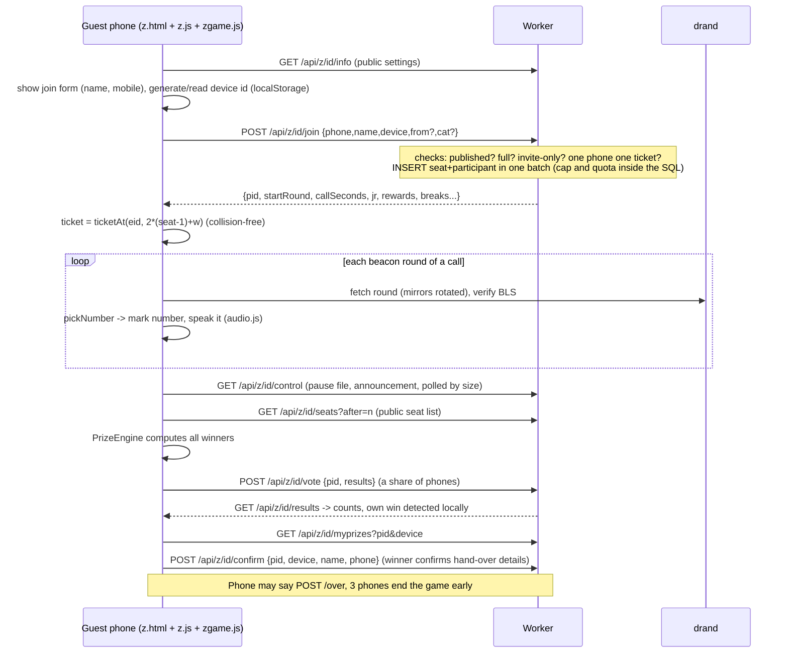
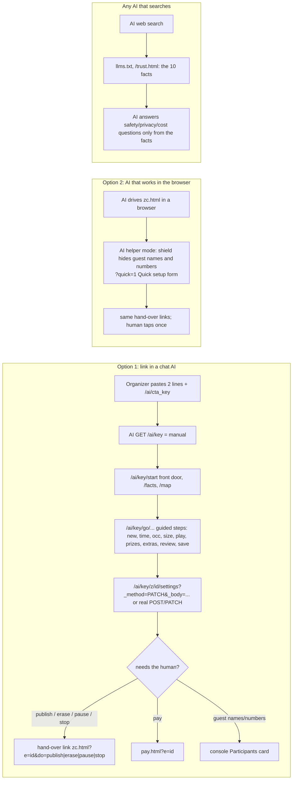
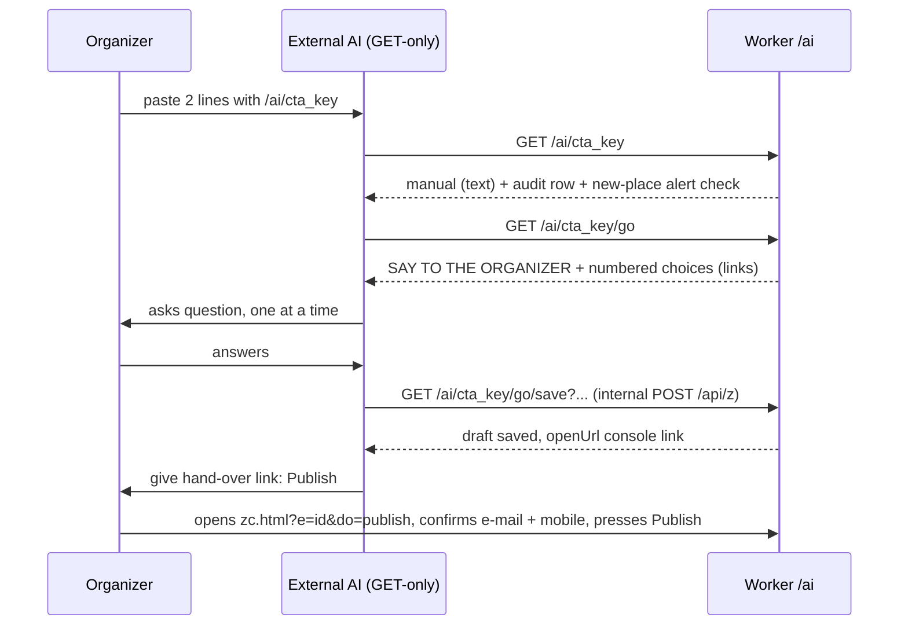
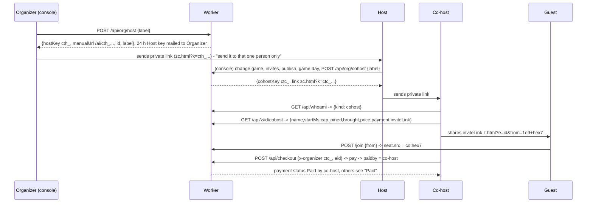
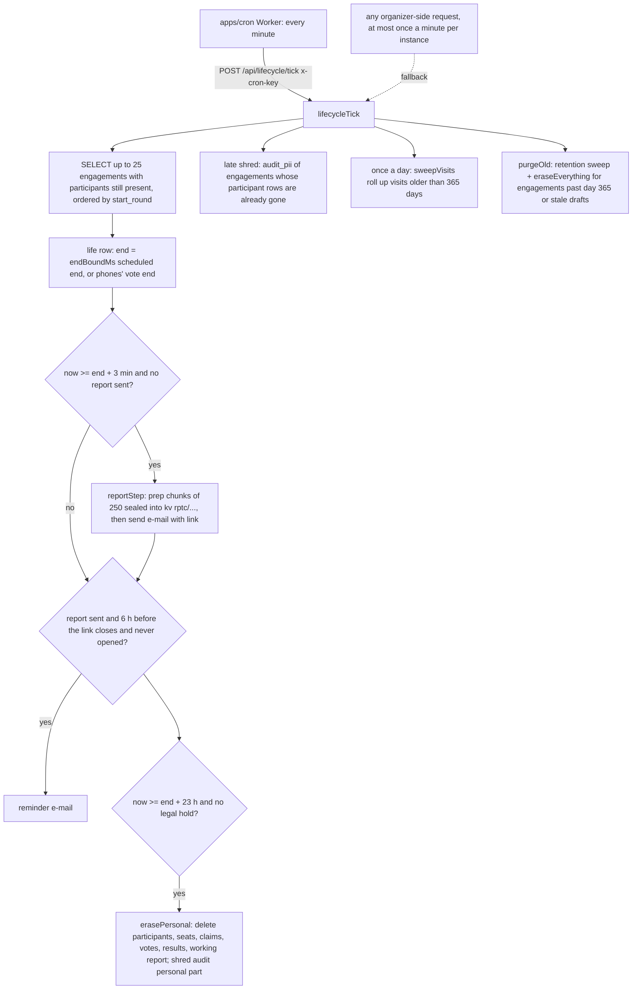
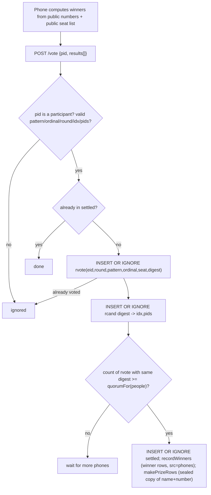
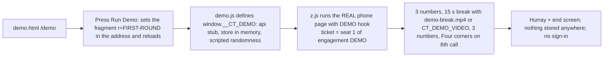
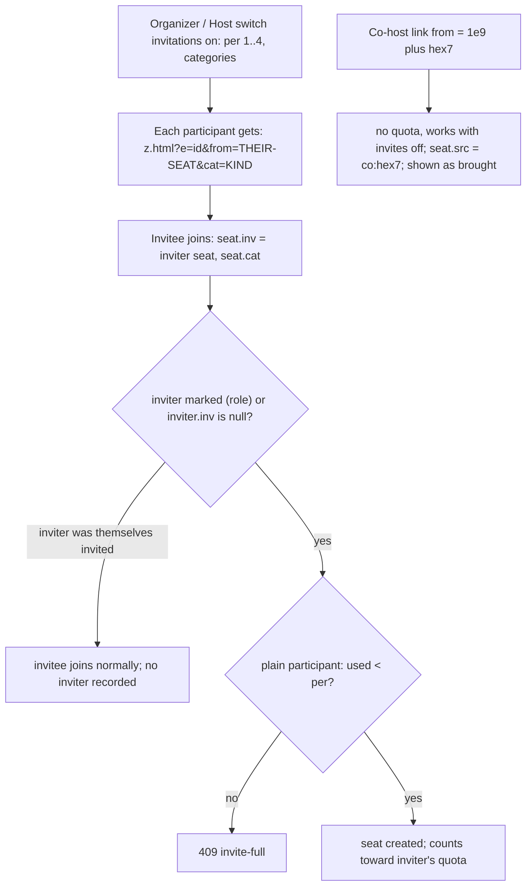

# 07 - Flows (Mermaid)

All diagrams are text. Names in boxes are real routes/functions; see `04-API-REFERENCE.md` for details and `06-BUSINESS-LOGIC.md` for rules.

## 1. Organizer: create, build, publish, pay, share, game day, report, deletion

```mermaid
flowchart TD
  A["Home / site.js: enter work e-mail"] -->|POST /api/start| B{"e-mail has account?"}
  B -->|"no"| C["Console opens at once: master key ctk_, AI key cta_, aiMessage<br/>one dedicated mail with a 24 h AI key"]
  B -->|"yes"| B2["POST /api/auth/email -> 6-digit code or one-click link<br/>POST /api/auth/verify or /api/auth/link -> new ctk_ key"]
  B2 --> C
  C --> D["Console zc.html: Step 1..9<br/>POST /api/z creates a DRAFT pack=0"]
  D --> E["Build: PATCH /api/z/id/settings<br/>time, speed, cap, tickets, rounds, prizes, brand moments, invites<br/>POST roster / reuse for guest list"]
  E --> F["Check + Publish: POST /api/z/id/publish {email, phone}<br/>kv pub/id, contact/id; mail with guest link + pay link"]
  F --> G{"Paid before start - 45 s?"}
  G -->|"pay: POST /api/checkout then Razorpay then verify/webhook"| H["pack set, paidby recorded<br/>invoice mailed"]
  G -->|"no"| HELD["Held at start: phones show waiting screen<br/>organizer mailed once"]
  HELD -->|"pays later"| RESTART["start_round = now+20 rounds: first number in ~3 min"]
  RESTART --> H
  H --> SH["Share guest link z.html?e=id and big screen big.html?e=id"]
  SH --> GD["Game day: start+2 min first number<br/>announce, pause/resume/stop signed in browser, prizes"]
  GD --> END["Game ends: last call / stop / phones say over"]
  END -->|+3 min| RPT["Report e-mailed as ONE link report.html?e=&k=<br/>PDF built in organizer's browser"]
  RPT -->|+22 h| LINKCLOSE["report link closes"]
  LINKCLOSE -->|+23 h| PURGE["participants' names, numbers, seats, votes, results deleted<br/>audit personal part shredded"]
  PURGE -->|00:00 IST end of day 365| ALL["everything deleted; certificate + anonymous stats kept"]
```

## 2. Guest: join, ticket, play, claim, prize

## 3. External AI link (three ways an AI is used)

Server pieces: `aiLink()` `worker.ts:294`, manual text `ai-link.ts`, functions list `ai-functions.ts`, facts `ai-facts.ts`, guided steps `ai-go.ts`, mails `mails.ts`, pages `ai-link.html/.js`, `trust.html`, `llms.txt`. Test: `ai-link.test.ts`, `ai-enablement.test.ts` (plays an outside AI), `ai-signin.test.ts`, `ai-mail*.test.ts`, `ai-privacy.test.ts`.

## 4. Host and Co-host: invite and pay

## 5. Payment (sequence)

See the sequence diagram in `06-BUSINESS-LOGIC.md` section 2. Summary states: `payment.status created -> paid`; entitlement created; draft published (`pack = paid size`, `kv pub/`, `paidby/`); invoice created; mails; commission row (if `ref`); funnel steps `published`, `paid`.

## 6. Lifecycle / cron tick

Code: `worker.ts:929` (route), `lifecycle.ts:294` (tick), `lifecycle.ts:114,124` (erase), `worker.ts:1333` (purge). The same route also performs `purgeOld` so one call per minute covers the daily clean-up; `housekeeping()` (`worker.ts:256`) adds the daily outbox retry and the 36-hour payment reminders on organizer traffic.

## 7. Winner quorum

## 8. Demo game

Script: `packages/beacon/src/demo-script.ts` (numbers `[1,23,80,9,50,60]`, corners `[1,80,9,60]`, `DEMO_CALL_SECONDS=9`, break after 3 for 15 s); test `packages/beacon/test/demo-script.test.ts`; page test `apps/web/test/pages.test.ts`.

## 9. Invite chain

Report: the invite tree (who brought whom, top inviter) is in the PDF (`report-layout.ts`, `lifecycle.ts:175-180`).
