# Corporate Tambola: JOIN, VERIFY and APPROVAL flows (as the code is, not as designed)

Source read: branch `wip/join-redesign`, HEAD `231dd78`, working tree clean when read (2026-10-26). Nothing in the source was edited.
Files: `apps/edge/src/worker.ts` (join `1584-1709`, who `1565-1583`, info `1812-1813`, checkin `1933`, gates `1488-1564`, helpers `377-401`, `1493-1514`), `apps/edge/src/people.ts`, `apps/edge/src/phonekit.ts`, `apps/edge/src/checkin.ts`, `apps/edge/src/consent.ts`, `packages/beacon/src/config.ts`. Intent documents compared against: `docs/handover-2026-10-26/join_design.json` (matrix of 20 rows, gaps G1-G30, decisions D1-D6) and `docs/ROLES_AND_CONSOLE_SPEC_3.md`.

Conventions
- Every `file:line` is in `apps/edge/src/` unless a file name is written. `w.ts` below means `worker.ts`; `p.ts` means `people.ts`.
- Outcome IDs (`G-`, `J-`, `R-`, `N-`, `H-`, `C-`, `P-`, `V-`) are the row IDs of the decision table in section 4. A pink dashed box in a chart, or the text `?? UNCLEAR`, points to an entry in section 5 (`GAP-nn`).
- "mode" = `verifyOf(e).mode`: `mobile` (default), `id`, `either`, `both`. "eo" = `employeesOnly`. "closed" = `engagement.closed` = the game setting "Who can join: list" (`whoCanJoin` is `"list"` when `closed` else `"anyone"`, w.ts:1813). Saving eo forces `closed=1` (w.ts:1410, 2038) and forces guest invitations off (config.ts:332).
- Production per-network limits are 600 a minute / 20,000 a day (`pages/wrangler.toml:19-20`); the code defaults are 200 / 1,500 (w.ts:390). Daily write budget in production 2,000,000 (`wrangler.toml:18`), code default 80,000 (w.ts:378). `JOIN_WRITES = 9` (w.ts:401). `ID_MISS_PER_10MIN = 30` (w.ts:390). `WAITING_MAX = 500` (p.ts:37).

---------------------------------------------------------------------------------------------------

## 1. MASTER CHART: what happens from the moment a phone opens a link

Reading guide: green = a ticket (200); red = refusal; amber = the person is put in the waiting room (chart 2 follows from there); pink dashed = ambiguous or suspected gap.

```mermaid
flowchart TD
  classDef ok fill:#d8f3dc,stroke:#2d6a4f,color:#000
  classDef err fill:#ffe0e0,stroke:#b00020,color:#000
  classDef wait fill:#fff3cd,stroke:#b58900,color:#000
  classDef unclear fill:#ffd6f5,stroke:#a0007a,color:#000,stroke-dasharray:4 3

  START(["Phone opens a link"]) --> LNK{"Which link?"}
  LNK -->|"personal link /j/token"| PJ["GET /j/token  w.ts:549, p.ts:622<br/>unknown or removed token, cancelled or not-started game = 404 page P-01<br/>else the page redirects to z.html?e=ID&t=token"]
  LNK -->|"common link z.html?e=ID&from=code"| PAGE
  LNK -->|"direct link z.html?e=ID"| PAGE
  PJ --> PAGE["Page: GET info gives whoCanJoin, verify, employeesOnly, invites<br/>Person ticks the two K4 consent boxes, types phone and or employee ID and name<br/>Page adds device id, from, cat, token"]
  PAGE --> POST["POST /api/z/ID/join  w.ts:1584"]

  subgraph A["A. Game state gates  w.ts:1491-1564"]
    POST --> A1{"Engagement row exists?"}
    A1 -->|no| X_G01["404 No such engagement  G-01"]:::err
    A1 -->|yes| A2{"Host key sent with AI work link header x-ct-link=1?"}
    A2 -->|yes| X_G03["403 deny  G-03"]:::err
    A2 -->|no| A3{"unplayed_ms set? (did not start)"}
    A3 -->|yes| X_G04["403 did-not-start  G-04"]:::err
    A3 -->|no| A4{"cancelled_ms set?"}
    A4 -->|yes| X_G05["403 cancelled  G-05"]:::err
    A4 -->|no| A5{"Unpaid and never published (draft)?"}
    A5 -->|yes| X_G06["403 not open yet, no code  G-06"]:::err
    A5 -->|no| A6["Unpaid, published, start time minus 45 s passed (locked):<br/>e-mail nudge to organizer, join CONTINUES  G-07"]:::unclear
  end

  subgraph B["B. Read and normalise the input  w.ts:1585-1612"]
    A6 --> B1{"body.token is a non-empty string?"}
    B1 -->|yes| B2{"personByToken found and status not removed?"}
    B2 -->|no| X_J01["404 link-gone  J-01"]:::err
    B2 -->|yes| B3["tok = that person row, tokPii = opened name and number"]
    B1 -->|no| B4
    B3 --> B4{"phone typed (not blank) but not 10-15 digits<br/>(8-15 if typed with + or 00)?"}
    B4 -->|yes| X_J02["400 Enter a valid mobile number, no code  J-02"]:::err
    B4 -->|no| B5{"empId not null after normEmp?<br/>(spaces dropped, upper case, A-Z 0-9 . _ - / , max 30)"}
    B5 -->|"bad characters or too long, ANY mode"| X_J03["400 bad-id  J-03"]:::err
    B5 -->|ok| B6{"eo and mode is id or both<br/>and no ID and no token?"}
    B6 -->|yes| X_J04["400 need-id  J-04"]:::err
    B6 -->|no| B7{"eo and mode is either, no ID,<br/>no phone typed, no token?"}
    B7 -->|yes| X_J05["400 need-id  J-05"]:::err
    B7 -->|no| B8{"mode is id or either, ID typed, no token?"}
    B8 -->|yes| B9["Look the ID up FIRST: person.ph = hash of ID,<br/>else kv alias idx/eid/idhash to a mobile hash"]
    B9 --> B10{"ID found (any status, even removed)?"}
    B10 -->|yes| B11["tok = that person, idHit = true<br/>typed mobile kept only as extra contact (extraDigits)<br/>typedPh and typedDigits cleared"]
    B10 -->|no| B12
    B8 -->|no| B12
    B11 --> B12["idOnly = ID typed, no phone typed, no person found (id or either)<br/>identity ph = hash of ID if idOnly, else typed phone hash, else the person's own ph"]
    B12 --> B13{"ph missing, or no digits and not idOnly<br/>and not (id or either with a known person)?"}
    B13 -->|yes| X_J06["400 mode-specific message, no code  J-06"]:::err
    B13 -->|no| B14["otherNumber = token AND a typed number that differs from the token's number<br/>dev = hash of the phone's device id (null if absent or malformed)<br/>ck = consent check result K4 (kept, not returned yet)"]
  end

  subgraph C["C. Returning phone: a participant row already exists for this identity  w.ts:1619-1639"]
    B14 --> C0{"participant with this identity hash exists?"}
    C0 -->|yes| C1{"seat.blocked (removed by organizer)?"}
    C1 -->|yes| X_R01["403 removed  R-01  (before the consent check)"]:::err
    C1 -->|no| C2{"K4 never recorded for this ticket<br/>AND ticks missing in this request?"}
    C2 -->|yes| X_R02["400 consent-required  R-02"]:::err
    C2 -->|ok| C3{"seat has a device bound that differs from this device?"}
    C3 -->|"yes, came by employee ID"| X_R03["423 id-used  R-03"]:::err
    C3 -->|"yes, token and no typed number"| X_R04["423 link-used needPhone  R-04"]:::err
    C3 -->|"yes, otherwise"| X_R05["423 other-phone  R-05"]:::err
    C3 -->|no| C4{"seat has NO device bound yet?"}
    C4 -->|"yes and a device is sent"| C5{"this device already holds another seat?"}
    C5 -->|yes| X_R06["409 device-used  R-06"]:::err
    C5 -->|no| C6{"daily write guard spend 2"}
    C6 -->|refused| X_R07["503 busy, no code  R-07"]:::err
    C6 -->|ok| C7["Bind device to seat, set person to joined, keep typed name if none on file"]
    C4 -->|"yes and NO device sent"| C8["No binding, no refusal  R-09"]:::unclear
    C4 -->|"no, same device"| C9
    C7 --> C9["Record K4 if missing"]
    C8 --> C9
    C9 --> X_R08["200 ticket again:true  R-08 / R-09<br/>(no waiting, no cap check, no rate limit on this path)"]:::ok
  end

  subgraph D["D. New person: list matching, ID-miss limiter, consent, device, capacity  w.ts:1640-1661"]
    C0 -->|no| D1["pr = person row for this identity (is this number or ID on ANY list of the game?)"]
    D1 --> D2{"mode not mobile AND ID typed AND no token?"}
    D2 -->|"yes, mode both"| D3{"pr missing, or pr holds an ID that differs from the typed ID?"}
    D3 -->|yes| D4["pr = null, idMiss = true"]
    D3 -->|no| D6
    D2 -->|"yes, mode id or either"| D5{"pr missing?"}
    D5 -->|yes| D4
    D5 -->|no| D6
    D4 --> D7{"this network has 30 or more ID misses in this 10-minute slot?"}
    D7 -->|yes| X_N01["429 too-many-tries  N-01"]:::err
    D7 -->|no| D8["count one more miss (kv idmiss/eid/slot/ip)"]
    D8 --> D6
    D2 -->|no| D2B{"mode both AND pr exists AND no token?"}
    D2B -->|yes| D9{"pr holds an employee ID?"}
    D2B -->|no| D6
    D9 -->|yes| D10["needIdAfterConsent = true"]
    D9 -->|no| D6
    D10 --> D6
    D6{"pr.status is removed?"}
    D6 -->|yes| X_N02["403 removed  N-02"]:::err
    D6 -->|no| D11{"ticks missing AND no K4 row from an earlier waiting request?"}
    D11 -->|yes| X_N03["400 consent-required  N-03"]:::err
    D11 -->|no| D12{"needIdAfterConsent?"}
    D12 -->|yes| X_N04["400 need-id  N-04"]:::err
    D12 -->|no| D13{"device id missing?"}
    D13 -->|yes| X_N05["400 refresh this page, no code  N-05"]:::err
    D13 -->|no| D14{"another seat already has this device?"}
    D14 -->|yes| X_N06["409 device-used  N-06"]:::err
    D14 -->|no| D15{"participants so far >= cap?"}
    D15 -->|yes| X_N07["409 This engagement is full, no code  N-07"]:::err
  end

  subgraph E["E. Whose list does this person belong to?  w.ts:1662-1677"]
    D15 -->|no| E1{"otherNumber (someone else on a personal link)?"}
    E1 -->|yes| E2["owner = the link owner's inviter, via = personal-link"]
    E1 -->|no| E3{"from code kind?"}
    E3 -->|"org 1,900,000,000"| E4["owner = o"]
    E3 -->|"host or cohost"| E5{"organizer_key row exists for org, kind, not revoked,<br/>this game or all games, first 7 hex match?"}
    E5 -->|yes| E6["owner = h:hex or c:hex"]
    E5 -->|"no (revoked or forged)"| E7["owner stays empty, falls back to Organizer silently"]:::unclear
    E3 -->|"guest (code below 1,000,000,000 = seat number)"| E8{"guest invitations ON<br/>and that seat exists, not removed,<br/>and is level 1 or a team seat?"}
    E8 -->|yes| E9["owner = s:seat, cat = body.cat if in the allowed categories else null"]
    E8 -->|"no (invites off, level 2, removed, unknown)"| E7
    E3 -->|"none, or code out of range"| E10["via = direct, owner empty"]
    E2 --> E11
    E4 --> E11
    E6 --> E11
    E7 --> E11
    E9 --> E11
    E10 --> E11["target = owner, or o when empty"]
  end

  subgraph F["F. Listed or not, and the invite limit  w.ts:1691-1699"]
    E11 --> F1{"pr exists? (on a list)"}
    F1 -->|yes| F2["Take inviter and role from the list row<br/>Fill name or number the list lacks<br/>No waiting, no limit check"]
    F1 -->|no| F3{"closed (Only people on a list) OR idMiss?"}
    F3 -->|yes| WAIT1[["WAITING ROOM  (chart 2)  wait(false)"]]:::wait
    F3 -->|no| F4["limit = limitOfInviter(target):<br/>Co-host: cohost_limit or 100 / level-1 guest: invites.per / team seat, Host, Organizer: none"]
    F4 --> F5{"limit set AND list of target already >= limit?"}
    F5 -->|yes| WAIT2[["WAITING ROOM  wait(true, limit): Organizer or Host decides  N-12"]]:::wait
    F5 -->|no| F6["inviter = target, guard = target and limit"]
  end

  subgraph G["G. Network rate limit, write guard, seat  w.ts:1700-1709"]
    F2 --> G1{"per-network limit: minute (production 600) or day (20,000)?"}
    F6 --> G1
    G1 -->|exceeded| X_N14["429 busy  N-14"]:::err
    G1 -->|ok| G2{"daily write guard spend 9"}
    G2 -->|refused| X_N15["503 busy  N-15"]:::err
    G2 -->|ok| G3["addSeat: ONE atomic batch<br/>seat only if participants < cap<br/>and (person is invited OR participants + unseated invited < cap)<br/>and (inviter list below limit) and (device not already used)"]
    G3 --> G4{"participant row now exists for this identity?"}
    G4 -->|no| G5{"this device now holds a seat?"}
    G5 -->|yes| X_N16["409 device-used  N-16"]:::err
    G5 -->|no| G6{"guard was set (inviter list limit)?"}
    G6 -->|yes| WAIT3[["WAITING ROOM  wait(true)  N-17"]]:::wait
    G6 -->|no| X_N18["409 This engagement is full, no code  N-18"]:::err
    G4 -->|yes| G7{"seat device differs from this device (race)?"}
    G7 -->|yes| X_N19["423 other-phone  N-19"]:::err
    G7 -->|no| X_N20["200 ticket: pid, jr, role  N-20<br/>K4 recorded for the ticket"]:::ok
  end

  WAIT1 --> WOUT
  WAIT2 --> WOUT
  WAIT3 --> WOUT
  WOUT["wait() outputs: 429 busy N-08 / 503 busy N-09 / 429 waiting-full N-10 /<br/>403 declined N-11 / 409 invite-full N-12 / 403 waiting N-13"]:::wait

  class A6,C8 unclear
```

Notes on the master chart
- The order of checks matters and is not the order a reader would assume: the "removed" answers (R-01 at `w.ts:1622`, N-02 at `1654`) and `link-gone` (J-01 at `1590`) are returned BEFORE the consent check (R-02 at `1624`, N-03 at `1656`). See `GAP-09`.
- The returning-phone branch (C) runs before everything in D to G: it skips the waiting room, the cap, the ID rules and the per-network rate limit.
- A person on a list (`pr` exists) never reaches the waiting room and never hits the invite limit (F2); their place was counted when they were listed.
- In an open game ("Anyone with the link"), the waiting room is reached only by (a) an ID that is not on the list (`idMiss`, F3) or (b) an inviter at the limit (F5). In a closed game every unlisted person waits (F3).
- Typed number versus employee ID: the identity of a person is `ph`, which is the hash of the LAST 10 DIGITS of the mobile (`w.ts:1500`), or the hash of the employee ID when the person is known by ID alone (`people.ts:54`). One person = one `ph` = one participant row = one ticket.
- The page sends `phone` even when the ID decides who the person is; a mobile typed together with a listed ID is only kept as contact (`extraDigits`, `w.ts:1607`, `1692`) and never causes a refusal, but an INVALID typed mobile refuses the whole request (J-02 at `1596`, in every mode).

### 1b. The mode matrix as the code applies it (what each verify mode checks)

| mode | eo? | what must be typed (server) | how the person is found | unlisted person |
|---|---|---|---|---|
| `mobile` | any | a valid mobile (J-06 "Enter a valid mobile number.") | by hash of last 10 digits | closed (eo forces closed): waits. Open: ticket at once (under the link owner) |
| `id` | eo | ID (J-04) | ID looked up first; a typed mobile is only contact | ID not on list: `idMiss`, waits, counts toward 30 misses |
| `id` | not eo | ID or mobile (J-06 "Enter your employee ID, or your mobile number if you have no employee ID.") | ID first, else the mobile | ID typed but not on list: `idMiss`, waits (even in an open game). Mobile only and unlisted: open = ticket, closed = waits |
| `either` | eo | ID or mobile (J-05) | ID first (also via the alias `idx/...`), else mobile | as `id`, plus: ID miss with a listed mobile = that person |
| `either` | not eo | ID or mobile (J-06 "Enter your mobile number or your employee ID.") | same | same |
| `both` | eo | ID and mobile (J-04; the mobile via J-06 "Enter a valid mobile number.") | by mobile; the typed ID must equal the ID on the list row | mobile unlisted or ID different: `idMiss`, waits |
| `both` | not eo | mobile (J-06); ID optional | by mobile | mobile unlisted + ID typed: `idMiss`, waits. Mobile unlisted + no ID: open = ticket, closed = waits. Mobile listed whose row holds an ID + no ID typed: N-04 (asked only after consent) |
| any | any | A valid personal-link token replaces ALL of the above | by the token | token + different typed number = `otherNumber`, goes through E/F as a stranger owned by the link owner's inviter |

---------------------------------------------------------------------------------------------------

## 2. WAITING ROOM chart

Where requests come from (all in `wait()`, `w.ts:1678-1690`): an unlisted person in a closed game, an employee-ID miss (open or closed game), or an inviter whose list is at its limit.
Where they are decided: `people.ts` `decideWaiting` (`498-525`), `decideAll` (`528-566`), listed by `listWaiting` (`483-490`), polled by the phone on `GET /api/z/ID/me?wid=` (`meRoute`, `579-586`, public, no names or numbers).

```mermaid
flowchart TD
  classDef ok fill:#d8f3dc,stroke:#2d6a4f,color:#000
  classDef err fill:#ffe0e0,stroke:#b00020,color:#000
  classDef wait fill:#fff3cd,stroke:#b58900,color:#000
  classDef unclear fill:#ffd6f5,stroke:#a0007a,color:#000,stroke-dasharray:4 3

  subgraph REQ["1. A person asks to come in  wait()  w.ts:1678"]
    W0(["join reaches wait(overlimit, limit)"]) --> W1{"per-network join limit (base figures)?"}
    W1 -->|exceeded| X_N08["429 busy  N-08"]:::err
    W1 -->|ok| W2{"daily write guard spend 2"}
    W2 -->|refused| X_N09["503 busy  N-09"]:::err
    W2 -->|ok| W3["record K4 under the pre-seat id (if ticks sent)"]
    W3 --> W4{"waiting row for this identity already exists?"}
    W4 -->|"yes (any status)"| W5["use that row, nothing new is written"]
    W4 -->|no| W6{"500 or more rows with status waiting?"}
    W6 -->|yes| X_N10["429 waiting-full  N-10"]:::err
    W6 -->|no| W7["insert row: sealed number, ID, name, via, inviter, chain<br/>chain = ,o, when over the limit, else the inviter and the inviter's own inviter"]
    W5 --> W8
    W7 --> W8{"row status?"}
    W8 -->|declined| X_N11["403 declined  N-11  (permanent, GAP-13)"]:::unclear
    W8 -->|"waiting"| W9{"over the inviter limit?"}
    W8 -->|"admitted"| X_ADM["403 waiting AGAIN although admitted  (only reachable in mode both with a wrong ID, GAP-03)"]:::unclear
    W9 -->|yes| X_N12["409 invite-full + waiting:true + wid  N-12"]:::wait
    W9 -->|no| X_N13["403 waiting + waiting:true + wid  N-13"]:::wait
  end

  X_N12 --> POLL
  X_N13 --> POLL
  POLL["Phone polls GET /me?wid=... (every 5 s in the page)<br/>p.ts:579"] --> P1{"row found?"}
  P1 -->|no| X_P20["404 state gone  P-20"]:::err
  P1 -->|yes| P2{"status"}
  P2 -->|"waiting and game ended"| X_P21["state lapsed: This game has ended"]:::wait
  P2 -->|waiting| X_P22["state waiting: Your request is with WHO"]:::wait
  P2 -->|declined| X_P23["state declined: This game could not add you"]:::err
  P2 -->|admitted| X_P24["state admitted: page re-sends join, now a listed person, ticket issued by chart 1 branch F2"]:::ok

  subgraph DEC["2. Who can decide  people.ts:114-139, 476-482"]
    D0(["Approver calls GET /people/waiting, POST /waiting/ID or POST /waiting/all"]) --> D1{"who is calling?"}
    D1 -->|"AI key or AI work link"| X_P02a["403 AI refusal  P-02"]:::err
    D1 -->|"Organizer, platform, Host key of this org"| D2["all = true: sees and decides EVERY request"]
    D1 -->|"Co-host key"| D3["all = false: sees and decides only rows whose chain contains ,c:ownid,<br/>i.e. people who came through THEIR link, or through a level-1 guest THEY listed"]
    D1 -->|"level-1 guest (ticket id AND device proof, invitations ON, no team role)"| D4["all = false: only rows whose chain contains ,s:ownseat,<br/>= people who came through their own link"]
    D1 -->|"anything else"| X_P02b["403 Not allowed / sign in  P-02"]:::err
    D2 --> D5
    D3 --> D5
    D4 --> D5["List: oldest first, first 200 rows only (p.ts:485)"]
  end

  subgraph ONE["3a. Decide ONE request  decideWaiting  p.ts:498"]
    E0(["POST /waiting/WID  decision = admit or decline"]) --> E1{"WID is 12 hex?"}
    E1 -->|no| X_P05["404 No such request  P-05"]:::err
    E1 -->|yes| E2{"decision is admit or decline?"}
    E2 -->|no| X_P06["400 Say admit or decline  P-06"]:::err
    E2 -->|yes| E3{"row exists AND (all OR chain contains caller)?"}
    E3 -->|no| X_P07["404 No such request  P-07  (a Co-host cannot touch another link's request)"]:::err
    E3 -->|yes| E4{"row.status is still waiting?"}
    E4 -->|no| X_P08["200 ok already:STATUS  P-08  (ignored: nothing changes)"]:::wait
    E4 -->|yes| E5{"game ended?"}
    E5 -->|yes| X_P09["409 game has ended, lapsed  P-09"]:::err
    E5 -->|no| E6{"daily write guard spend 3"}
    E6 -->|refused| X_P10["503 busy  P-10"]:::err
    E6 -->|ok| E7{"decision"}
    E7 -->|decline| X_P11["status = declined, 200 declined:true  P-11"]:::err
    E7 -->|admit| E8["inviter = row.inviter, or the APPROVER when the request was over the limit"]
    E8 --> E9{"limit of that inviter set AND its list is full?"}
    E9 -->|"yes and approver is not Organizer or Host"| X_P12["409 over-limit  P-12"]:::err
    E9 -->|"yes and approver is Organizer or Host"| E10["inviter = the approver (unlimited list)"]
    E9 -->|no| E11
    E10 --> E11{"persons on the game >= cap AND this identity has no live person row?"}
    E11 -->|yes| X_P13["409 over-cap: all places are taken  P-13  (approve after cap full)"]:::err
    E11 -->|no| E12{"person row for this identity?"}
    E12 -->|"none"| E13["insert person: status invited, approved_by, approved_ms, new token"]
    E12 -->|"status removed"| E14["REVIVE person (status invited, new token) AND unblock the seat  (approve after removal)"]
    E12 -->|"invited or joined"| E15["no new row, only mark the request admitted"]
    E13 --> E16
    E14 --> E16
    E15 --> E16{"the final UPDATE changed a row? (lost a race with a decline or another approver)"}
    E16 -->|no| X_P14["200 ok already:STATUS  P-14"]:::wait
    E16 -->|yes| X_P15["200 admitted:true placedUnder:LABEL  P-15<br/>NO seat yet: the person must open the link again and join"]:::ok
  end

  subgraph ALL["3b. Decide ALL  decideAll  p.ts:528"]
    F0(["POST /waiting/all  decision"]) --> F1{"decision valid?"}
    F1 -->|no| X_P16["400 Say admit or decline  P-16"]:::err
    F1 -->|yes| F2{"game ended?"}
    F2 -->|yes| X_P17["409 lapsed  P-17"]:::err
    F2 -->|no| F3{"any rows in my reach? (500 oldest at most)"}
    F3 -->|no| X_P18a["200 zeros  P-18"]:::wait
    F3 -->|yes| F4{"spend 3 per row"}
    F4 -->|refused| X_P10b["503 busy  P-10"]:::err
    F4 -->|ok| F5{"decision"}
    F5 -->|decline| X_P19["every row declined, 200 declined:N  P-19"]:::err
    F5 -->|admit| F6["for each row, oldest first"]
    F6 --> F7{"identity has a live person row?"}
    F7 -->|yes| F8["just mark the request admitted (counted as admitted)"]
    F7 -->|"no, or removed"| F9{"persons on the game >= cap?"}
    F9 -->|yes| F10["stays waiting; message: The game is full"]:::wait
    F9 -->|no| F11{"inviter list full?"}
    F11 -->|"yes and caller is Co-host or guest"| F12["stays waiting; message: Some lists are full"]:::wait
    F11 -->|"yes and caller is Organizer or Host"| F13["placed on the caller's own list"]
    F11 -->|no| F14["placed on the inviter's list (a removed person is revived and unblocked)"]
    F8 --> OUT["200 admitted:N stillWaiting:M  P-18"]:::ok
    F10 --> OUT
    F12 --> OUT
    F13 --> OUT
    F14 --> OUT
  end

  subgraph IGN["4. Nobody answers  (ignored)"]
    I0["Row stays status waiting<br/>no timeout, counts toward the 500 limit<br/>phone keeps showing Your request is with WHO"]:::wait --> I1{"game ends?"}
    I1 -->|yes| I2["phone shows lapsed. The row itself is not changed (p.ts:583); whether lifecycle.ts removes it later was not checked"]
    I1 -->|"no"| I3["still waiting; the person may also add a NEW request by typing a different number or ID<br/>(the old row stays: GAP-14)"]:::unclear
  end

  subgraph LIST["5. Other ways out of the waiting room"]
    L0["Someone adds the person to a list (people.ts:328-329)"] --> L1["waiting row set to admitted by the lister, person row created. Also works for a DECLINED row"]
  end
```

Who may decide what (verified in code)

| Approver | Sees | May admit / decline | May place over a full list | Notes |
|---|---|---|---|---|
| Organizer (master key, or platform) | every request | every request | yes, onto own list `o` | `people.ts:120` |
| Host | every request (`all=true`) | every request, not only their own link | yes, onto own list `h:...` | `people.ts:121` |
| Co-host | only rows whose `chain` contains `,c:<own id>,` (own link, or a level-1 guest the Co-host listed) | those rows only; other rows answer 404 "No such request." (P-07) | no: P-12 (single) or stays waiting (all) | `people.ts:122-125, 504` |
| Level-1 guest | only rows whose `chain` contains `,s:<own seat>,` (own common link) | those rows only | no | needs ticket id AND device proof, invitations ON, not a team seat (`people.ts:128-138`) |
| Level-2 guest, AI key, AI work link | nothing | nothing | no | `people.ts:117, 136` |

Requests that were over a limit have chain `,o,` (`people.ts:604`): ONLY the Organizer and Hosts can decide them, never the Co-host or guest whose limit was hit.

---------------------------------------------------------------------------------------------------

## 3. INVITE CHAINS chart

Model: Organizer, then Host, then Co-host, then level 1 guest (L1), then level 2 guest (L2). Every inviter has ONE list (table `person`, column `inviter`) and ONE common link; a listed person also has a personal link (single use, binds to the first phone).

```mermaid
flowchart TD
  classDef ok fill:#d8f3dc,stroke:#2d6a4f,color:#000
  classDef err fill:#ffe0e0,stroke:#b00020,color:#000
  classDef wait fill:#fff3cd,stroke:#b58900,color:#000
  classDef unclear fill:#ffd6f5,stroke:#a0007a,color:#000,stroke-dasharray:4 3

  ORG["ORGANIZER  id o<br/>from=1,900,000,000<br/>list limit: none<br/>can add (bulk, CSV), remove anyone, resend, export, decide all requests"]
  HOST["HOST  id h:7hex<br/>from=1,500,000,000 + hex<br/>list limit: none<br/>same rights as Organizer inside a game; a removal e-mails the Organizer (p.ts:401)"]
  COH["CO-HOST  id c:7hex<br/>from=1,000,000,000 + hex<br/>list limit: engagement.cohost_limit or 100 (settings 10 to 1000)<br/>can add, resend and remove ONLY own list and only BEFORE the game starts<br/>decides requests of own link"]
  L1["LEVEL 1 GUEST (L1)  id s:seat<br/>from = seat number (below 1,000,000,000)<br/>list limit: invites.per (1 to 10, default 4), only while invitations are ON (never with employees-only)<br/>can add own list, remove own people before the start; kinds (cat) from the allowed categories"]
  L2["LEVEL 2 GUEST (L2)<br/>plays, has no list, no link that records them as inviter, cannot call the people routes<br/>(403 Guests invited by a guest can play but cannot invite more people.)"]

  ORG -->|"lists / link"| HOST
  ORG -->|"lists / link"| COH
  ORG -->|"lists / link"| L1
  HOST -->|"lists / link"| COH
  HOST -->|"lists / link"| L1
  COH -->|"lists / link"| L1
  L1 -->|"lists / link: seat.inv = L1 seat"| L2
  L2 -.->|"NO further level"| L2X["Their common link resolves to the Organizer's list (GAP-26)"]:::unclear

  subgraph LISTADD["Adding a person to a list  POST /people  p.ts:259"]
    A0(["Caller adds people"]) --> A1{"caller allowed? (not AI; Organizer, Host, Co-host, L1 with device proof)"}
    A1 -->|no| XA1["403  V-01"]:::err
    A1 -->|yes| A2{"K6 consent ticked? (the console sends it)"}
    A2 -->|no| XA2["400 consent-required  V-03"]:::err
    A2 -->|yes| A3{"more than 200 people in this request?"}
    A3 -->|yes| XA3["413 too-many  V-04"]:::err
    A3 -->|no| A4{"game ended?"}
    A4 -->|yes| XA4["409 The game has ended  V-05"]:::err
    A4 -->|no| A5["Per person: clean name, normEmp, cleanPhone; mode rules (id/either/both/eo)<br/>invalid rows are reported, never stored"]
    A5 --> A6{"already on ANY list, or already seated, or twice in the request?"}
    A6 -->|"yes (first inviter wins)"| A7["counted in duplicates; the inviter is NOT named in the answer"]:::unclear
    A6 -->|"removed person"| A8{"caller is Organizer/Host, or removed them themselves?"}
    A8 -->|yes| A9["revived (status invited, new token, seat unblocked)"]
    A8 -->|no| A10["invalid: This person was removed. Ask the Organizer or a Host to put them back."]
    A6 -->|no| A11["new person row"]
    A9 --> A12
    A11 --> A12{"caller has a limit AND adds more than the room left?"}
    A12 -->|yes| XA12["409 over-limit, nothing added  V-06"]:::err
    A12 -->|no| A13{"persons + adds > cap?"}
    A13 -->|yes| XA13["409 over-cap, nothing added  V-07"]:::err
    A13 -->|no| A14{"daily write guard"}
    A14 -->|refused| XA14["503 busy  V-08"]:::err
    A14 -->|ok| A15["INSERT guarded again inside SQL by the list limit and the cap<br/>anyone waiting with this number becomes admitted (decided_by = the lister)"]
    A15 --> XA15["200 added, duplicates, invalid, people with personal link and WhatsApp link  V-09"]:::ok
  end

  subgraph LINKUSE["A stranger uses a COMMON link  (chart 1, section E and F)"]
    U0(["from=code"]) --> U1{"code kind"}
    U1 -->|"1,900,000,000"| U2["Organizer list o"]
    U1 -->|"1,500,000,000 range"| U3["Host list (key must exist and not be revoked)"]
    U1 -->|"1,000,000,000 range"| U4["Co-host list (key must exist and not be revoked)"]
    U1 -->|"below 1,000,000,000"| U5{"invitations ON AND seat exists, not removed, seat is L1 or a team seat?"}
    U5 -->|yes| U6["L1 list s:seat, category recorded"]
    U5 -->|no| U7["Organizer list o  (silently)"]:::unclear
    U3 -->|"revoked or forged"| U7
    U4 -->|"revoked or forged"| U7
    U2 --> U8
    U3 --> U8
    U4 --> U8
    U6 --> U8
    U7 --> U8{"person already on a list?"}
    U8 -->|yes| U9["Stays under the list that has them (first wins), even through another inviter's link"]
    U8 -->|no| U10{"game is Only people on a list?"}
    U10 -->|yes| U11["waiting room: the link owner and the people above them can decide"]:::wait
    U10 -->|"no (anyone with the link)"| U12{"owner has a limit and the list is full?"}
    U12 -->|yes| U13["waiting room, chain o: Organizer or Host only (409 invite-full)"]:::wait
    U12 -->|no| U14["ticket at once, person row created on the owner's list, seat.inv = L1 seat for a guest owner (so the new person is L2), seat.inv empty for every other owner (so the new person is L1)"]:::ok
  end

  subgraph PERS["A stranger uses a PERSONAL link of someone else  (otherNumber)"]
    P0(["token + a different number typed"]) --> P1{"typed number already on a list?"}
    P1 -->|yes| P2["joins as that listed person"]
    P1 -->|no| P3{"game is Only people on a list?"}
    P3 -->|yes| P4["waiting room under the link OWNER'S inviter (via personal-link)"]:::wait
    P3 -->|"no"| P5["ticket at once under the link owner's inviter, link is not consumed  (GAP-05)"]:::unclear
  end

  subgraph REM["Removing people  POST /people/ID/remove  p.ts:370"]
    R0(["remove"]) --> R1{"person is on caller's list, or caller is Organizer/Host?"}
    R1 -->|no| XR1["404 No such person on your list  V-11"]:::err
    R1 -->|yes| R2{"game started AND caller is Co-host or guest?"}
    R2 -->|yes| XR2["403 Once the game has started only the Organizer or a Host can remove people  V-12"]:::err
    R2 -->|no| R3{"person is a team member's own seat?"}
    R3 -->|yes| XR3["409  V-13"]:::err
    R3 -->|no| R4["optionally withTheirPeople: also their invitees, 3 levels<br/>before start: seat, participant, claims deleted; after start: seat blocked, stays in public seat list"]
  end
```

Limits and categories at a glance

| Inviter | Where the limit comes from | Counted how | At the limit, an open-game joiner... | At the limit, a LIST add... |
|---|---|---|---|---|
| Organizer, Host | none | n/a | n/a | never limited |
| Co-host | `engagement.cohost_limit ?? 100`, settings accept 10-1000 (`p.ts:33`, `w.ts:2033`) | persons with `inviter=c:id`, status not removed, no team role (`listCount`, `p.ts:163`) | waits, answer `invite-full` 409, chain `,o,` (N-12) | 409 `over-limit` (V-06) |
| L1 guest | `invites.per`, 1-10, default 4 (`config.ts:115-116, 324-325`); only while `invites.on` | same count, key `s:seat` | same | same |
| Team seat (Organizer/Host/Co-host's own play seat, `seat.role` set) | none (`limitOfInviter` returns null for a seat with a role, `p.ts:171-172`) | n/a | n/a | the people routes refuse a team seat that calls with a ticket ("invites through the console") |
| L2 | cannot invite | n/a | n/a | 403 |

Categories (`cat`): ten fixed kinds (family, colleagues, friends, dealers, vendors, customers, partners, franchisees, neighbours, guests; `config.ts:61-64`). The Organizer picks the allowed set when switching invitations on (at least one). A joiner's `cat` is stored in `seat.cat` ONLY when the link owner is a level-1 guest and the value is in the allowed set (`w.ts:1673, 1703`); otherwise null. Categories are never used for any limit or permission.

---------------------------------------------------------------------------------------------------

## 3b. Small charts for the other routes you asked about: `who`, `info`, `checkin`

```mermaid
flowchart TD
  classDef ok fill:#d8f3dc,stroke:#2d6a4f,color:#000
  classDef err fill:#ffe0e0,stroke:#b00020,color:#000
  classDef unclear fill:#ffd6f5,stroke:#a0007a,color:#000,stroke-dasharray:4 3

  subgraph WHO["POST /who  'Is this you?'  w.ts:1565-1583  (no caller found in apps/web/public/z.js)"]
    W0(["POST who: empId, consent"]) --> W1{"draft / cancelled / did not start?"}
    W1 -->|"draft"| XW0a["403 not open yet  H-06"]:::err
    W1 -->|"cancelled or did not start"| XW0b["409 (join gives 403 for the same states)  H-06"]:::unclear
    W1 -->|no| W2{"mode mobile, or no usable ID?"}
    W2 -->|yes| XW1["200 known:false  H-01"]:::ok
    W2 -->|no| W3{"both consent boxes?"}
    W3 -->|no| XW2["400 consent-required  H-02"]:::err
    W3 -->|yes| W4["look up the ID hash; also the alias for mode either"]
    W4 --> W5{"found and not removed?"}
    W5 -->|yes| XW5["200 known:true name: first name and first letter of last name  H-05<br/>hits are NOT counted or limited"]:::unclear
    W5 -->|no| W6{"30 or more misses in this slot for this network (same counter as join)?"}
    W6 -->|yes| XW3["429 too-many-tries  H-03"]:::err
    W6 -->|no| XW4["count a miss, 200 known:false  H-04"]:::ok
  end

  subgraph INFO["GET /info  w.ts:1563, 1812"]
    I0(["GET info"]) --> I1{"draft and caller is not organizer side?"}
    I1 -->|yes| XI1["403 not open yet  I-01"]:::err
    I1 -->|no| I2["200: cancelled / didNotStart / locked flags, startMs, cap, whoCanJoin (list or anyone),<br/>verify (the word 'number' for mobile mode), employeesOnly, invites {on, per, cats}  I-02"]:::ok
  end

  subgraph CHECKIN["GET and POST /checkin  checkin.ts:62-112  (after a ticket exists)"]
    C0(["checkin with pid and device"]) --> C1{"game created before 2026-10-23 10:00 UTC?"}
    C1 -->|yes| XC1["200 required:false  C-01"]:::ok
    C1 -->|no| C2{"pid has a seat?"}
    C2 -->|no| XC2["403 Not a participant, no code  C-02"]:::err
    C2 -->|yes| C3{"seat blocked?"}
    C3 -->|yes| XC3["403 removed  C-03"]:::err
    C3 -->|no| C4{"device matches the seat's device (seat device must be set)?"}
    C4 -->|no| XC4["403 other-phone  C-04"]:::err
    C4 -->|yes| C5{"GET or POST?"}
    C5 -->|GET| XC5["200 details; code only when open and not yet present  C-05"]:::ok
    C5 -->|POST| C6{"already present?"}
    C6 -->|yes| XC6["200 present (idempotent)  C-06"]:::ok
    C6 -->|no| C7{"check-in open? (5 min before start)"}
    C7 -->|no| XC7["403 not-open  C-07"]:::err
    C7 -->|yes| C8{"name on file not confirmed, or mobile on file not confirmed?"}
    C8 -->|yes| XC8["400 confirm  C-08"]:::err
    C8 -->|no| C9{"5 wrong codes in the last 10 minutes?"}
    C9 -->|yes| XC9["429 locked  C-09"]:::err
    C9 -->|no| C10{"4-digit code equals the keyed code for this seat?"}
    C10 -->|no| XC10["400 wrong-code triesLeft  C-10 (503 busy if the write guard refuses)"]:::err
    C10 -->|yes| C11{"edited mobile passes cleanPhone?"}
    C11 -->|no| XC11["400 bad-mobile  C-11"]:::err
    C11 -->|yes| XC13["spend 2 (503 busy C-12) then 200 present, editedName, editedMobile  C-13"]:::ok
  end
```

---------------------------------------------------------------------------------------------------

## 4. DECISION TABLE: every distinct outcome

Messages are quoted from the code. `-` in the `code` column means the response has NO `code` field. `??` marks an entry discussed in section 5.

### 4.1 Gates before the join logic (apply to join; some also to who)

| ID | HTTP | code | Message / body | Exact condition | file:line |
|---|---|---|---|---|---|
| G-01 | 404 | - | "No such engagement." | no `engagement` row for the id | w.ts:1491 |
| G-02 | 404 | - | "Not found" + hint | path does not match the route regex (wrong action name) | w.ts:1488-1489 |
| G-03 | 403 | - | `deny()`: for a Host "Only the Organizer can do this. A Host looks after the game, not the account." | Host key presented with header `x-ct-link: 1` and the action is not in `HOST_ACTIONS` (join, who are not) | w.ts:1517, 715, 713 |
| G-04 | 403 | `did-not-start` | "This game did not start. Your details have been erased." `didNotStart:true` | `e.unplayed_ms` set, method POST, action join (checked before cancelled) | w.ts:1522-1524 |
| G-05 | 403 | `cancelled` | "This game was cancelled by the organizer." `cancelled:true` | `e.cancelled_ms` set, POST join | w.ts:1526 |
| G-06 | 403 | - | "This engagement is not open yet." | `pack===0` and not published (draft), POST join or POST who | w.ts:1519, 1563 |
| G-07 ?? | (none: join continues) | - | organizer gets an e-mail "could not begin: payment is due" (once) | unpaid, published, `start - 45 s <= now`, caller not organizer side | w.ts:1562, 1564 |

### 4.2 Join: reading and normalising the input

| ID | HTTP | code | Message | Exact condition | file:line |
|---|---|---|---|---|---|
| J-01 | 404 | `link-gone` | "This link is not valid any more. Please ask the person who invited you to send it again." | `token` is a non-empty string AND (no person has that token hash, or token fails `/^[a-z0-9]{6,20}$/i`, or person status is `removed`). A non-string token is ignored silently | w.ts:1588-1590, p.ts:611-614 |
| J-02 | 400 | - | "Enter a valid mobile number." | phone typed (string not blank, or any non-null value) but `digitsOf` is null: fewer than 10 digits (fewer than 8 when it starts with `+` or `00`) or more than 15. Applies in EVERY mode, also when the ID alone would be enough. An oversize (>4096 chars) or non-JSON body gives the same text through J-06 | w.ts:1593-1596, 1493-1496, 246, 287 |
| J-03 | 400 | `bad-id` | "An employee ID has letters and numbers only." | `normEmp` returns null (not `/^[A-Z0-9][A-Z0-9._\-/]{0,29}$/` after dropping spaces and upper-casing). Checked in EVERY mode, also `mobile` where the ID is never used | w.ts:1598-1599, p.ts:52 |
| J-04 | 400 | `need-id` | mode id: "Enter your employee ID." / mode both: "Enter your employee ID and your mobile number." | eo AND mode is `id` or `both` AND no ID AND no token | w.ts:1600 |
| J-05 | 400 | `need-id` | "Enter your mobile number or your employee ID." | eo AND mode `either` AND no ID AND phone not typed AND no token | w.ts:1601 |
| J-06 | 400 | - | mode id: "Enter your employee ID, or your mobile number if you have no employee ID." / mode either: "Enter your mobile number or your employee ID." / otherwise: "Enter a valid mobile number." | identity `ph` is null, OR (no digits AND not ID-only AND not [(id or either) with a person found]). Includes: mode `mobile`/`both` with nothing typed; mode `both` not eo with an ID but no mobile | w.ts:1609-1612 |

### 4.3 Join: a participant already exists for this identity (returning phone)

| ID | HTTP | code | Message | Exact condition | file:line |
|---|---|---|---|---|---|
| R-01 | 403 | `removed` | "You were removed from this game by the organizer." `removed:true` | participant row exists and `seat.blocked` (returned BEFORE the consent check ??GAP-09) | w.ts:1620-1622 |
| R-02 | 400 | `consent-required` | "Please tick the box to continue." (`kind:K4`, `version`) | no K4 row for `ref=eid` and subject = ticket id or `pidOf(ph)`, and the request lacks the current terms version or a box | w.ts:1623-1624, consent.ts:35-40 |
| R-03 | 423 | `id-used` | "This employee ID already has a ticket on another phone. A ticket plays on one phone only. If it is you on a new phone, ask your organizer to move your ticket to this phone." | seat has a device bound that differs from this one (also when this request sent no device) AND the person was found by employee ID (`idHit`) | w.ts:1625-1626 |
| R-04 | 423 | `link-used` | "This link was already opened on another phone. If you are someone else, type your own mobile number to ask to join. If it is you on a new phone, ask whoever invited you to send the link again." `needPhone:true` | same, token present, no number typed | w.ts:1627 |
| R-05 | 423 | `other-phone` | "This ticket was opened in a different browser or app (or on another phone). A ticket plays on one device only. Open your link in the same browser or app you used first. If you cannot, ask your organizer to move your ticket to this phone." | same, any other case | w.ts:1628 |
| R-06 | 409 | `device-used` | "This phone already holds a ticket in this engagement. One phone, one ticket. Ask the person to open the link on their own phone." | seat has NO device bound, a device is sent, and another seat already has this device | w.ts:1630 |
| R-07 | 503 | - | "It is very busy right now. Please try again in a few minutes." | seat unbound, device sent, `spend(2)` refused | w.ts:1632, 399 |
| R-08 | 200 | - | `{pid, startRound, callSeconds, trackClaims, again:true, jr, role?}` | same identity and same device (or device bound just now); K4 recorded if missing | w.ts:1637-1638 |
| R-09 ?? | 200 | - | same as R-08 | seat has no device and the request sent NO device: nothing is bound, nothing refused | w.ts:1631, 1638 |

### 4.4 Join: a new person

| ID | HTTP | code | Message | Exact condition | file:line |
|---|---|---|---|---|---|
| N-01 | 429 | `too-many-tries` | "Too many tries with an employee ID that is not on the list. Please ask your organizer for help." | `idMiss` AND this network (hash of `cf-connecting-ip`) already has >= 30 counted misses in this fixed 10-minute slot (`ISO time .slice(0,15)`) for this game | w.ts:1642-1649, 390 |
| N-02 | 403 | `removed` | "You were removed from this game by the organizer." | the person row found for this identity has status `removed` (token holder, ID hit, or typed number) | w.ts:1654 |
| N-03 | 400 | `consent-required` | "Please tick the box to continue." | request lacks the K4 boxes AND no K4 row exists under `pidOf(ph)` (written earlier by a waiting request) | w.ts:1655-1656 |
| N-04 | 400 | `need-id` | "Enter your employee ID." | mode `both`, no token, mobile is on a list row that holds an employee ID, and no ID typed (asked only after consent) | w.ts:1653, 1657 |
| N-05 | 400 | - | "Please refresh this page and try again." | `device` missing or not 16-64 hex chars | w.ts:1616, 1658 |
| N-06 | 409 | `device-used` | "This phone already holds a ticket in this engagement. One phone, one ticket. Others can join from their own phones, using your invitation link if the organizer allowed it." | a seat with this device hash exists | w.ts:1659 |
| N-07 | 409 | - | "This engagement is full." | participants >= cap (counted on `participant`, not `person`; ??GAP-10) | w.ts:1660-1661 |
| N-08 | 429 | `busy` | "It is busy right now. Please try again in a few minutes." | inside `wait()`: per-network limit with base figures (`paidSeats` not passed) | w.ts:1679 |
| N-09 | 503 | `busy` | "It is very busy right now. Please try again in a few minutes." | inside `wait()`: `spend(2)` refused | w.ts:1680 |
| N-10 | 429 | `waiting-full` | "Many people are waiting for an answer right now. Please try again a little later." | 500 or more waiting rows in this game and this identity has no row yet | w.ts:1683, p.ts:600-603 |
| N-11 ?? | 403 | `declined` | "This game could not add you. Please talk to whoever invited you." `declined:true`, `wid` | an existing waiting row for this identity has status `declined` (permanent; ??GAP-13) | w.ts:1684, p.ts:600-601 |
| N-12 | 409 | `invite-full` | "This invitation has already been used by N people, which is the most one person can invite. Your request is with WHO. You can come in as soon as they say yes." `waiting:true`, `wid`, `with` | not listed, game open, `idMiss` false, target inviter has a limit and its list count >= limit (also reached through the lost-race branches N-17). The request is placed on chain `,o,` | w.ts:1695-1696, 1688, p.ts:604 |
| N-13 | 403 | `waiting` | "This engagement is by invitation. Your request is with WHO. You can come in as soon as they say yes." `waiting:true`, `wid`, `with` | not listed AND (game closed, or `idMiss`). Also returned when the existing waiting row is `admitted` (??GAP-03) | w.ts:1694, 1689 |
| N-14 | 429 | `busy` | "It is busy right now. Please try again in a few minutes." | per-network minute or day limit (production 600 / 20,000; never below the pack size) | w.ts:1700, 391-398 |
| N-15 | 503 | `busy` | "It is very busy right now. Please try again in a few minutes." | `spend(9)` refused | w.ts:1701 |
| N-16 | 409 | `device-used` | "This phone already holds a ticket in this engagement. One phone, one ticket." | the insert produced no participant AND the device holds a seat | w.ts:1705 |
| N-17 | as N-12 | `invite-full` | as N-12 | the insert produced no participant, the device holds no seat, and an inviter guard was set (the list filled up in the same instant) | w.ts:1705 |
| N-18 ?? | 409 | - | "This engagement is full." | the insert produced no participant and no guard: cap reached, OR the remaining places are reserved for invited people (`addSeat` second clause), OR a race | w.ts:1705, 1508 |
| N-19 | 423 | `other-phone` | as R-05 | participant exists but its seat device differs from this one | w.ts:1706 |
| N-20 | 200 | - | `{pid, startRound, callSeconds, trackClaims, jr, role?}` | seat issued; K4 recorded for the new ticket | w.ts:1707-1708 |

### 4.5 `who` (the "Is this you?" lookup)

| ID | HTTP | code | Message / body | Exact condition | file:line |
|---|---|---|---|---|---|
| H-01 | 200 | - | `{known:false}` | mode `mobile`, or no usable ID (blank or invalid; no `bad-id` here) | w.ts:1567 |
| H-02 | 400 | `consent-required` | as R-02 | ticks missing | w.ts:1568 |
| H-03 | 429 | `too-many-tries` | as N-01 | no live person for that ID AND >= 30 misses in the slot (same counter and key as join) | w.ts:1572-1576 |
| H-04 | 200 | - | `{known:false}` | not found, or removed (counter +1; a counter error never blocks) | w.ts:1577-1579 |
| H-05 ?? | 200 | - | `{known:true, name:"Asha K."}` (first name + first letter of last name) | the ID resolves to a person that is not removed. Hits are not counted, not limited | w.ts:1581-1582 |
| H-06 | 403 / 409 | - / `did-not-start`, `cancelled` | draft: "This engagement is not open yet."; did not start / cancelled: the same texts as G-04/G-05 but HTTP 409 | draft: w.ts:1563; others: 1525, 1527 (join answers 403 for the same states) |

### 4.6 `info` and `GET /j/<token>`

| ID | HTTP | code | Message / body | Exact condition | file:line |
|---|---|---|---|---|---|
| I-01 | 403 | - | "This engagement is not open yet." | GET info on a draft by someone who is not on the organizer side | w.ts:1563 |
| I-02 | 200 | - | flags `cancelled`/`message`, `didNotStart`, `locked`, `waitingFor`, `whoCanJoin`, `verify` (the word `number` for mobile mode, but the server's own name is `mobile`), `employeesOnly`, `invites {on, per, cats}`, `startMs`, `cap` ... | otherwise; side effect: the locked-game e-mail nudge (G-07) | w.ts:1812-1813, 104 |
| P-01 | 404 | - | HTML page "This link is not valid any more. Please ask the person who invited you to send it again." | `GET /j/TOKEN`: malformed token, unknown token, person removed, game cancelled or did not start. Otherwise a 200 page that redirects to `z.html?e=ID&t=TOKEN` | w.ts:549, p.ts:622-637 |

### 4.7 Waiting room routes (all under `peopleRoute`, `p.ts:213-239`)

| ID | HTTP | code | Message | Exact condition | file:line |
|---|---|---|---|---|---|
| P-02 | 403 | - | "Names and mobile numbers are handled by people in the console, never by an AI assistant. Ask the owner to do this in the console." | AI key, AI work link or `x-ct-link: 1` | p.ts:117, 110 |
| P-02b | 403 | - / `device` / `removed` | "Not allowed." / "Your Co-host link is for a different game." / "Please sign in, or open your ticket link first." / "Not a participant of this game." / "Open this ticket on the phone you joined with to invite people." / "You were removed from this game." / "Your team seat invites through the console, not through the ticket." / "Guests invited by a guest can play but cannot invite more people." / "The organizer has not switched on guest invitations for this game." | each failed condition of `callerOf` in that order | p.ts:119, 123, 126, 129, 131, 133, 134, 135, 136, 137 |
| P-03 | 409 | `did-not-start` / `cancelled` | as G-04 / G-05 | non-GET people/waiting call on such a game | p.ts:222-223 |
| P-04 | 404 | - | "Not found" | unknown waiting sub-route | p.ts:229 |
| P-05 | 404 | - | "No such request." | `wid` is not 12 hex | p.ts:499 |
| P-06 | 400 | - | "Say admit or decline." | decision is neither | p.ts:501 |
| P-07 | 404 | - | "No such request." | no such row, or caller is not `all` and the row's chain does not contain `,callerId,` | p.ts:503-504 |
| P-08 | 200 | - | `{ok:true, already:STATUS}` | row is not `waiting` (already admitted or declined): ignored | p.ts:505 |
| P-09 | 409 | - | "The game has ended, so this request has lapsed." | `now >= endBound` | p.ts:506 |
| P-10 | 503 | - | "It is very busy right now. Please try again in a few minutes." | `spend(3)` refused | p.ts:507, w.ts:399 |
| P-11 | 200 | - | `{ok:true, declined:true}` | decline of a waiting row | p.ts:508 |
| P-12 | 409 | `over-limit` | "Your list is full (N people). Remove someone first." | admit, target inviter's list full, caller not Organizer/Host. For a Co-host approving a guest's request the "Your" is wrong (??GAP-16) | p.ts:512 |
| P-13 | 409 | `over-cap` | "This game is for N people and all places are taken." | admit: live persons >= cap and this identity has no live person row | p.ts:513 |
| P-14 | 200 | - | `{ok:true, already:STATUS}` | the final UPDATE changed no row (a decline or another approval won the race) | p.ts:522 |
| P-15 | 200 | - | `{ok:true, admitted:true, placedUnder:LABEL}` | admit done; a person row exists (new, revived and unblocked, or already there); NO seat is created | p.ts:514-524 |
| P-16 | 400 | - | "Say admit or decline." | `/waiting/all` with another decision | p.ts:530 |
| P-17 | 409 | - | "The game has ended, so these requests have lapsed." | `/waiting/all` after the end | p.ts:532 |
| P-18 | 200 | - | `{admitted, declined:0, stillWaiting}` + optional message "The game is full (N places). The rest are still waiting." or "Some lists are full, so those requests are still waiting." | admit all (also zeros when nothing is waiting in reach) | p.ts:538, 565 |
| P-19 | 200 | - | `{admitted:0, declined:N, stillWaiting:0}` | decline all | p.ts:544 |
| P-20 | 404 | - | `{state:"gone", error:"That request is not here any more."}` | `GET /me?wid=` for an unknown id | p.ts:581 |
| P-21 | 200 | - | `{state, with, message}`: waiting "Your request is with WHO. You can come in as soon as they say yes." / admitted "You are in. Open your ticket again to join." / declined "This game could not add you. Please talk to whoever invited you." / lapsed "This game has ended." | known id; `lapsed` is computed on read only | p.ts:582-585 |
| P-22 | 400 | - | "Say which: ?pid=<your ticket id> or ?wid=<your request id>." | `/me` without either | p.ts:587 |
| P-23 | 404 | - | "Not a participant of this game." | `/me?pid=` unknown ticket | p.ts:574 |

### 4.8 Invite lists (people routes)

| ID | HTTP | code | Message | Exact condition | file:line |
|---|---|---|---|---|---|
| V-01 | 403 | - | see P-02 / P-02b | caller not allowed | p.ts:114-139 |
| V-02 | 400 | - | "Send at least one person: {people:[{name, phone}]}." | no people array | p.ts:260 |
| V-03 | 400 | `consent-required` | as R-02 with `kind:K6` | K6 boxes missing | p.ts:261 |
| V-04 | 413 | `too-many` | "Send up to 200 people at a time; the console sends a bigger list in several parts." | more than 200 | p.ts:262 |
| V-05 | 409 | - | "The game has ended, so no one can be added." | now >= endBound | p.ts:263 |
| V-05b | 200 | - | `{added:0, duplicates, invalid:[{raw, why}], people:[]}` | nothing to add (every row invalid or duplicate; first inviter is not named) | p.ts:305 |
| V-06 | 409 | `over-limit` | "Your list is full: N people. Remove someone first, or ask the Organizer." / "You can add K more people (your limit is N). Nothing was added; please send fewer." | Co-host or L1 would pass its limit | p.ts:306-309 |
| V-07 | 409 | `over-cap` | "This game is for N people and M are already on the lists. Nothing was added." | live persons + adds > cap | p.ts:310-311 |
| V-08 | 503 | - | busy | write guard | p.ts:312 |
| V-09 | 200 | - | `{added, duplicates, invalid, people:[{link, waLink,...}]}` | success | p.ts:344 |
| V-10 | 403 | - | "Only the Organizer and Hosts can download a list." | export by Co-host/L1 | p.ts:348 |
| V-11 | 404 | - | "No such person." / "No such person on your list." | id not 12 hex; or not on the caller's list and caller is not Organizer/Host | p.ts:364, 366 |
| V-12 | 403 | - | "Once the game has started only the Organizer or a Host can remove people." (resend: "... can send a link again.") | Co-host/L1 after the start | p.ts:374, 412 |
| V-13 | 409 | - | "That is a team member's own seat. Retire the team member instead." | removing a person row that has a team role | p.ts:375 |
| V-14 | 200 | - | `{ok:true, removed:N, during:started}` / `{ok:true, removed:0}` when already removed | removal done | p.ts:376, 404 |
| V-15 | 409 / 400 / 403 | `duplicate` / - / - | "That person was removed. Add them again first." / "They have already joined with their first number. Their ticket can move to a new phone, but not to a new number." / "That number is already invited." / cleanPhone message | resend rules | p.ts:411, 417, 422-423, 433 |
| V-16 | 200 | - | `{ok, link, waLink, unlocked}` (the seat's device is cleared, the first phone to open the new link keeps the ticket) | resend done | p.ts:429-436 |

### 4.9 Check-in (after the ticket exists)

| ID | HTTP | code | Message | Exact condition | file:line |
|---|---|---|---|---|---|
| C-01 | 200 | - | `{required:false}` | game created before 2026-10-23 10:00 UTC | checkin.ts:13, 20, 64 |
| C-02 | 403 | - | "Not a participant of this engagement." | pid not a ticket id or no such participant+seat | checkin.ts:68-70 |
| C-03 | 403 | `removed` | "You were removed from this game by the organizer." | seat blocked | checkin.ts:71 |
| C-04 | 403 | `other-phone` | "This ticket belongs to another phone. Open your own link on your own phone to check in." | device missing/malformed, seat device NULL, or different | checkin.ts:72-75 |
| C-05 | 200 | - | details: ids, name, masked mobile, `hasName`, `hasMobile`, `invitedBy`, `open`, `present`, and `code` only when open and not present | GET | checkin.ts:78-84 |
| C-06 | 200 | - | `{ok:true, present:true, presentMs}` | already present (checked before "open") | checkin.ts:87 |
| C-07 | 403 | `not-open` | "Check-in opens at HH:MM India time, 5 minutes before the game." | POST before start - 5 min | checkin.ts:88 |
| C-08 | 400 | `confirm` | "Please confirm your name and your mobile number." (or one of them) | a name/mobile that is on file is not confirmed | checkin.ts:89-90 |
| C-09 | 429 | `locked` | "Too many wrong codes. Please wait a few minutes and try again." | 5 wrong codes within 10 minutes | checkin.ts:15-16, 93 |
| C-10 | 400 / 503 | `wrong-code` / - | "That code is not the one on your ticket. Look at your code again and type its 4 digits." (+ `triesLeft`) / busy | wrong or short code | checkin.ts:94-99 |
| C-11 | 400 | `bad-mobile` | the `cleanPhone` text | an edited mobile fails the shared parser | checkin.ts:106 |
| C-12 | 503 | - | busy | `spend(2)` refused | checkin.ts:107 |
| C-13 | 200 | - | `{ok:true, present:true, presentMs, editedName, editedMobile}` | success | checkin.ts:108-111 |

---------------------------------------------------------------------------------------------------

## 5. Suspected gaps

Each entry: file:line, one-sentence repro, and what is unclear. "Docs" means `join_design.json` / `ROLES_AND_CONSOLE_SPEC_3.md`.

- **GAP-01 (R-09) An unbound seat is handed back with no device.** `w.ts:1631-1638`. Repro: the organizer presses "send link again" for a joined person (`people.ts:431` sets `seat.dev=NULL`), then someone POSTs join with that number and NO `device` field: the answer is `200 again:true` with the ticket id, nothing is bound and nothing is refused, while a brand-new person without a device gets 400 "Please refresh" (`w.ts:1658`). The branch only binds when a device is sent; the case "no device" has no `else`.
- **GAP-02 `who` and `join` share one ID-miss counter, and `who` can never hit in mode `both`.** `w.ts:1569-1579` vs `1645-1651`; keys by `people.ts:285, 291`. Repro: mode `both`, list rows are keyed by mobile hash, so `who` looks up the ID hash and always finds nothing; 30 `who` calls from one office network in a 10-minute slot make the next real `join` with a wrong ID answer 429 `too-many-tries`. (Latent: no caller of `who` was found in `apps/web/public/z.js`.) Also the counter increments before consent and the removed check and on every retry of the same wrong ID (`1645-1652`), the fixed 10-minute slot lets 60 misses through across a slot boundary, and the limit is not configurable.
- **GAP-03 An admitted person can be sent back to "waiting" for ever (mode `both`, wrong ID).** `w.ts:1643, 1683-1689`, `people.ts:515, 600-601`. Repro: mode `both`; mobile M is listed with ID E1; the person types M with E2: `pr` is nulled, `idMiss` (`1643`), waiting; the organizer presses Admit: a person row already exists so only the request status flips (`people.ts:515-520`, answer `placedUnder` as if placed); the phone re-sends join with E2, `idMiss` fires again, `addWaiting` returns the `admitted` row and the code falls through to the plain "waiting" answer (`1684` only special-cases `declined`). Each retry also burns a try of the 30-per-10-minute counter. (Docs gap G4, still open.)
- **GAP-04 Open game + inviter at the limit: code waits, join_design says fall back.** `w.ts:1695-1696` vs `join_design.json` matrix row 7 and G17. Repro: open game, Co-host limit 100, the 101st person via the Co-host link gets `409 invite-full` and waits; the matrix says they should simply join under the Organizer. `ROLES_AND_CONSOLE_SPEC_3.md:11` agrees with the code ("beyond it they go to the Organizer/Host waiting room"), so the two documents disagree; decide which one is right.
- **GAP-05 A personal link opened by a different number in an OPEN game gives a ticket at once and is not consumed.** `w.ts:1615, 1666, 1694`. Repro: open game; B opens A's personal link and types B's own number: B is seated under A's inviter with no approval. Spec 3 line 10 and matrix row 10 say "that person goes to the waiting room". (In a closed game the code does wait.)
- **GAP-06 Join has no "game ended" check.** `w.ts:1584-1709` (none), while `people.ts:263, 506, 532, 582` all check `endBound`. Repro: after the game's end time POST join for a new number in an open game: 200 ticket. (Docs G30 says "verify with a test"; the code shows no check.)
- **GAP-07 (G-07) A locked (unpaid, past start) game still seats people.** `w.ts:1562-1564`. Repro: publish an unpaid game, wait until start minus 45 s, POST join: 200 ticket (the organizer only gets an e-mail). `info` returns `locked:true` but join returns no `locked` code, so a phone that skipped `info` is never told the game will not begin.
- **GAP-08 Several refusals carry no `code`, so a page can only match on text.** `w.ts:1563 (G-06), 1596 (J-02), 1612 (J-06), 1632 (R-07, plain BUSY), 1658 (N-05), 1661 (N-07), 1705 (N-18)`, and in `people.ts` the decision refusals P-05, P-06, P-07, P-09, P-10 (P-12 and P-13 do have codes). Repro: any of those; `join_design.json` compatibility item 2 lists `full` as a wanted code but N-07 and N-18 return none.
- **GAP-09 "Removed" and "link-gone" are disclosed before consent.** `w.ts:1590, 1622, 1654` come before `1624, 1656`, although the comment at `w.ts:1653` says the point of asking later is "an untick-and-ask cannot be used to find out who is on the list". Repro: POST join with a removed person's mobile and no consent ticks: 403 `removed`; any other number gets 400 `consent-required`. Also J-06/J-02 differences exist before consent.
- **GAP-10 Capacity is counted three ways.** Join counts `participant` rows (`w.ts:1660`), the reservation for invited people counts `person` rows with status invited and no seat (`w.ts:1508`), admit and add count live `person` rows (`people.ts:165, 311, 513`). Seats made by `roster` (`w.ts:2022`) and `reuse` (`2001`) pass no `ownerId`, so no `person` row is written (`w.ts:1512`). Repro: cap 5; four people join; one more asks and waits; the organizer loads one name through the legacy `roster` call and then Admits: the person count is 4, admit succeeds, the person returns and gets `409 This engagement is full.` (N-07) and is stuck "admitted but cannot enter".
- **GAP-11 A removed person can be put back by a stale or mis-typed request.** `w.ts:1643, 1654`; `people.ts:394-398, 519, 559`. Repro: mode `both`; person X (listed with ID E1) is removed BEFORE the game starts (after the start the blocked seat answers R-01 first); X types the same mobile with ID E2: `pr` is nulled so the `removed` check (`1654`) never sees the row, X gets 403 `waiting` (not `removed`); an Admit then calls `admitRevive` and un-blocks the seat. Removal also never touches waiting rows (`people.ts:394-398`). The waiting list does not show that the person was removed before.
- **GAP-12 Request ceiling and ghost IDs.** `people.ts:602-603, 485`; `w.ts:1644`. Repro: in an open game with mode `id`, 500 different wrong IDs (30 per network per 10 minutes) fill the table with `waiting` rows that nobody can see beyond the first 200 (`listWaiting` returns 200 oldest); every later honest request gets 429 `waiting-full`. "Approve all" would admit all ghost IDs as people (docs G9). A mistyped number creates a new row each time and the old row stays (docs G19).
- **GAP-13 (N-11) A decline is permanent and not reversible from the waiting list.** `people.ts:508, 505, 600-601`; `w.ts:1684`. Repro: closed game; a Co-host declines X; later the Organizer wants X in: Approve on the old row answers `ok already:declined` (`people.ts:505`). The only way out is to add X to a list (`people.ts:328-329` flips a declined row to admitted). The console may or may not tell the Organizer this.
- **GAP-14 A new request does not withdraw the old one.** `w.ts:1682` (key = identity hash). Repro: person types a wrong number, waits, goes back and types the right one: two rows now exist; the first stays `waiting` until the game ends and counts toward 500 (also docs G19).
- **GAP-15 `info` says `verify:"number"` while the server's name is `mobile`.** `w.ts:104` vs `people.ts:56`, `config.ts:129`. Repro: GET info for a default game returns `"verify":"number"`; any page code that compares to `"mobile"` misses it.
- **GAP-16 Wrong wording for an approver at a guest's full list.** `people.ts:512`. Repro: a Co-host admits a request that came through a level-1 guest whose list is full: "Your list is full (4 people)" although it is the guest's list, and the Co-host has no list to place the person on instead.
- **GAP-17 Admit is not atomic with the list limit or the cap.** `people.ts:493` (`admitInsert` has no limit or cap guard), against `people.ts:317` and `w.ts:1508` which have. Repro: two Organizer/Host tabs press Admit for two different requests at the same instant when the cap has one place left: both pass the in-code count check (`513`) and both insert. Low probability; the join itself still stops at the cap, so the extra person would be stuck as in GAP-10.
- **GAP-18 `who` discloses a name to anyone with the ticks.** `w.ts:1581-1582`. Repro: type any ID with both K4 boxes ticked; a hit returns first name and first letter of the surname, and hits are never counted (only misses, 30 per network per slot). Intended by the comment ("so the person sees the name"), but it is an enumeration oracle for a company's employee IDs. Also `who` answers 409 for cancelled and did-not-start games where join answers 403 (`w.ts:1525, 1527` vs `1524, 1526`).
- **GAP-19 Bare numbers are looser on join than in lists.** `w.ts:1493-1496` (accepts any 10 to 15 digits; letters are silently dropped; `+91` with 8 to 11 digits is allowed because the minimum is 8 after a `+`) vs `phonekit.ts:7-21` (India must be 10 digits starting 6 to 9). Repro: join with `5123456789` is accepted and stored as `915123456789`; adding the same number to a list is refused "An Indian mobile number starts with 6, 7, 8 or 9." The identity hash is the last 10 digits only, so a Singapore and an Indian number with equal last 10 digits are one person (docs D6).
- **GAP-20 Mode `both` trusts a list row that has no ID.** `w.ts:1643`: the typed ID must match only when the row holds an ID (`pp0?.empId && ...`). Repro: list 10 people while the game is in mode `mobile` (their rows hold no ID), then switch the game to `both` + employees only (allowed until the start, no warning, docs G22): any ID typed with a listed mobile is accepted. (`addPeople` itself requires an ID in `both` + eo, `people.ts:273`, so only rows made before the switch are affected.) People loaded through the legacy `roster` call are participants with no `person` row and never reach this check at all (returning-phone branch).
- **GAP-21 Returning phones are never re-verified or rate limited.** `w.ts:1621-1639`. Repro: in mode `both` a returning participant can type a wrong ID or none and still get `200 again`; the per-network limit (`joinOverLimit`) is skipped, so a script can call join for known numbers without limit (each call may write a K4 row or call `spend`).
- **GAP-22 The over-limit fallback and invalid inviter links are silent.** `w.ts:1669, 1673, 1676`. Repro: a revoked Co-host link, a forged `from=`, a guest link while invitations are off, a removed guest's link, or a level-2 guest's link all record the person under the Organizer (`target = "o"`) with `via="common-link"`; nothing tells the person or the Organizer. The code comment at `w.ts:1672` says an L2's link "records no inviter" but the person row is created with inviter `o` (`1697, 1703`) and `seat.inv` stays null, so that new person is a level 1 who can invite (people.ts:136 only blocks seats with `inv !== null`). This lets the two-level rule be extended by one hop.
- **GAP-23 Category wording versus behaviour.** `config.ts:60` says "the invitees may invite in turn" and "co-hosts any number"; the code allows exactly two levels (`w.ts:1673`, `people.ts:136`) and gives a Co-host a limit (`people.ts:124`). Comment only, no behaviour risk.
- **GAP-24 A declined, ignored or lapsed request has no timeout and the poll state `lapsed` is not stored.** `people.ts:583` computes `lapsed` on read and never writes it; the row stays `waiting` (counted in the 500); whether `lifecycle.ts` removes it was not checked. Repro: leave a request after the game's end and call `/me?wid=`: `lapsed`, but the table row is unchanged.
- **GAP-25 Admitted does not mean seated.** `people.ts:514-524`. Repro: Admit returns `placedUnder` and the person row is `invited`, but the seat is created only when the person's phone sends join again; a person whose page is closed (the page resumes a saved wait for up to 7 days per the docs) never appears as a participant, while the organizer's "waiting" count already dropped.

---------------------------------------------------------------------------------------------------

## 6. Summary (10 lines)

1. Read: `worker.ts` join `1584-1709`, who `1565-1583`, info `1812`, checkin `1933`; all of `people.ts`, `phonekit.ts`, `checkin.ts`, `consent.ts`; `config.ts` invite/verify rules; `join_design.json`; `ROLES_AND_CONSOLE_SPEC_3.md`. No source file was edited.
2. Three charts plus one for who / info / check-in are in this file; the master join chart has 6 stages (A to G) and 3 entry points into the waiting room.
3. Decision-table rows: 7 gates (`G-`), 6 input (`J-`), 9 returning (`R-`), 20 new-person (`N-`), 6 `who` (`H-`), 2 info (`I-`), 24 waiting-room and link page (`P-01` to `P-23` plus `P-02b`), 17 invite-list (`V-`, incl. `V-05b`), 13 check-in (`C-`): 104 rows in all.
4. Join-only rows by HTTP status (39 rows; G-02, G-07 and the duplicate N-17 left out): 200 x3 (new ticket, again, again-without-device), 400 x9, 403 x8, 404 x2, 409 x6, 423 x4, 429 x4, 503 x3.
5. Distinct error `code` values on join: `did-not-start`, `cancelled`, `link-gone`, `bad-id`, `need-id`, `removed`, `consent-required`, `id-used`, `link-used`, `other-phone`, `device-used`, `too-many-tries`, `busy`, `waiting-full`, `declined`, `invite-full`, `waiting` (17); 9 join refusals have no code at all (G-01, G-03, G-06, J-02, J-06, R-07, N-05, N-07, N-18).
6. Limits found: 30 ID misses per network per 10-minute slot (join and `who` share it), 500 waiting rows, 200 shown to approvers, 200 people per add, Co-host 100 (10 to 1000), guest 1 to 10 (default 4), join 600/min and 20,000/day per network in production, write cost 9 per join and 2 per waiting request.
7. Approval rights verified: Organizer and Host decide everything; a Co-host or level-1 guest decides only requests whose chain names them; over-limit requests are Organizer/Host only; AI keys can do nothing.
8. Suspected gaps: 25 entries (GAP-01 to GAP-25); the ones most likely to hurt a live game are GAP-03 (admitted yet "waiting" in mode `both`), GAP-10 (capacity counted three ways, admitted person stuck at "full"), GAP-01 (ticket handed back without a device), GAP-05 (personal link works for strangers in open games) and GAP-06 (no end-of-game check on join).
9. Where the code and the two design documents disagree: GAP-04 (limit fallback), GAP-05 (personal link, other number), GAP-22 (L2 link comment), GAP-23 (comment on invitee levels). Items G4, G9, G17, G18, G19, G30 of `join_design.json` are confirmed still present in this tree.
10. Everything above is read from code, not run; no test or server was started (the laptop is short of RAM and the handover forbids heavy runs), so each gap's repro is a code-derived expectation that should be confirmed with a test before anyone relies on it.
