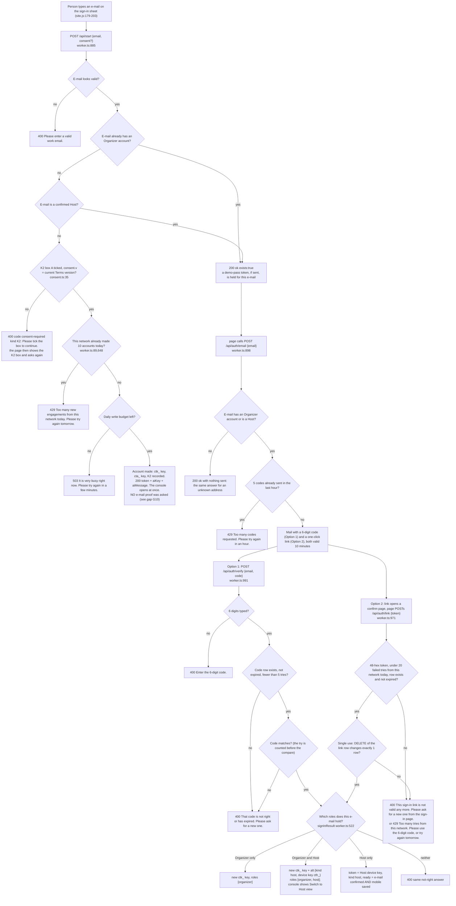
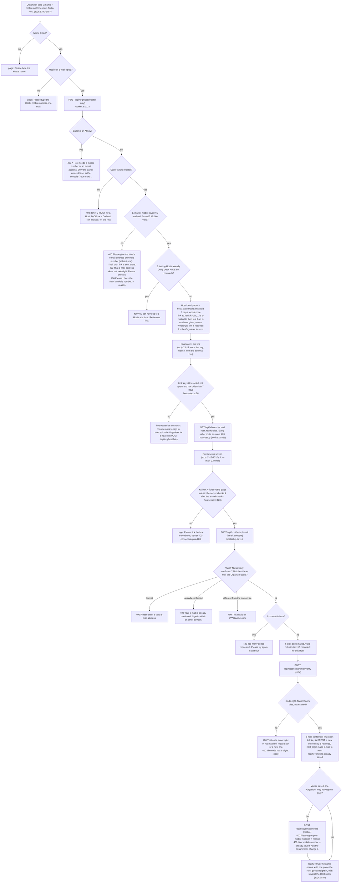
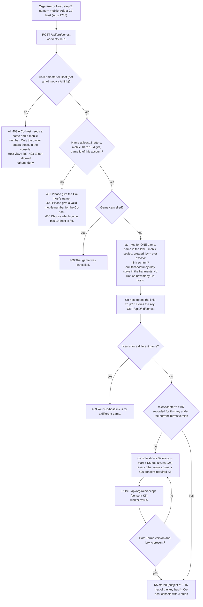
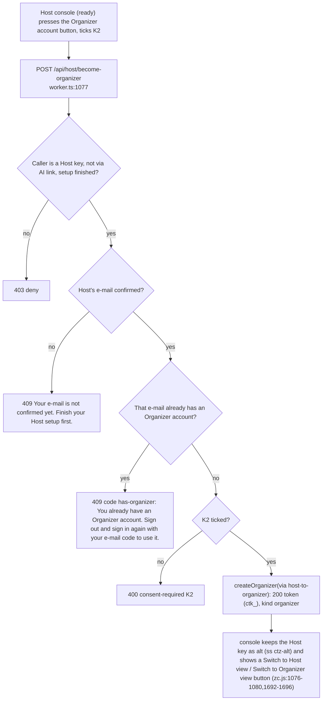
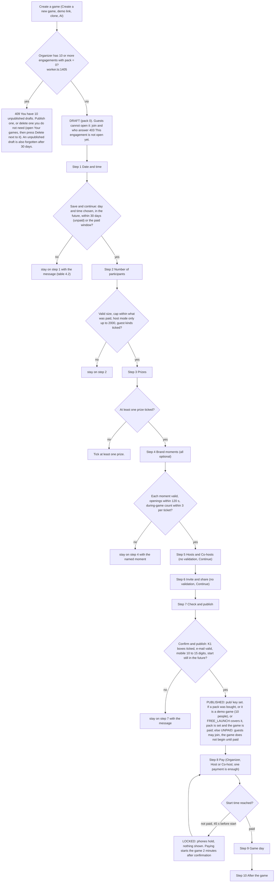
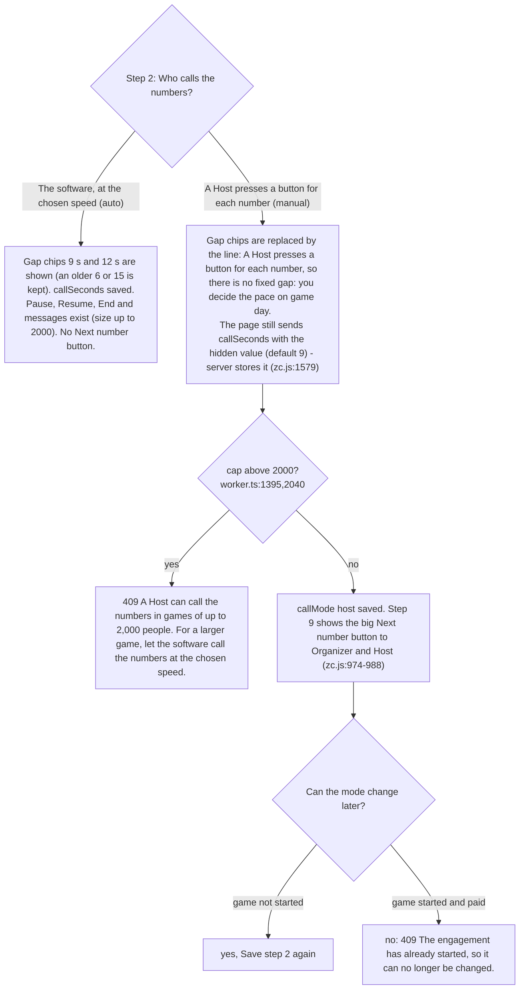
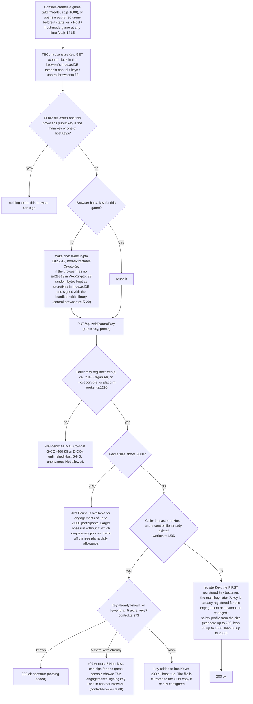
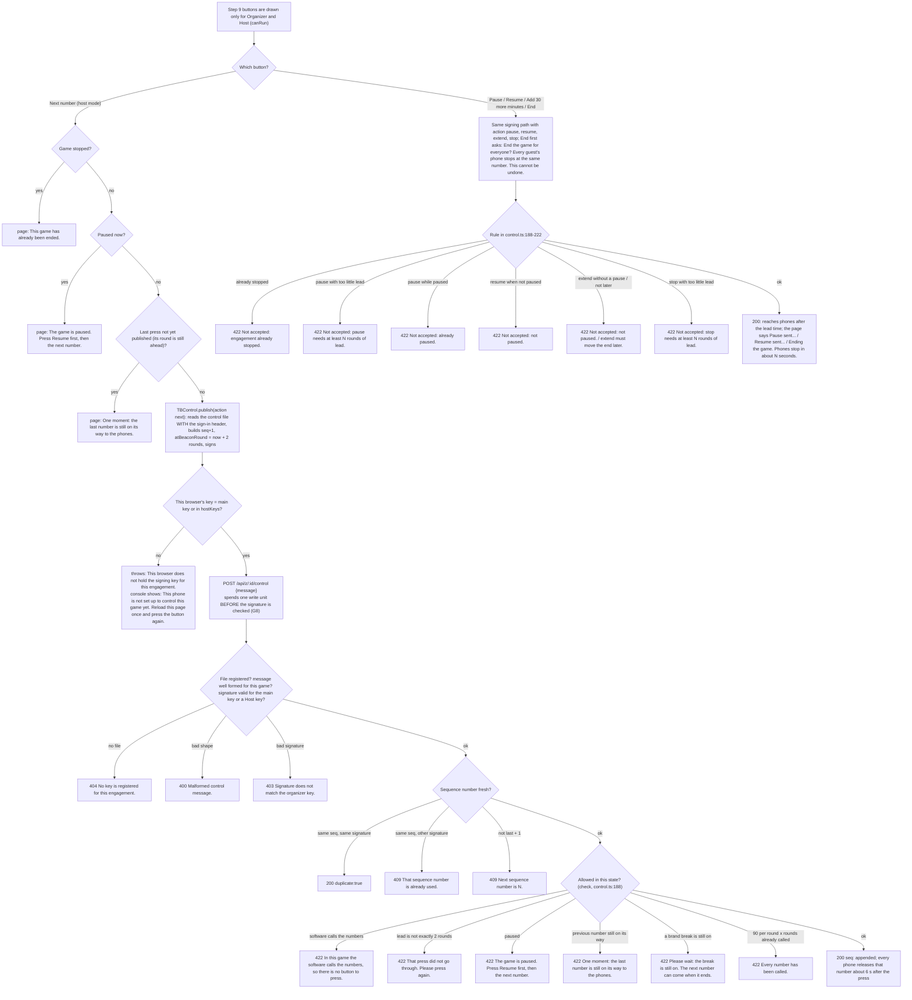
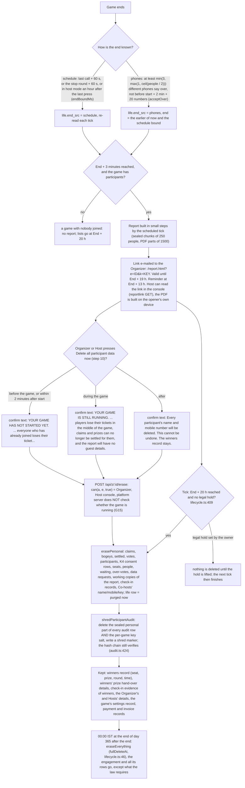

# 02 - Organizer, Host and Co-host: exact if/then logic (from the code)

Branch `wip/join-redesign`, read on 2026-10-26. Read-only study: nothing in the source was changed.
Every statement below is taken from the files named next to it. Where the code and a document disagree, the code wins and the disagreement is listed in section 9.
`?? UNCLEAR` marks a branch whose intent or outcome I could not settle from the code alone.

Sources read in full or in the parts that matter: `apps/edge/src/worker.ts` (all routes and gates), `people.ts`, `hostsetup.ts`, `consent.ts` + `consent-text.json`, `pay.ts` (payer checks, `MAX_DRAFTS`), `credit.ts`, `paylink.ts`, `cancel.ts`, `clone.ts`, `winners.ts`, `lifecycle.ts`, `audit.ts` (shred), `helpdesk.ts` (keys), `testlogins.ts`, `packages/beacon/src/control.ts`, `control-browser.ts`, `config.ts`, `apps/web/public/zc.js` (console), `site.js` (sign-in sheet), `docs/ROLES_AND_CONSOLE_SPEC_3.md`, `docs/ORGANIZER_FLOW_DESIGN_2026-10-25.md`, `docs/dev/05-ROLES-AND-PERMISSIONS.md`, `docs/Corporate_Tambola_Roles_and_Rules.xlsx` (text extracted; it is an 8 October draft and is partly out of date).

Conventions: `file:line` = line number in the file as it stands; `worker.ts` is `apps/edge/src/worker.ts`; `zc.js` is `apps/web/public/zc.js`. Quoted messages are the exact strings in the code.

---

## 1. Who is who

| Role | Key / credential | Made by | Lifetime | Notes |
|---|---|---|---|---|
| Organizer | `ctk_` + 48 hex, kind `master` | `/api/start` (new e-mail), `/api/auth/verify`, `/api/auth/link`, `/api/auth/google`, `/api/host/become-organizer`, payment fulfilment | many sessions per account; an old key keeps working until retired (`worker.ts:529`) | The only role that may touch the account (keys, AI link, close). |
| Organizer's AI | `cta_` + 48 hex, kind `ai` | sign-up (lasting, sealed copy in `kv aikey/<org>`), `replaceAiLink` (`worker.ts:432`), `mailTempLink` (24-hour copies, `worker.ts:422`) | lasting or 24 h | Works at `/ai/<key>`. Never pays, publishes, erases or signs. |
| Host | `cth_` + 48 hex, kind `host` | `POST /api/org/host` (`worker.ts:1114`), one identity row + one device key per sign-in (`hostsetup.ts:47`) | first-open link: 7 days and once (`hostsetup.ts:15,36`); device keys lasting | Max **5** Hosts (`worker.ts:716`); a Help Desk "desk Host" (`created_by 'd'`) does not use one of the 5 (`worker.ts:1124`). A Host works in **all** the Organizer's games (key row has `eid` NULL). |
| Host AI link | the same `cth_` key + header `x-ct-link: 1` (set by `/ai/<key>/...`, `worker.ts:623`) | `mailTempLink(kind "host")` 24 h key (`worker.ts:1137`) or any Host key | 24 h or lasting | `viaLink = true` (`worker.ts:792`): narrow rights, see section 5.3. |
| Co-host | `ctc_` + 48 hex, kind `cohost`, bound to ONE game (`eid`) | `POST /api/org/cohost` (`worker.ts:1181`) | lasting until retired / 20 h after the game ends | Has a name and a mobile number, no e-mail. Cannot use `/ai/` (`LINK_KEY` is `ct[ah]_`, `ai-link.ts:14`; `worker.ts:567-570`). |
| Partner | `ctp_` + 40 hex in table `partner_key`, header `x-partner` | `/api/partner/enroll/verify` (`partners.ts:148`) | lasting | Not an `organizer_key` row, so on every organizer route it is **anonymous** (`worker.ts:690`). |
| Platform (owner) | secret `ORGANIZER_SECRET`, compared with `===` (`worker.ts:688`) | environment | - | `plat = true`: passes `can()` on every game; is refused on account routes (its kind is `"platform"`, not `"master"`). |
| Help Desk helper | an `ai` key with `created_by 'd'`; after the Organizer publishes, a desk Host | `helpdesk.ts:298,370` | until the link is stopped | Same rights as an AI key, plus `/api/helpdesk/*`. Not walked row by row here. |
| Guest / player | no key. A ticket id (`pid`, public in the seat list) plus the phone's device id | `POST /api/z/:id/join` | one game | Level 1 guest may invite (if the Organizer switched it on); level 2 may not. |
| Anonymous | none | - | - | Public routes only. |

Key facts that decide most outcomes:

* `can(a, e, master)` (`worker.ts:702`): true for the platform, or for a key of the same account that is **not** a Co-host; with `master = true` only for kind `master` or a Host that is **not** `viaLink`. So `can(a,e)` lets the AI key and a Host-through-AI-link in; `can(a,e,true)` keeps both out.
* `canAi(a, e)` (`worker.ts:704`): master, ai, or a Host that is not `viaLink`, or platform.
* `mayPay(a, e)` (`worker.ts:706`): master, host (not `viaLink`), or the Co-host of that game; never the AI.
* `deny(a)` (`worker.ts:713`) is role specific:
  * D-AI (kind ai): "Your AI assistant may not do this. It is for the organizer to do themselves in their console: tell them plainly what needs doing and where (your instructions say how)."
  * D-HOST (kind host): "Only the Organizer can do this. A Host looks after the game, not the account."
  * D-CO (kind cohost): "A Co-host can invite people and pay. Ask the Organizer or a Host for anything else."
  * D-ANON (anything else, including master, platform, no key): "Not allowed."
  All are HTTP 403. The console turns a bare "Not allowed." into "Please sign in again with the e-mail address you used." (`zc.js:548`).

---

## 2. The request pipeline (what is checked, in which order)

```mermaid
flowchart TD
  R["Request"] --> M{"Owner switched the site off?<br/>admin.ts:69"}
  M -- "yes, path not exempt" --> M1["503 back-soon answer"]
  M -- no --> K{"STRICT_KEYS=1 and a secret missing?<br/>worker.ts:546"}
  K -- yes --> K1["503 The service is not configured. Please try again later."]
  K -- no --> P{"Path /ai or /ai/...?<br/>worker.ts:548"}
  P -- yes --> AI{"Key is a cta_ AI key or a cth_ Host key?<br/>worker.ts:570"}
  AI -- no --> AI1["404 text: Not found."]
  AI -- yes --> AI2["rewrite to /api/... with x-organizer = key and x-ct-link = 1<br/>HEAD becomes GET; GET with _method=POST or PATCH and _body=JSON acts as that call"]
  P -- no --> A["authOf: key from x-organizer or Authorization Bearer<br/>worker.ts:683"]
  AI2 --> A
  A --> T{"Which key?"}
  T -- "equals ORGANIZER_SECRET" --> PL["plat = true"]
  T -- "row in organizer_key, revoked 0, not expired" --> KD["kind master, ai, host or cohost"]
  T -- "no match, or Host link already used or older than 7 days" --> AN["kind = null (anonymous)"]
  PL --> V
  KD --> V
  AN --> V
  V{"kind host and x-ct-link = 1?<br/>worker.ts:792"} -- yes --> VL["viaLink = true"]
  V -- no --> VB
  VL --> VB{"viaLink and path starts /api/payments/ or /api/org/team or /api/org/cohost?<br/>worker.ts:793"}
  VB -- yes --> VB1["403 code ai-not-allowed: A Host's AI assistant cannot pay or manage the team. The Host does this in their own console."]
  VB -- no --> HS{"Host console key, not viaLink, setup unfinished?<br/>worker.ts:811"}
  HS -- "yes and path is not whoami, host/setup*, auth/*, paylink/*, GET notices" --> HS1["403 code host-setup: Please finish your setup first: confirm your e-mail address and add your mobile number."]
  HS -- no --> PUB["public, owner, payment and credit routes<br/>worker.ts:814-854"]
  PUB --> RA{"Host or Co-host, not viaLink, POST /api/org/role/accept?<br/>worker.ts:855"}
  RA -- yes --> RA1["needs K5 ticks, records consent, 200 ok + Terms version"]
  RA -- no --> CH{"Key is a Co-host?"}
  CH -- no --> REST
  CH -- yes --> CK{"Path is GET whoami, GET notices or GET /api/z/:id/cohost?<br/>worker.ts:861"}
  CK -- yes --> REST
  CK -- no --> C5{"K5 ticked under the current Terms version?"}
  C5 -- no --> C5x["400 code consent-required kind K5: Please tick the box to continue."]
  C5 -- yes --> CP{"Path is /api/z/:id/people or /waiting, or POST /api/z/:id/paylink?<br/>worker.ts:862"}
  CP -- yes --> REST
  CP -- no --> CPx["403 D-CO"]
  REST["everything else: sign-in, account, control, create, history, people, per-game actions<br/>worker.ts:863-2068"]
```

Per-game actions (`/api/z/:id/<action>`) add three more filters before the action runs (`worker.ts:1488-1527`):

1. `<action>` not in the list -> 404 `{error:"Not found", hint:"Read the list of what you can do at /api/z/ai-manifest..."}`; unknown game -> 404 "No such engagement.".
2. Host through an AI link and action not in `HOST_ACTIONS` (participants, summary, results, info, announce, prizes, prizegiven, reportlink, life) -> D-HOST (`worker.ts:1517`).
3. Game closed because it never started (`unplayed_ms`): `join` -> 403 "This game did not start. Your details have been erased." (code did-not-start); any other non-GET except erase, forget, person, cancel, clone, leave, datareq -> 409 same text. Cancelled game: `join` -> 403 "This game was cancelled by the organizer."; any other non-GET except erase, forget, person, cancel, reopen, clone, leave, datareq -> 409 same text.

Order matters in two places that the matrix depends on:

* The payment and credit routes (`worker.ts:852-854`) run **before** the Co-host consent gate (`worker.ts:861`). A Co-host who never ticked K5 can already pay (see gap G3).
* The unfinished-Host gate (`worker.ts:811`) runs before everything, including the public manifest. It is skipped when the call comes through a Host AI link.

---

## 3. Flow 1 - sign-in and role resolution

### 3.1 Organizer or Host signs in (e-mail code or link)

Notes:
* The three special test addresses `demo1@xyz.in`, `demo2@xyz.in`, `demo3@xyz.in` take the code `123456` and no mail is sent (`testlogins.ts:4-5`, `worker.ts:908,997-1008`). See gap G9.
* "Continue with Google": `/api/auth/google` answers 404 unless `GOOGLE_CLIENT_ID` is set (`worker.ts:924`); the console never offers it (`zc.js:1292` returns at once, `zc.js:1311` `googleBlock` is empty). Intent `signin` for an e-mail with no account -> 404 code no-account "There is no account for this Google e-mail yet. Choose sign up to make one."
* Rate limits: 5 codes per e-mail per hour; 5 tries per code; 20 failed link or Google tries per network per day.

### 3.2 Organizer adds a Host; the Host's first open

Branches of the Host account after setup:
* Later devices: the same e-mail sign-in as 3.1 gives a fresh device key (`hostForEmail`, `hostsetup.ts:66`); only the newest Host row for an e-mail is found (`?? UNCLEAR`, see G18).
* The 24-hour Host AI key mailed to the Organizer has no `host_state` row: `temp = true`, it can never run setup (`worker.ts:696,1090`).
* Organizer can send a new first-open link only while the Host has not confirmed an e-mail (`worker.ts:1149` 409 code host-active "This Host has already finished setup and signs in with their e-mail. If they cannot get in, retire them and add them again.").
* Retire: `POST /api/org/team/retire` (master retires Hosts and Co-hosts, a Host retires Co-hosts only) revokes the identity row and every device key (`retireHost`, `hostsetup.ts:71`).

### 3.3 Co-host: add, open, accept the role (K5)

What a Co-host can do after accepting, exactly (`worker.ts:861-862`): `GET /api/whoami`, `GET /api/notices`, `GET /api/z/:id/cohost` (the small header with their invite link, how many they brought, payment status), the people and waiting routes of that game (their own list only, limit `cohost_limit`, default 100, 10 to 1000), `POST /api/z/:id/paylink`, and the payment and credit routes. Everything else is D-CO.
A Co-host's data (name, mobile, key) is erased with the guests 20 hours after the game ends (`eraseCohostsSql`, `cancel.ts:137`; `lifecycle.ts:421-430`).

### 3.4 Host becomes an Organizer; role switch

Sign-in afterwards gives both roles at once (`signInResult`, `worker.ts:532`). "Organizer wins" when one e-mail is both: `acct` is used first; the Host key is delivered as `alt`.

---

## 4. Flow 2 - the ten console steps

Organizer and Host see 10 steps (`zc.js:65-76`); a Co-host sees 3 (`zc.js:77-81`: Today's game, Invite people, Payment). The role pill: "Signed in as Organizer / Host n of 5 / Co-host" (`zc.js:1068`). Role note under the bar: Organizer "You made this game. You can do everything." Host "You have the Organizer's rights for this game. Not the account." Co-host "You can invite people and pay. Nothing else." (`zc.js:82`). The page re-reads the game every 5 seconds unless a field has focus (`zc.js:2047`).

### 4.1 Step completion and locks

* A step is "done" when the owner pressed Save and continue (`markDone`), or when the game proves it: step 7 when published, step 8 when paid, steps 1 to 6 once the game has started, step 9 when the game ended, step 10 when the report was sent or the data purged (`zc.js:89-91`).
* Once the game has started and is paid, steps 1 to 4 show "The game has started, so this can no longer be changed." (`zc.js:362-363`). The server agrees: `PATCH settings` on a paid game whose start has passed -> 409 "The engagement has already started, so it can no longer be changed." (`worker.ts:2029`). An **unpaid** game whose start has passed can still be re-dated (it needs a future start: 400 "Pick a start time in the future.", `worker.ts:2042`).
* Unsaved choices in steps 1 to 4 are flagged "Step n has changes you have not saved yet..." and a step dot or the Next tab can carry the person away before Save (`zc.js:92`).

### 4.2 What blocks Save and Publish, step by step

Client messages are in `zc.js` (line in brackets); server messages come from `worker.ts` `settings` (`worker.ts:2027-2066`) and `validateCfg` (`config.ts:191-334`).

| Step | Fields and choices | Client check (blocks the request) | Server check (refuses with 400 / 409 / 402) |
|---|---|---|---|
| 1 Date and time | Occasion chips (Diwali party ... Other), day (today + 4 days or another date), time chips (10 am, 12 pm, 4 pm, 6 pm, 7 pm, 8 pm, other, 5-minute steps) | `Pick the day and the time.` plus which half is missing (`zc.js:1525`); time already passed today: "That time has already passed today. Tap a later time, or tap Tomorrow."; any other past time: "Please choose a start time in the future (at least 2 hours ahead is best)." (`zc.js:1522,1578`; the 2 hours is advice only); later than 30 days for an unpaid game: "A game that is not paid for yet can start at most 30 days from today. Once it is paid, the Organizer can move it to any day within 365 days of the payment."; later than the paid window: "Your credit and your game last 365 days from the payment, so a paid game can be moved to any day within 365 days of it. Please pick an earlier date."; an "Other" occasion with no name saves, with the note "Your game has no name yet..." | 400 "Pick a start time in the future."; 400 code too-far TOO_FAR (same 30-day sentence, plus "Once it is paid you can move it to any day within 365 days of the payment."); 400 code after-paid-window "Pick a date on or before <date>: a paid game can be moved to any day within 365 days of the payment." The start is rounded to a 3-second beacon round (`ZG.roundAt`). |
| 2 Number of participants | Size chips: Demo 10 (Rs 0) + each pack (100, 250, 500, 750, 1000, 2500, 5000, 10000) or "My crowd is a different size"; Who calls the numbers (auto / host); gap 9 or 12 s (auto only); tickets 1 or 2; rounds 1 to 5; Who is this game for (6 choices, 4.5); what an employee gives (ID, mobile, either, both); guests: how many each may invite (1 to 10) and which kinds | "Please give the number of players, for example 180."; over 10,000: "For more than 10,000 players, please write to hello@corporatetambola.com and we will arrange it."; more than a paid pack: "Your payment covers up to N people. Choose N or fewer, or make a new game like this one in step 7 for a bigger crowd."; guests may invite but no kind ticked: "Pick at least one kind of guest." (`zc.js:1579`) | `callMode` host with cap above 2000: 409 "A Host can call the numbers in games of up to 2,000 people. For a larger game, let the software call the numbers at the chosen speed."; gap not 6/9/12/15: 400 "The gap between numbers can be 6, 9, 12 or 15 seconds."; demo over 10: 400 code demo-cap "A demo game is for up to 10 people. Make it a real game to invite more."; cap below the people already on lists: 409 "The limit cannot be lower than the people already on the list."; cap above a bought pack: 402 "Your pack allows up to N people. For more people, make a new game like this one."; a published free game turned into a real one by flipping the mark: 402 code demo-pay; tickets/rounds/verify/invites messages in `config.ts`; coHostLimit outside 10 to 1000: 400 "A Co-host can list 10 to 1000 people."; more than 100000: 400 "Check the details." |
| 3 Prizes | Start from (Classic, Simple, Rich, Choose myself); tick houses; winners per house; a prize per winner or one for all; prize kind chips (voucher, cash with currency, hamper, ... later, none); share or next for ties | "Tick at least one prize." (`zc.js:1580`). "I will decide later" saves an empty prize and never blocks (the page reminds before publish); "No prize" saves the words No prize | `Add between 1 and 300 rewards.`; "Unknown house in the rewards."; "Only the Full House can be won across two tickets"; "A Full Two-Ticket House needs two tickets per participant." (saving with 1 ticket silently drops the two-ticket house: `config.ts:230`); "<House> can have only 1 winner / at most N winners. Please remove the extra ones."; "The same reward is listed twice."; "A 2nd, 3rd... reward needs the one before it..."; prize text cut to 80 characters |
| 4 Brand moments | Company name, one of 8 colours, optional logo; opening, during-game and closing moments (message, YouTube, video file, audio file, slides); lucky draws (1, 3, 5, 10 winners; draw or scratch card) | Everything is optional. Checked before sending (`zc.js:1547-1566`): link must start `https://`; YouTube box needs a YouTube link; a one-letter message: "write a little more: the message needs at least 2 letters."; seconds 15 to 120 (opening) or 15 to 600 (during), kept in steps of 3; openings together over 120 s: "The opening moments last N seconds together, but the game waits only 120 seconds (2 minutes) before the first number. Make them shorter. A moment with no time typed counts as 60 seconds."; during-game moments plus lucky draws over 3 per ticket: "During the game you can have N things in all, moments and lucky draws together. You have M. Remove K, then press Save again."; a company name that has &, quotes: changed (& becomes "and") and the person is told; a colour or logo without a name is not used and the person is told | 5 moments per ticket (1 opening, 3 during, 1 closing; 10 with 2 tickets); "A break starts after 1 to 89 numbers have been called."; "A moment during the game lasts 15 to 600 seconds, in steps of 3..."; "Two breaks cannot start at the same number."; "A lucky draw picks 1, 3, 5 or 10 people."; "This kind of break needs a link."; "The link must start with https:// and have no spaces."; brand name 1 to 40 characters; colour must be one of the 8; logo PNG/JPEG/WebP, 30 KB, 48 to 192 px, not more than 4 times wider than tall (`config.ts:97-114`) |
| 5 Hosts and Co-hosts | Add a Host (Organizer only), add a Co-host (Organizer or Host), Co-host limit chips 10/50/100/250/500/1000 (Organizer's page), Send a new link, Remove | No blocking validation on Continue. Add a Host: "Please type the Host's name.", "Please type the Host's mobile number or e-mail.", "Please check the Host's mobile number.", "Please check the Host's e-mail."; Add a Co-host: "Please type the Co-host's name.", "Please type the Co-host's mobile number." (`zc.js:1782-1788`) | see section 3.2 and 3.3; a Host row's Remove button is shown to the Organizer only (`zc.js:561`) |
| 6 Invite and share | Guest link (common link), big-screen link, My board, play-along, My people (add one, contacts, CSV, PDF), waiting room | No blocking validation on Continue. Blank rows: "A mobile number is needed." etc. (`zc.js:622-637`); "This PDF is too big (over 8 MB)..." | People routes, section 5 rows M80-M88: 200 people per request ("Send up to 200 people at a time; the console sends a bigger list in several parts."), K6 box, limit and cap messages |
| 7 Check and publish | Read-back, preview, Cancel this game (3 taps), Create a new game like this one, Publish (free) | Needs both K1 boxes (A: Terms/Privacy/Refund; B: players pay nothing, the Organizer provides prizes, game allowed in the State, allowed to invite); otherwise "Please tick the box to continue." (`zc.js:1741`) | 400 consent-required K1; 400 "Please confirm a valid email address."; 400 "Please confirm a valid mobile number. <why>"; 400 code start-pending "The start time has passed or has not been chosen. Please choose a new start time first."; nothing else (no check that prizes, brand or people exist); already published: 200 `{already:true}` |
| 8 Pay | Price, Use my credit, Pay, Copy payment link, Confirming state | - | see rows M39-M42; unpaid game: 45 s before the start phones are held (`LOCK_LEAD_MS`, `worker.ts:264`) |
| 9 Game day | Next number (host mode), Pause, Resume, Add 30 more minutes, End the game, Message to everyone, Present n of m, prizes handed over | End asks "End the game for everyone?" ... "This cannot be undone." | section 6 |
| 10 After the game | Report, New report link, Delete all participant data now, Create a new game like this one | The erase question changes with the time (section 7) | section 7 |

### 4.3 Draft limit (10)

* `MAX_DRAFTS = 10` (`pay.ts:82`), checked in `POST /api/z` for every non-platform caller that has no bought pack (`worker.ts:1403-1407`) and in clone (`clone.ts:55-56`, code draft-limit).
* The counted rows are every engagement of the account with `pack = 0`: a never-published draft, but also a published-but-unpaid game and an unpaid game that was cancelled. Only a never-published draft can be deleted ("Delete" next to it, `POST /api/z/:id/discard`, Organizer only, 409 code not-a-draft "Only a game that is not published yet can be deleted here. A published game is cancelled from step 10."). See gap G7.
* Forgetting: an unpublished draft is deleted after 30 days (`DRAFT_DAYS`, `worker.ts:87,2110`).
* A game created while a pack is already bought (entitlement big enough) is created paid and is not counted; a demo game (10 people) is created as a draft.

### 4.4 Manual (a Host presses Next) versus automatic numbers

Facts: the gap field is shown only for auto (`zc.js:415`); the server never ignores `callSeconds` in host mode and still validates it against 6, 9, 12, 15. The press is always signed two beacon rounds (6 s) ahead (`NEXT_LEAD_ROUNDS`, `control.ts:19`), so the number itself still comes from the public beacon; a press cannot choose a number.

### 4.5 "Who is this game for?" - how the six choices set the stored settings

Code: `AUD`, `audOf`, `applyAud` (`zc.js:344-351`), save (`zc.js:1579`), server (`worker.ts:1410,2038`, `config.ts:317-332`).

| # | Choice (button text) | `employeesOnly` | `whoCanJoin` (`closed`) | `verify` (what a person gives) | `invites` (guests may invite) | Server side effect |
|---|---|---|---|---|---|---|
| 1 | Only my employees (the list I upload) | true | list (`closed` 1, forced) | id (default when it was mobile), choices id / mobile / either / both | forced off (`invites.on` false) | `validateCfg` switches invites off whatever is sent (`config.ts:332`) |
| 2 | My employees, plus their friends and family | false | list | id (default), choices id / mobile / either / both | on, 1 to 10 each, kinds | A listed employee is level 1 and may invite; invited people give mobile |
| 3 | A list of people I choose | false | list | mobile (forced) | off | Unlisted people go to the waiting room |
| 4 | A list of people I choose, plus the people they invite | false | list | mobile (forced) | on | Level 1 guests invite, level 2 do not |
| 5 | Anyone with the link | false | anyone | mobile (forced) | off | No waiting room unless a limited inviter's list is full |
| 6 | Anyone with the link, my employees confirm with their employee ID | false | anyone | id or both only | off | An ID typed that is not on the list waits for the Organizer |

* Reading a stored game back: `audOf` shows `emp` as 1; `anyone` as 5 (mobile) or 6 (other verify); `list` with invites as 4 (mobile) or 2 (other verify); `list` without invites as 3 (`zc.js:345`). A game saved as employees-only with invites left on stays employees-only (invites forced off).
* Difference from `docs/ORGANIZER_FLOW_DESIGN_2026-10-25.md`: the document puts choice 2 under "list + employees + guests may invite"; the code does **not** set `employeesOnly` for choice 2 (only choice 1 does), so choice 2 is "list + invites + ID rule". `?? UNCLEAR` whether the document or the code is the intended one. The document also says step 6 changes with the choice (choice 5 leads with the common link only; the waiting-room text only for list games). In `stepShare` (`zc.js:803-812`) the blocks are the same for every choice; only `commonNote` (`zc.js:796`) and the add-people columns change. `?? UNCLEAR`.
* Join behaviour that follows from these settings (worker.ts:1584-1709): token or listed number/ID -> seat at once under the listed inviter; unlisted and `closed` -> waiting room (403 code waiting "This engagement is by invitation. Your request is with <who>. You can come in as soon as they say yes."); unlisted and open -> seat under the link owner (Organizer "o" by default) up to that owner's limit, over the limit -> waiting (409 code invite-full "This invitation has already been used by N people, which is the most one person can invite. Your request is with ..."); an employee ID not on the list -> waiting; 30 wrong IDs per network per 10 minutes -> 429 code too-many-tries "Too many tries with an employee ID that is not on the list. Please ask your organizer for help."; game full -> 409 "This engagement is full."; removed -> 403 "You were removed from this game by the organizer."; second phone -> 423 other-phone / link-used / id-used; two tickets on one phone -> 409 device-used.

---

## 5. Permission matrix

Legend. Cells name what the caller gets. Message texts for the codes are in section 5.2.

* `OK` allowed. `OK†` allowed once the Host's first-open setup is done (before that: G-HS on every row except `whoami`, `/api/host/setup*`, `/api/auth/*`, `/api/paylink/*`, `GET /api/notices`). `OK(link)` also allowed through a Host AI link. `OK-AI-masked` allowed, but numbers are masked or cut.
* `=Anon` identical to the Anonymous column. The **Guest** and **Partner** columns equal Anonymous on every key-based route (a guest has no key, a partner key is not an `organizer_key` row, `worker.ts:690`); they differ only where a cell says so.
* D-ANON, D-AI, D-HOST, D-CO: the four `deny()` texts of section 1. G-CO: the Co-host gate (400 consent-required K5 before the box is ticked, else 403 D-CO). G-HS: the unfinished-Host gate.
* Public rows: a request that carries a Co-host key is answered G-CO on any public route after `worker.ts:862`, and one that carries an unfinished Host key is answered G-HS; the same request without the header is public. This is marked ¹.
* Platform key: `can()` is true on every game route, refused on every account route (it is neither `master` nor `host`), and the only key for the owner routes (M118).

### 5.1 The matrix

| ID | Action / route (file:line) | Organizer | Host | Co-host | Guest | Partner | AI key | Anonymous |
|---|---|---|---|---|---|---|---|---|
| **A. Public and sign-in** | | | | | | | | |
| M01 | GET `/api/z/ai-manifest` (`worker.ts:814`) | OK | OK† | OK | OK | OK | OK | OK |
| M02 | GET `/api/beacon/<chain>/public/<round or latest>` (`worker.ts:815`; 404 for any other chain) | OK | OK† | OK | OK | OK | OK | OK |
| M03 | GET `/api/mode` (public word TEST or LIVE; changes are owner only, `mode.ts`) | OK | OK† | OK | OK | OK | OK | OK |
| M04 | GET `/api/notices` (`worker.ts:1450`) | OK | OK | OK | OK | OK | OK | OK |
| M05 | POST `/api/notices` (platform only, `worker.ts:1454`) | D-ANON | D-HOST | D-CO | =Anon | =Anon | D-AI | D-ANON |
| M06 | POST `/api/start` (`worker.ts:885`) | OK¹ (exists:true) | OK¹ | OK¹ | OK¹ | OK¹ | OK¹ | OK (new account needs K2) |
| M07 | POST `/api/auth/email` (`worker.ts:898`) | OK¹ | OK | OK¹ | OK¹ | OK¹ | OK¹ | OK |
| M08 | POST `/api/auth/verify` (`worker.ts:991`) and POST `/api/auth/link` (`worker.ts:971`) | OK¹ | OK | OK¹ | OK¹ | OK¹ | OK¹ | OK |
| M09 | GET `/api/auth/config`, POST `/api/auth/google` (`worker.ts:922-923`; 404 if no `GOOGLE_CLIENT_ID`) | OK¹ | OK | OK¹ | OK¹ | OK¹ | OK¹ | OK |
| M10 | GET `/api/payments/status`, POST `/api/payments/paytest` (`pay.ts:320,416`) | OK | OK† (viaLink: ai-not-allowed) | OK | OK | OK | OK | OK |
| M11 | GET `/api/paylink/<48hex>`, POST `/api/paylink/<48hex>/checkout` (token is the credential, `pay.ts:323-357`) | OK | OK | OK | OK | OK | OK | OK |
| M12 | GET `/api/report/<eid>?k=<report key>` (`worker.ts:851`; 403 "This report link is not valid."; 404 code gone after end + 19 h) | OK | OK† | OK | OK | OK | OK | OK |
| M13 | POST `/api/v/b` visit beacon (`worker.ts:818`) | OK | OK† | OK | OK | OK | OK | OK |
| M14 | GET `/j/<token>` personal join page (`worker.ts:549`) and `/ai/<key>...` (cta_ or cth_ only, else 404 "Not found.") | OK | OK | OK | OK | OK | OK (own key) | OK (page) / 404 (ai) |
| M15 | `/api/partner/*` enrol and sign-in (public); `me` / `close` need header `x-partner`; `/api/partners*` platform only (`partners.ts:80-259`) | OK | OK | OK | OK | OK (own) | OK | OK |
| M16 | POST `/api/inbound-email` (needs header `x-inbound-secret`, `worker.ts:1424`); POST `/api/lifecycle/tick` (platform or `x-cron-key`, `worker.ts:1463`); POST `/api/purge` (platform) | D-ANON | D-HOST | D-CO | =Anon | =Anon | D-AI | D-ANON |
| **B. Account, team and money** | | | | | | | | |
| M20 | GET `/api/whoami` (`worker.ts:1072`) | OK (kind, e-mail) | OK (kind, ready) | OK | D-ANON | =Anon | OK (kind ai) | D-ANON |
| M21 | POST `/api/pass` demo pass (`worker.ts:825`) | OK | D-HOST | D-CO | =Anon | =Anon | D-AI | D-ANON |
| M22 | POST `/api/org` make an organizer (platform only, `worker.ts:1026`) | D-ANON | D-HOST | D-CO | =Anon | =Anon | D-AI | D-ANON |
| M23 | POST `/api/org/ai`, `/api/org/ai/replace` (`worker.ts:1033`) | OK | D-HOST | G-CO | =Anon | =Anon | D-AI | D-ANON |
| M24 | GET `/api/org/ai/link` (`worker.ts:1041`) | OK | D-HOST | G-CO | =Anon | =Anon | D-AI | D-ANON |
| M25 | POST `/api/org/ai/fresh` (max 5 live 24-h keys: 429 "You already asked for several fresh links today. Use the latest e-mail, or press Replace my AI link.") (`worker.ts:1048`) | OK | D-HOST | G-CO | =Anon | =Anon | D-AI | D-ANON |
| M26 | POST `/api/org/ai/revoke` (`worker.ts:1252`) | OK | D-HOST | G-CO | =Anon | =Anon | D-AI | D-ANON |
| M27 | GET `/api/org/ai/audit` (`worker.ts:1211`) | OK | D-HOST | G-CO | =Anon | =Anon | OK (its own trail) | D-ANON |
| M28 | GET `/api/org/keys`; POST `/api/org/keys/revoke` (409 "That is the key you are using right now. Sign in with another key first.") (`worker.ts:1055,1061`) | OK | D-HOST | G-CO | =Anon | =Anon | D-AI | D-ANON |
| M29 | POST `/api/org/close` (needs `{confirm:true}`; 409 "A game is running. Close the account after it ends.") (`worker.ts:1234`) | OK | D-HOST | G-CO | =Anon | =Anon | D-AI | D-ANON |
| M30 | POST `/api/org/host` add a Host (`worker.ts:1114`) | OK | D-HOST | G-CO | =Anon | =Anon | 403 custom: "A Host needs a mobile number or an e-mail address. Only the owner enters those, in the console (Your team). Tell the organizer to add the Host there." | D-ANON |
| M31 | POST `/api/org/host/link` new first-open link (`worker.ts:1140`) | OK | D-HOST | G-CO | =Anon | =Anon | 403 custom: "Only the owner sends a Host's link, in the console (Your team)." | D-ANON |
| M32 | GET `/api/org/team` (no keys; AI sees no e-mail or mobile) (`worker.ts:1164`) | OK | OK† (viaLink: ai-not-allowed) | G-CO | =Anon | =Anon | OK (masked) | D-ANON |
| M33 | POST `/api/org/cohost` add a Co-host (`worker.ts:1181`) | OK | OK† (viaLink: ai-not-allowed) | G-CO | =Anon | =Anon | 403 custom: "A Co-host needs a name and a mobile number. Only the owner enters those, in the console." | D-ANON |
| M34 | POST `/api/org/team/retire` (`worker.ts:1197`) | OK (Host or Co-host) | OK† Co-hosts only; a Host: D-HOST (viaLink: ai-not-allowed) | G-CO | =Anon | =Anon | D-AI | D-ANON |
| M35 | GET `/api/host/setup`, POST `/api/host/setup/mobile`, `/email`, `/email/verify` (`worker.ts:1089`, `hostsetup.ts:95`) | D-ANON | OK (own key; not viaLink, not a 24-h AI key) | G-CO | =Anon | =Anon | D-AI | D-ANON |
| M36 | POST `/api/host/become-organizer` (`worker.ts:1077`) | D-ANON | OK† (needs confirmed e-mail, K2) | G-CO | =Anon | =Anon | D-AI | D-ANON |
| M37 | POST `/api/org/role/accept` K5 (`worker.ts:855`) | 404 Not found | OK† | OK | =Anon | =Anon | 404 | 404 |
| M38 | GET `/api/org/credit` (`credit.ts:222`) | OK | OK† | 403 "Credit is shown to the Organizer and Hosts." | =Anon | =Anon | D-ANON text "Not allowed." | "Not allowed." |
| M39 | POST `/api/z/:id/pay-with-credit` (`credit.ts:226`) | OK | OK† | OK for own game, even before K5; other game: 403 "Your Co-host link is for a different game." | =Anon | =Anon | 403 "Paying is for people to do themselves. Ask the owner to use their credit in the console." | "Not allowed." |
| M40 | POST `/api/checkout` with `eid` of the account (`pay.ts:357-373`; K3, e-mail, name; 404 "No such engagement.") | OK | OK† (also through a Host AI link, gap G5) | OK for own game, even before K5 | public pack purchase flow | =Guest | 403 "Please sign in again." | public pack purchase flow (no `eid`) |
| M41 | POST `/api/proforma` (`pay.ts:519`) | OK | OK† (viaLink not blocked) | OK own game | public pay-link form | =Guest | 403 "Please sign in again." | 404 |
| M42 | POST `/api/z/:id/paylink` (`worker.ts:1098`; 409 already-paid "This game is already paid for."; 409 "This game was cancelled. It cannot be paid for."; 400 "That many participants needs a custom arrangement. Please write to us.") | OK | OK† (viaLink: D-HOST) | OK own game, needs K5 first; other game 403 "Your Co-host link is for a different game." | =Anon | =Anon | 403 "A pay link is for people to make themselves. It is not available through an AI link. Ask the owner to make it in the console (Check, publish and pay)." | D-ANON |
| M43 | `/api/z/suggestions` GET, POST, `/<id>/vote`; `/status` platform only (`worker.ts:1332`) | OK | OK† | G-CO | =Anon | =Anon | OK | D-ANON |
| M44 | GET `/api/history` (list of the account's games) (`worker.ts:1415`) | OK | OK†, also through a Host AI link (gap G6) | G-CO | =Anon | =Anon | OK | D-ANON |
| M45 | GET `/api/z/schedule?at=` date helper (`worker.ts:873`) | OK | OK† | G-CO¹ | OK¹ | OK¹ | OK | OK (needs a time zone: 400 "Give a date and time with a time zone...") |
| **C. One game** | | | | | | | | |
| M50 | POST `/api/z` create (`worker.ts:1382`; draft limit: section 4.3) | OK | D-HOST | G-CO | =Anon | =Anon | OK | D-ANON |
| M51 | PATCH or POST `/api/z/:id/settings` (`worker.ts:2027`) | OK | OK† (viaLink: D-HOST) | G-CO | =Anon | =Anon | OK | D-ANON |
| M52 | GET `/api/z/:id/summary` (`worker.ts:1831`) | OK | OK†(link) | G-CO | =Anon | =Anon | OK | D-ANON |
| M53 | POST `/api/z/:id/publish` (`worker.ts:1859`) | OK | OK† (viaLink: D-HOST) | G-CO | =Anon | =Anon | 200 `{published:false, needsOrganizer:true, consoleUrl}`; never publishes | D-ANON |
| M54 | POST `/api/z/:id/discard` (never-published draft only) (`worker.ts:1979`) | OK | D-HOST | G-CO | =Anon | =Anon | D-AI | D-ANON |
| M55 | GET `/api/z/:id/cancel-preview` (`worker.ts:1528`) | OK | OK† | G-CO | =Anon | =Anon | D-AI | D-ANON |
| M56 | POST `/api/z/:id/cancel` (needs `confirmations: 3`: 400 "Please confirm three times to cancel the game."; 409 "The start time has passed and this game is paid, so it cannot be cancelled now. Please use End the game instead.") (`worker.ts:1532`) | OK | OK† | G-CO | =Anon | =Anon | D-AI | D-ANON |
| M57 | POST `/api/z/:id/reopen` move a cancelled paid game (`worker.ts:1540`) | OK | OK† | G-CO | =Anon | =Anon | D-AI | D-ANON |
| M58 | POST `/api/z/:id/clone` (`worker.ts:1547`) | OK | OK† | G-CO | =Anon | =Anon | D-AI | D-ANON |
| M59 | POST `/api/z/:id/announce` (160 characters; 5 s apart; draft: 400 "Publish the engagement first. Nobody can see a draft.") (`worker.ts:1816`) | OK | OK†(link) | G-CO | =Anon | =Anon | OK | D-ANON |
| M60 | GET `/api/z/:id/participants` (ticket ids only) (`worker.ts:1906`) | OK | OK†(link) | G-CO | =Anon | =Anon | OK | D-ANON |
| M61 | GET `/api/z/:id/claims` (`worker.ts:1900`) | OK | OK† (viaLink: D-HOST) | G-CO | =Anon | =Anon | OK | D-ANON |
| M62 | GET `/api/z/:id/life` (`worker.ts:1943`) | OK | OK†(link) | G-CO | =Anon | =Anon | OK | D-ANON |
| M63 | GET `/api/z/:id/presence` (`worker.ts:1934`) | OK | OK† (viaLink: D-HOST) | G-CO | =Anon | =Anon | OK | D-ANON |
| M64 | GET `/api/z/:id/names?pids=` (60 at a time) (`worker.ts:1913`) | OK | OK† | G-CO | =Anon | =Anon | D-AI | D-ANON |
| M65 | POST `/api/z/:id/person`, `/forget` (one player's data; forget: 409 "The game is running. Please delete this person after it ends.") (`worker.ts:1752`) | OK | OK† | G-CO | =Anon | =Anon | D-AI | D-ANON |
| M66 | POST `/api/z/:id/erase` all participant data (`worker.ts:1972`) | OK | OK† | G-CO | =Anon | =Anon | D-AI (may ask: M93) | D-ANON |
| M67 | POST `/api/z/:id/roster` (K6; 1 to 100 per request) (`worker.ts:2006`) | OK | OK† | G-CO | =Anon | =Anon | 403 "Names and mobile numbers are handled by the owner in the console, not by the AI. Ask the owner to paste the list in the Participants card. You can set the limit with settings and refer to people by ticket number." | D-ANON |
| M68 | POST `/api/z/:id/reuse` copy an earlier list (`worker.ts:1987`) | OK | OK† | G-CO | =Anon | =Anon | OK | D-ANON |
| M69 | POST `/api/z/:id/mark` flag a seat organizer, host or co-host, only before start + 120 s (409 "Flag your own team before the game begins...") (`worker.ts:1920`) | OK | OK† | G-CO | =Anon | =Anon | OK by ticket number only (a phone number: same 403 as M67) | D-ANON |
| M70 | POST `/api/z/:id/unbind` move a ticket to a new phone (`worker.ts:1774`) | OK | OK† | G-CO | =Anon | =Anon | OK by ticket number only | D-ANON |
| M71 | GET `/api/z/:id/prizes` (`worker.ts:1970`) | OK | OK†(link, numbers cut) | G-CO | =Anon | =Anon | OK-AI-masked | D-ANON |
| M72 | POST `/api/z/:id/prizegiven` (`worker.ts:1971`; 409 code removed "Not given: this person was removed from the game."; recorded as "organizer" for master, **"co-host" for a Host**, "organizer's AI" for AI, gap G4) | OK | OK†(link) | G-CO | =Anon | =Anon | OK | D-ANON |
| M73 | GET `/api/z/:id/reportlink` (`worker.ts:1958`) | OK (URL) | OK†(link): **URL returned even to a Host AI link** (G6) | G-CO | =Anon | =Anon | OK, `url:null` + note "The report holds every participant's name and number, so its address goes only to the organizer..." | D-ANON |
| M74 | POST `/api/z/:id/reportlink` new link, the old stops at once (`worker.ts:1952`) | OK | OK† (viaLink: D-HOST) | G-CO | =Anon | =Anon | D-AI | D-ANON |
| M75 | GET `/api/z/:id/cohost` small header (`worker.ts:1551`) | OK | OK† | OK (own game; also before K5; returns `roleAccepted`, `inviteLink`, `brought`) | =Anon | =Anon | OK | D-ANON ("Not allowed.") |
| **D. People, links and the waiting room** (`people.ts`; paths `/api/z/:id/people...`, `/waiting...`) | | | | | | | | |
| M80 | GET `people` (own list; Organizer and Host see every list) (`people.ts:241`) | OK (all lists) | OK† (all lists) | OK (own list) | Level 1 guest with a matching device, invites on: own list. Others: see notes | =Anon | 403 "Names and mobile numbers are handled by people in the console, never by an AI assistant. Ask the owner to do this in the console." | 403 "Please sign in, or open your ticket link first." |
| M81 | POST `people` add (K6; max 200 per request) (`people.ts:259`) | OK (no limit) | OK† (no limit) | OK up to `cohost_limit` (default 100) | Level 1 guest up to `invites.per` (1 to 10) | =Anon | same 403 as M80 | 403 same as M80 |
| M82 | GET `people/export` CSV (`people.ts:347`) | OK | OK† | 403 "Only the Organizer and Hosts can download a list." | 403 same | =Anon | AI 403 | 403 |
| M83 | GET or POST `people/me` own play seat (`people.ts:440`) | OK | OK† | OK | 403 "Your ticket link is the one you were sent." | =Anon | AI 403 | 403 |
| M84 | POST `people/<id>/remove` (`people.ts:370`) | any person, any time | any person, any time (e-mails the Organizer) | own people, only before start | own people, only before start; then 403 "Once the game has started only the Organizer or a Host can remove people." | =Anon | AI 403 | 403 |
| M85 | POST `people/<id>/resend` new personal link (`people.ts:407`) | any | any | own, before start | own, before start | =Anon | AI 403 | 403 |
| M86 | GET `waiting` (`people.ts:483`) | all requests, with the typed employee ID | all | requests that came through their link | same, level 1 | =Anon | AI 403 | 403 |
| M87 | POST `waiting/<id>` admit or decline (`people.ts:498`) | any | any | own chain | own chain | =Anon | AI 403 | 403 |
| M88 | POST `waiting/all` (`people.ts:528`) | all | all | own chain | own chain | =Anon | AI 403 | 403 |
| M89 | GET `/api/z/:id/me?pid=` or `?wid=` (status of a ticket or a request) (`people.ts:570`) | OK | OK | OK¹ | OK | OK | OK | OK |
| **E. Game-day controls** | | | | | | | | |
| M90 | GET `/api/z/:id/control` the pause file (public, shared 1 s; sent with a key header it is read fresh) (`worker.ts:1265`) | OK | OK† | OK without header; with header G-CO (K5 400 or D-CO) | OK | OK | OK | OK |
| M91 | POST `/api/z/:id/control` a signed message (the signature is the authority; no key needed, but the console also sends its sign-in header, `control-browser.ts:85`, which a Co-host or unfinished Host would be refused for) (`worker.ts:1278`) | OK | OK† | OK¹ | OK | OK | OK | OK (needs a valid signature: 403 "Signature does not match the organizer key.") |
| M92 | PUT `/api/z/:id/control/key` register the signing key (`worker.ts:1289`) | OK (first caller registers; later browsers join as extra keys) | OK† (not viaLink) | G-CO | =Anon | =Anon | D-AI | D-ANON |
| M93 | POST `/api/z/:id/control/request` ask for pause, resume, stop or erase (`worker.ts:1305`) | OK | OK†, also through a Host AI link (G6) | G-CO | =Anon | =Anon | OK (it only files a request) | D-ANON |
| M94 | GET `/api/z/:id/control/request` open requests (`worker.ts:1318`) | OK | OK†, also via link | G-CO | =Anon | =Anon | OK | D-ANON |
| M95 | POST `/api/z/:id/control/request/clear` (`worker.ts:1323`) | OK | OK† (not viaLink) | G-CO | =Anon | =Anon | D-AI | D-ANON |
| **F. Phones (public by ticket)** | | | | | | | | |
| M100 | POST `join` (K4; `worker.ts:1584`) | OK¹ | OK¹ | OK¹ | OK | OK | OK¹ | OK |
| M101 | POST `who` "Is this you?" employee ID check (K4) (`worker.ts:1565`) | OK¹ | OK¹ | OK¹ | OK | OK | OK¹ | OK |
| M102 | GET `info`; GET `seats`; GET `results`; GET `invites` (`worker.ts:1812,1714,1805,1935`); draft: `info` 403 "This engagement is not open yet." for non-managers | OK¹ | OK¹ | OK¹ | OK | OK | OK¹ | OK |
| M103 | POST `claims`, POST `bogey` (ticket id + device when check-in is on) (`worker.ts:1785,1737`) | OK¹ | OK¹ | OK¹ | OK | OK | OK¹ | 403 "Not a participant of this engagement." |
| M104 | POST `leave`, `datareq` (`worker.ts:1710`) | OK¹ | OK¹ | OK¹ | OK | OK | OK¹ | OK |
| M105 | POST `vote`, `confirm` (prize details), GET `myprizes`, POST `over`, POST `won` (no-op) | OK¹ | OK¹ | OK¹ | OK (ticket + device) | OK | OK¹ | OK (checked by ticket) |
| M106 | POST `settle` (`worker.ts:1951`) | 403 "Winners are decided by the software, from the public numbers, when several phones agree. Nobody can post or change them." (same for every caller) | same | same | same | same | same | same |
| M107 | GET or POST `checkin` (`checkin.ts`) | OK¹ | OK¹ | OK¹ | OK | OK | OK¹ | OK |
| **G. Owner** | | | | | | | | |
| M118 | `/api/owner/*`, `/api/mode` changes, admin routes, audit log, visits, game records (`worker.ts:816-849,1215-1233`) | 404 {"error":"Not found"} | 404 | 404 | 404 | 404 | 404 | 404 (platform key only; calls through an AI link also 404) |

Footnote ¹: a Co-host key sent along answers G-CO, an unfinished Host key G-HS (see the legend). In practice a phone page sends no key header, so players are unaffected.

### 5.2 Route notes (messages the matrix refers to)

* **M50 create** (`worker.ts:1382-1413`): 400 "Check the engagement details." (bad id, start round, gap, or cap outside 1 to 100000); 400 "The gap between numbers can be 6, 9, 12 or 15 seconds."; 400 TOO_FAR / AFTER_PAID_WINDOW; 400 or 409 from `validateCfg`; 409 HOST_MODE_MSG; 400 DEMO_CAP_MSG; 409 the draft-limit text; an existing id returns `{ok:true, existed:true}` and never overwrites. A game made with a Help Desk helper's key is recorded as the helper's.
* **M51 settings** (`worker.ts:2027-2066`): `whoCanJoin` must be "list" or "anyone" (400 `Who can join: choose "list" (only people on a list) or "anyone" (anyone with the link).`); AI and Host both allowed; a paid game is limited to its pack (402); a published demo cannot be flipped to real (402). If the size moves to another pause profile before any pause was signed, the registered signing key is deleted so the console registers the right one (`worker.ts:2058-2065`).
* **M53 publish** (`worker.ts:1859-1898`): see step 7 row; server also refuses a past start with 400 start-pending; the Organizer's e-mail and mobile are stored (`contact/<eid>`); mail "Your engagement <id> is published..." is sent; a free pack (demo or `FREE_LAUNCH` up to 100) or a bought pack makes it paid at once.
* **M56 cancel**: preview says what happens (credit for 365 days, no refund); a paid game whose start has passed cannot be cancelled; the Organizer and Hosts are e-mailed (`cancel.ts:130,159`).
* **M60, M62** a Host through an AI link gets the same ticket-only data; names and numbers never.
* **M80 notes** (`people.ts:115-139`): level 2 guest 403 "Guests invited by a guest can play but cannot invite more people."; team seat 403 "Your team seat invites through the console, not through the ticket."; invites off 403 "The organizer has not switched on guest invitations for this game."; removed 403 "You were removed from this game."; wrong phone 403 "Open this ticket on the phone you joined with to invite people." (code device); Co-host of another game 403 "Your Co-host link is for a different game."; non-GET on a cancelled game 409; game over 409 "The game has ended, so no one can be added."; list full 409 "Your list is full: N people. Remove someone first, or ask the Organizer."; over the limit 409 code over-limit "You can add K more people (your limit is N). Nothing was added; please send fewer."; game full 409 code over-cap "This game is for N people and M are already on the lists. Nothing was added."; someone removed by another inviter 409-style row "This person was removed. Ask the Organizer or a Host to put them back."; missing K6 400 consent-required.
* **M92** details are in section 6.

### 5.3 What a Host gets through an AI work link (`x-ct-link: 1`)

* Meant to be allowed (`HOST_ACTIONS`, `worker.ts:715`): `participants, summary, results, info, announce, prizes, prizegiven, reportlink, life` of the Organizer's games.
* Blocked: every other `/api/z/:id/<action>` (D-HOST), `/api/payments/*`, `/api/org/team*`, `/api/org/cohost` (ai-not-allowed), people and waiting routes (AI refusal text), credit (`Not allowed.`), `paylink` (D-HOST), the unfinished-Host gate is skipped, `/ai/<key>/map|facts|go` -> 403 "This is for the organizer's AI link. A Host's AI link reads the game and messages guests (see the instructions at the main address).", `/ai/<key>/start` works.
* Not blocked although outside the nine actions: `control/request` GET and POST, `/api/history`, `/api/z/suggestions*`, `/api/z/:id/cohost`, `/api/checkout`, `/api/proforma`, `/api/z/schedule`, `/api/z/ai-manifest` (gaps G5, G6).
* Every AI-key call and every Host-AI-link call is written to the AI audit trail (`worker.ts:797-803`); the first use from a new country, network prefix or program e-mails the Organizer a "new place" alert once per 24 h (`noteUse`, `worker.ts:442`).

---

## 6. Game-day controls: Next number, pause, resume, end, and the signing key

### 6.1 The key lifecycle

Facts:
* The main key is whoever registers first: normally the Organizer's browser at game creation. A Host (or the Organizer's second browser, or the same person in a private window) adds its own key as one of at most **5** extra signers (`MAX_HOST_KEYS`, `control.ts:21`). The count is shared by all Hosts and all the Organizer's other browsers, and never goes down (G1, G2).
* A key lives in one browser profile (IndexedDB). A cleared profile or a private window loses it; the same person then needs a new slot.
* Pause lead times come from `deriveSafety` (`control.ts:283`): standard profile 13 rounds (39 s), lean 30 profile 29 rounds (87 s), lean 60 profile 53 rounds (159 s) (my arithmetic from the formula; the console shows `leadSec()`, `zc.js:989`). An open-ended pause ends by itself after 600 rounds = 30 minutes; the console always sends a 30-minute pause and "Add 30 more minutes" extends it.

### 6.2 What happens on each button

* The Message to everyone (`announce`) needs no signing key but the page disables Send when there is no pause file ("Messages become available once this game is set up.", or "Messages are available for games of up to 2,000 people.").
* The AI cannot sign. It files `control/request` {pause, resume, stop, erase}; the Organizer sees the request in the console (zc.js:1941-1951) and signs or dismisses it. An erase request e-mails the Organizer once a day ("Your AI assistant asked to delete all participant data") and deletes nothing.
* End of a game by `stop`: `stopRound` is the end; the lifecycle clock then uses it (`endBoundMs`, `lifecycle.ts:80`).

### 6.3 What a Co-host or an unfinished Host gets

| Caller | Request | Answer | What the console shows |
|---|---|---|---|
| Co-host (K5 ticked) | GET `/control` with the sign-in header (done by `sign()` on purpose, control-browser.ts:75), PUT `/control/key`, POST `/control/request` | HTTP 403 D-CO "A Co-host can invite people and pay. Ask the Organizer or a Host for anything else." (`worker.ts:862`) | The Co-host console has no Game-day step at all (3 steps). If the page logic were reached anyway, `sign()` reads that error body as the "file", finds no `pubKey` and throws the client text "This browser does not hold the signing key for this engagement." (`control-browser.ts:78`), which `ctlWords` turns into "This phone is not set up to control this game yet. Reload this page once and press the button again." (`zc.js:997`) |
| Co-host (K5 not yet ticked) | same | HTTP 400 consent-required K5 "Please tick the box to continue." | same |
| Host with unfinished setup | same | HTTP 403 code host-setup "Please finish your setup first: confirm your e-mail address and add your mobile number." | same client text as above |
| Host AI link | PUT `/control/key` | 403 D-HOST (`can(a, ce, true)` false for viaLink) | - |
| AI key | PUT `/control/key` | 403 D-AI | - |
| Anyone without a registered key | POST `/control` | 404 "No key is registered for this engagement." | "This phone is not set up to control this game yet..." |
| Anyone with a wrong key | POST `/control` | 403 "Signature does not match the organizer key." | "This phone is not set up to control this game yet..." |

Important correction to the wording in the brief: the sentence "does not hold the signing key" is **not** an HTTP 403 body. It is the browser-side error thrown by `TBControl.sign` after the server's 403 (or 400) answer to the signed-in read. The HTTP answers are the ones in the table. (`docs/HANDOVER_2026-10-26_JOIN_REDESIGN.md:95` describes the same side effect.)

Browsers that cannot control: an older browser without Ed25519 in WebCrypto still works (raw secret in IndexedDB, bundled signer). Headless profiles without IndexedDB lose the key when the tab closes (`transcript-digest` notes; `control-browser.ts:7-13`).

---

## 7. After the game: report, erase, crypto-shred

The code's clocks are **19 hours** (report link) and **20 hours** (personal data and the participants' audit part). The words "23-hour shred" in `apps/edge/test/shred.test.ts:1`, `tests/e2e/timetravel/11-lifecycle-money-mode.test.ts` (TT-17, TT-20, TT-21) and `docs/GO_TO_MARKET.md` are older numbers; the constants are `PURGE_AFTER_MS = 20 h` and `REPORT_LINK_MS = 19 h` (`lifecycle.ts:26-27`). The promise to players stays "within 24 hours". `apps/web/test/gtm-site.test.ts:146` already pins "the clock is 20 hours, the report link 19".

Other clocks on the same page: a game nobody paid for -> guests' data erased 20 h after it was **meant** to end, and the game is closed ("This game did not start. Your details have been erased."; 6-hour heads-up mail before; settings kept 30 days, `SETTINGS_KEEP_MS`); a cancelled game -> erased 20 h after the cancel time and Co-hosts at once; an unpublished draft -> forgotten after 30 days; account close -> everything now except records the law requires. The lazy tick (`LAZY_TICK_MS` = 5 minutes, `worker.ts:500`) runs the same housekeeping on any API call, so deletion does not wait for the 2-hourly external cron.

---

## 8. Consent boxes: which action needs which tick

Wording lives in `apps/edge/src/consent-text.json` (Terms version `2026-10-30`); the server needs the **current version** and **every box** of the point (`consent.ts:35-40`); a miss is HTTP 400 `{error:"Please tick the box to continue.", code:"consent-required", kind, version}`.

| Point | Boxes | Needed for | Stored as (consent_log) | Notes |
|---|---|---|---|---|
| K1 | A (Terms, Privacy, Refund), B (players pay nothing; I provide and hand over any prize; allowed in my State; allowed to invite these guests) | `POST /api/z/:id/publish` of a draft (`worker.ts:1876`); also read when an already published game is published again to store the contact (`worker.ts:1869`) | subject = Organizer account, ref = game | Kept as the record of what the Organizer accepted (`worker.ts:1247` deletes K1, K2, K5, K6 rows only when the account is closed) |
| K2 | A (Terms, Privacy) | a new account: `POST /api/start`, `/api/auth/google` sign-up, `POST /api/host/become-organizer` | subject = org id | Test logins do not record it (`worker.ts:1006`) |
| K3 | A (Terms, Refund; no refund, payment stays as credit) | `POST /api/checkout` (console, public, pay link), `/api/payments/paytest` | subject = org or the payment id | Not asked for credit payments (`pay-with-credit`) |
| K4 | A (name and mobile used for this game only, deleted within 24 h; the winner's record 365 days; Hindi on request), B (18 or older) | `join` and `who` (employee ID check) | subject = ticket id, ref = game | Erased with the participants; also in the waiting room when the person ticked |
| K5 | A (I will not charge any player; I will hand over prizes as the Organizer decides; I follow the Terms) | Host: `POST /api/host/setup/email` and Google host intent; Co-host: `POST /api/org/role/accept`; both may call `/api/org/role/accept` | subject h: or c: + 16 hex | Only the **Co-host** is re-gated on every request under the current Terms version (`worker.ts:861`); a Host is asked once during setup (`?? UNCLEAR`, G14) |
| K6 | A (allowed to use these names and numbers; the people have been told) | `POST /api/z/:id/roster`, `POST people` (add) | subject = Organizer, or `org/inviter` for a Host, Co-host or guest | Recorded again on each add |
| K7 | text exists in the JSON ("no promise of funding or results") | no use in this worker | - | Not in the `ConsentKind` type (`consent.ts:12`) |
| K9 | A (use my details to reply) | no use in this worker (a contact form elsewhere) | - | In the type, not used here |

---

## 9. Suspected gaps

Each has file:line and a one-sentence repro. "Low" means correctness or wording, not a way in.

| # | Gap | Where | Repro (one sentence) |
|---|---|---|---|
| G1 | A retired Host keeps the power to pause, end and press Next: nothing removes a Host's public key from the control file | `worker.ts:1296-1300` (adds), `worker.ts:1207` and `hostsetup.ts:71-76` (retire revokes only `organizer_key` rows); no code anywhere writes `hostKeys` except `control.ts:373` | Let a Host open a published game, retire that Host, then POST a message signed by that Host's browser key to `/api/z/<id>/control`: it is accepted (200). |
| G2 | The 5 extra signing slots are shared by all Hosts and all the Organizer's other browsers and never freed; the 6th gets a misleading message | `control.ts:21,379`; `control-browser.ts:68` | Open the console of one published game in 6 different browser profiles: the 6th PUT answers 409 "At most 5 Host keys can sign for one game." but the page says "This engagement's signing key lives in another browser." |
| G3 | A Co-host who never ticked K5 can already pay (checkout, proforma, pay-with-credit) and read their invite link, although the K5 gate blocks everything else | `worker.ts:852-854` run before `worker.ts:861`; `pay.ts:357-363` | Add a Co-host, do not open the role-accept screen, POST `/api/z/<id>/pay-with-credit` with the Co-host key: 200, while `POST /api/z/<id>/paylink` answers 400 consent-required K5. |
| G4 | "Prize given" ticked by a **Host** is recorded as `co-host` (a platform key is recorded as `organizer`) | `winners.ts:134` | Host ticks a prize as given, then GET `/api/z/<id>/prizes` shows `givenBy: "co-host"`. |
| G5 | A Host AI work link is not stopped from `/api/checkout` and `/api/proforma`; where no gateway is configured or in TEST mode `/api/checkout` marks the game paid at once | `worker.ts:793` (regex lists only `/api/payments/` and `org/(team\|cohost)`), `pay.ts:357-373,405` | `GET /ai/<cth_ key>/checkout?_method=POST&_body={"eid":"<id>","pack":100,"email":"a@b.co","name":"Ab","consent":{"v":"2026-10-30","boxes":["A"]}}` creates a payment for the game (and fulfils it when no gateway is on). |
| G6 | The "nine actions only" promise of a Host AI link holds only for `/api/z/:id/<action>`: `control/request`, `/api/history`, `/api/z/suggestions`, and `reportlink` (which hands the AI the report URL, i.e. the key to every name and number) are open to it | `worker.ts:1305-1327,1415,1332,1964-1965` (only `a.kind === "ai"` hides the report URL); `ai-link.ts:73` documents the URL as intended for the Host link `?? UNCLEAR` | `GET /ai/<cth_ key>/z/<id>/reportlink` after the report is ready returns `url` with the report key; `GET /ai/<cth_ key>/history` lists all the account's games. A first-open Host link (not yet used) also works at `/ai/<key>` and skips the setup gate. |
| G7 | The "10 drafts" limit counts published-unpaid and cancelled-unpaid games, but only a never-published draft can be deleted; the message says "unpublished drafts" | `worker.ts:1405`, `worker.ts:1979-1982`, `cancel.ts:149` (cancel leaves `pack` 0) | Publish 10 unpaid games: create answers 409 "You have 10 unpublished drafts...", and `discard` on any of them answers 409 not-a-draft. They disappear only after the 30-day clean-up. |
| G8 | Anyone can burn the shared daily write budget with unauthenticated POSTs to the control route, because `spend()` runs before the signature is checked | `worker.ts:1278-1286`, budget 80,000 (`worker.ts:378`) | POST `{}` to `/api/z/anything/control` 80,000 times in a day: every later write in the Worker answers 503 "It is very busy right now...". |
| G9 | The test sign-ins (`demo1@xyz.in` ...) with the fixed code `123456` are live in production; `demo1@xyz.in` is also granted free packs up to 1000 people until 8 Nov 2026; the source comment says the keys are trimmed to the latest three but the SQL keeps six | `testlogins.ts:4-5`; `worker.ts:299-301,365-376,1007` | POST `/api/auth/verify {"email":"demo1@xyz.in","code":"123456"}` returns an Organizer key; creating a 1000-person game gets a free pack and it publishes as paid without any payment. (`?? UNCLEAR` whether production sets a variable that disables it; no such switch exists in the code.) |
| G10 | `/api/start` gives a working Organizer key for any unclaimed e-mail without proving the mailbox; the real owner later signs in by code, but the earlier key keeps working | `worker.ts:885-897`, `createOrganizer` `worker.ts:644-665`, `worker.ts:529` ("old ones keep working until the organizer retires them") | Create an account for a colleague's address, prepare games, wait: the colleague's later sign-in does not revoke the first key. |
| G11 | Hosts receive their first-open key in a query string (`?k=`), the Co-host key in a URL fragment | `worker.ts:1134,1158` and `mails.ts:93` (Host); `worker.ts:1195` (Co-host) | Open the Host link: the key appears in the request URL that the static host sees and logs. (Low; `zc.js:14` removes it from the address bar after load.) |
| G12 | The AI manual says per-house winner limits "Full House 10, Top/Middle/Bottom 2, others 1", while the code allows 100 per house | `worker.ts:740`; `config.ts:19,23-41` | Ask an AI for the limits, then PATCH settings with 20 winners of Early Five: accepted. |
| G13 | The `docs/dev/05-ROLES-AND-PERMISSIONS.md` says an AI may add a Host and the guest invite limit is 4; the code refuses the AI (403) and allows 1 to 10 | `worker.ts:1115`; `config.ts:115` | POST `/api/org/host` with a `cta_` key: 403 custom text. (Doc drift, Low.) |
| G14 | A Host's K5 is asked once in setup and never re-asked after a Terms change, unlike a Co-host's | `worker.ts:861` (cohost only), `hostsetup.ts:123,134` | Change `TERMS_VERSION`: Co-hosts must tick again, Hosts keep working. (`?? UNCLEAR` if intended.) |
| G15 | The server does not refuse "erase all participant data" while the game is running; only the page warns | `worker.ts:1972-1978` (compare `worker.ts:1764-1765` for one person) | POST `/api/z/<id>/erase` with an Organizer or Host key mid-game: 200, all tickets, seats and claims are gone. |
| G16 | The Co-host's common invite link works and is shown before the role is accepted; the people they bring through it are counted | `worker.ts:861` exempts `GET /cohost`, `worker.ts:1560,1669` | Do not tick K5, copy `inviteLink` from `GET /api/z/<id>/cohost`, let a guest join through it. (`?? UNCLEAR`) |
| G17 | A Help Desk "publish approval" link yields a full 30-minute Organizer key (kind master) although it exists only to publish | `helpdesk.ts:31,346-348` | Open the approval link, call `/api/helpdesk/approve/start`, then use the returned `ctk_` key on `/api/org/close` (not run). (Low; link is single use, 7 days.) |
| G18 | A person who is a Host for two Organizers can sign in only to the newest one | `hostsetup.ts:66-68` | Confirm the same e-mail as a Host for two accounts; sign-in returns only the newest `host_login` row. (`?? UNCLEAR`) |
| G19 | The "23-hour" figure persists in tests and docs although the clock is 20 hours | `apps/edge/test/shred.test.ts:1`, `tests/e2e/timetravel/11-lifecycle-money-mode.test.ts:82-92`; `lifecycle.ts:26` | Run TT-17: it ticks at end + 22 h 59 and expects the data still there, while the code deletes at end + 20 h. (Test or doc is stale; the code matches the privacy page.) |
| G20 | Step 6 does not change with the audience choice as the 25 Oct design says; choice 2 does not set `employeesOnly` as the table in the design implies | `zc.js:803-812,346-351` vs `docs/ORGANIZER_FLOW_DESIGN_2026-10-25.md` | Pick choice 5 and open step 6: the add-people box and the waiting-room panel are still drawn. (`?? UNCLEAR`) |

---

## 10. Summary (10 lines)

1. Flowcharts: 10 Mermaid `flowchart TD` blocks (request pipeline, sign-in, Host first-open, Co-host accept, Host to Organizer, 10-step state chart, auto versus manual, signing-key lifecycle, button logic, after the game) with 78 decision diamonds and 174 labelled branch edges, plus the audience table (6 choices).
2. Permission matrix: 93 rows (A public 16, B account and money 26, C one game 26, D people 10, E controls 6, F phones 8, G owner 1) by 7 role columns, with exact 403 / 400 / 409 messages in section 1, 5.1 and 5.2.
3. Role resolution: one e-mail may hold Organizer and Host at once; the Organizer key is the main one and the Host key rides along as `alt`; a Co-host is a per-game key that must tick K5 before it does anything.
4. The Co-host gate (`worker.ts:861-862`) lets exactly five things through (whoami, notices, the game header, people and waiting, paylink); the payment and credit routes run before it.
5. A Host is account-wide with every game right except create, discard, adding Hosts and the account; a Host AI link is narrower but leaks past its list (G5, G6).
6. Signing: one main Ed25519 key plus at most 5 extra keys, never freed; a retired Host's key keeps working (G1); a Co-host or unfinished Host gets HTTP 403 (or 400 before K5) and then the browser-side text "does not hold the signing key".
7. Clocks in the code: report link 19 h, personal data and audit shred 20 h after the end, winners record to 00:00 IST on day 365; the "23-hour" wording in tests and docs is stale (G19).
8. Consents: K1 publish, K2 new account, K3 pay, K4 join, K5 Host or Co-host role, K6 adding people; K7 and K9 are unused in the Worker.
9. Suspected gaps: 20 (G1 to G20); 7 touch access control or availability (G1, G3, G5, G6, G8, G9, G10), the rest are correctness, wording or document drift.
10. `?? UNCLEAR` marks in the body: 10 (audience choice 2, step-6 branching, Host AI link report URL, Host K5 re-ask, Co-host link before K5, two-account Host sign-in, production switch for the test logins, plus the document-versus-code notes in 4.5).
