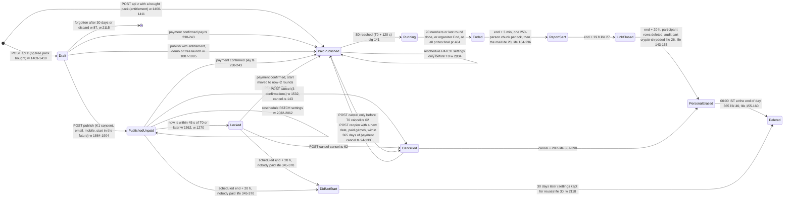
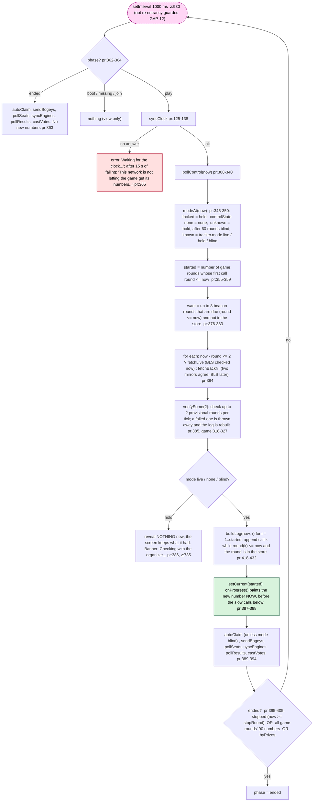
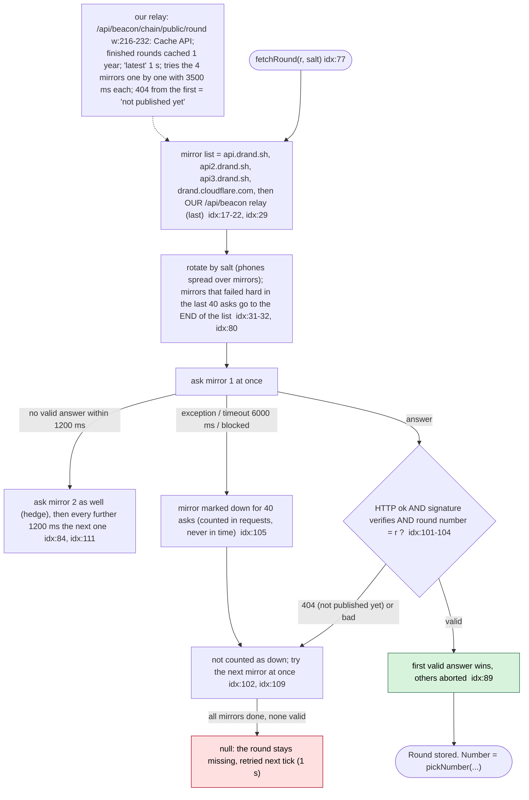
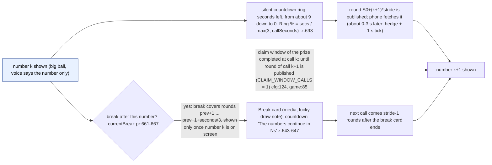
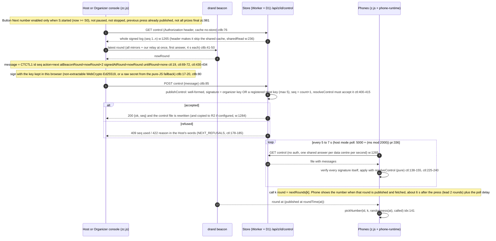
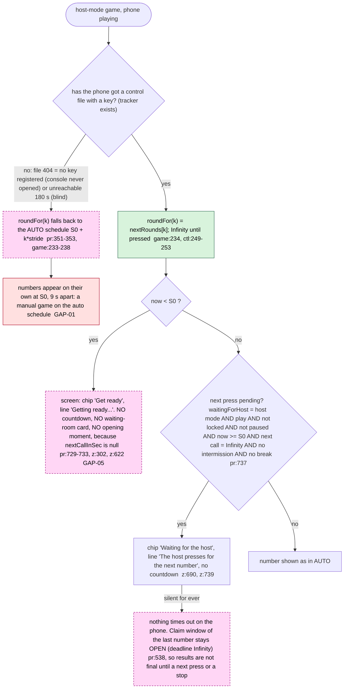
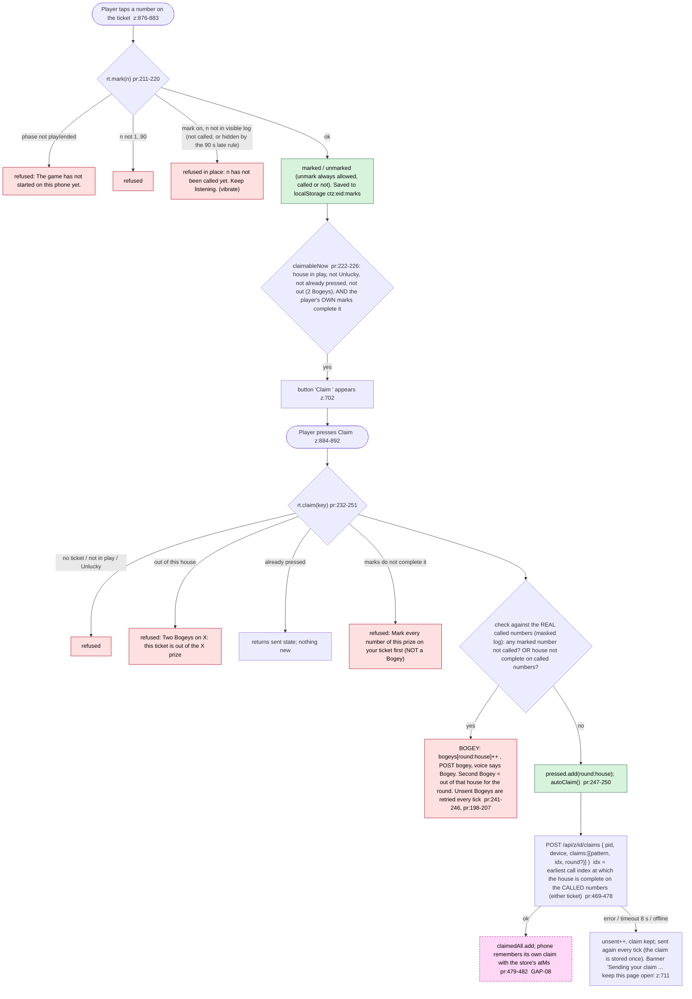
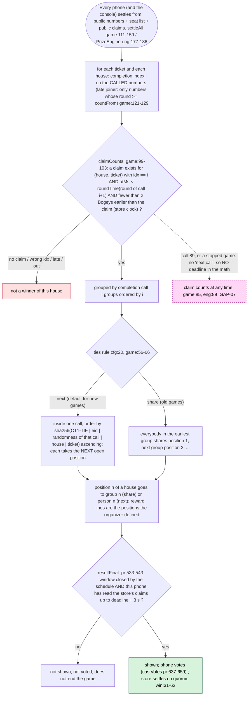
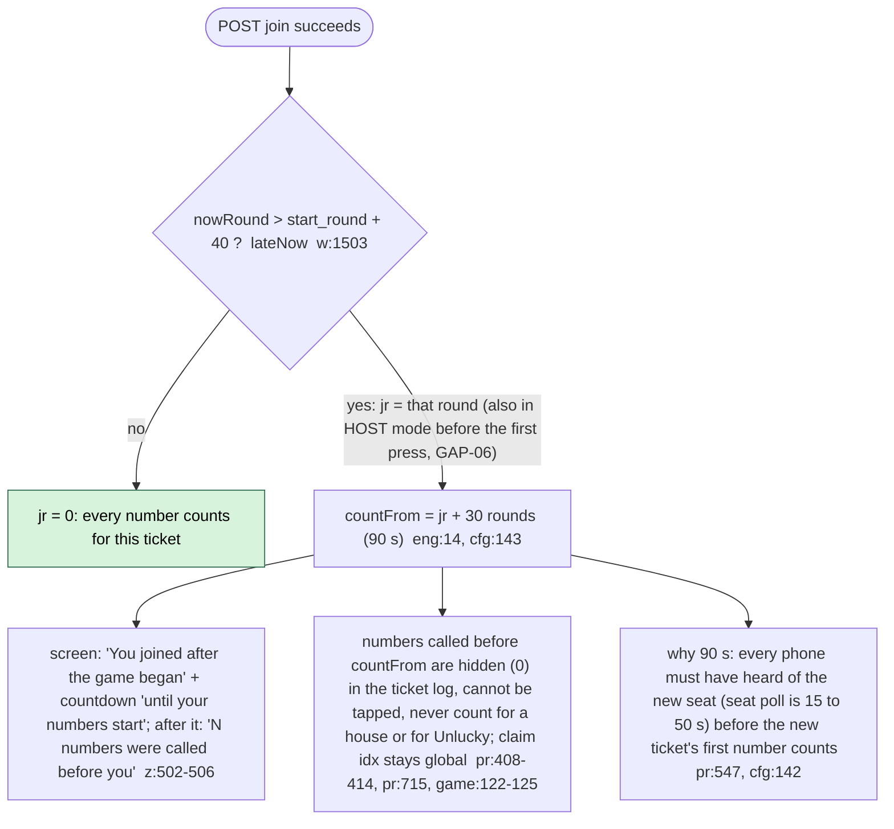

# Corporate Tambola: GAME-DAY LIFE CYCLE, from publish to the final report (as the code is, not as designed)

Source read: branch `wip/join-redesign`, HEAD `9105562`, 2026-10-26. `apps/edge/src/worker.ts` had an uncommitted edit in the join area (after line 1630) while this was written, so every `worker.ts` line number below is the working-tree number (+5 after line 1640, +9 after line 2090 compared with an unmodified checkout). `z.js` numbers are those of HEAD `9105562` (the join-redesign merge reflowed that file during this work; the numbers were re-mapped). Nothing in the source was edited. `apps/web/public/zgame.js` is the esbuild bundle of `packages/beacon` (file dated 26 Oct 21:58); it was NOT diffed against the sources, the sources are what is described here.

Files read: `packages/beacon/src/{index,game,control,control-browser,config,phone-runtime,prize-engine,prize-status,unique-ticket,zgame-browser}.ts`, `apps/edge/src/{lifecycle,winners,checkin,gamerecord,cancel,pay(244-248),people(me),worker}.ts`, `apps/web/public/{z,big,zc}.js`, `apps/cron/*`, `docs/{WINNERS_AND_AUDIT,ZERO_SERVER_DESIGN,AI_LINK_AND_PAUSE_DESIGN,RETENTION,SESSION_KNOWLEDGE_2026-10-23_to_26}.md`.

## 0. Conventions

- `file:line`. Short names: `cfg` = `packages/beacon/src/config.ts`, `game` = `game.ts`, `ctl` = `control.ts`, `ctlb` = `control-browser.ts`, `pr` = `phone-runtime.ts`, `eng` = `prize-engine.ts`, `idx` = `index.ts` (beacon), `w` = `apps/edge/src/worker.ts`, `life` = `lifecycle.ts`, `win` = `winners.ts`, `ck` = `checkin.ts`, `z` = `apps/web/public/z.js` (the phone page), `zc` = `apps/web/public/zc.js` (the organizer console), `big` = `big.js`.
- `?? UNCLEAR` = the code does not settle it from the files read; collected in section 9.
- `GAP-nn` = an entry of section 8 (Suspected gaps). A red dashed box in a chart points to one.
- "round" in a beacon sense = one 3-second drand round. A "round" of the game (1 to 5) is always written "game round".
- `stride` = `call_seconds / 3` beacon rounds between two numbers (2, 3, 4 or 5 for 6, 9, 12, 15 seconds; `w:248`). `S0 = start_round + GRACE_ROUNDS` = the beacon round of call 0 in AUTO mode. `T0` = the start time the organizer gave = `roundMs(start_round)` (`w:262`).
- A call is numbered `k = 0..89` (the "k-th number"); the screen says "number k+1".

---------------------------------------------------------------------------------------------------

## 1. TIMELINE STATE CHART: draft to deletion

### 1.1 The engagement record (what the store knows)



Notes for 1.1
- Draft = `pack = 0` and no `pub/<id>` key. Guests cannot `join` or `who` it, and `info` for a non-organizer answers 403 "This engagement is not open yet." (`w:1563`). A game created while a free pack exists (entitlement) is `pack > 0` at once and counts as published (`isPublished`, `w:271-274`), without the organizer pressing Publish.
- PublishedUnpaid is the "payment pending" state. Publish mails say "payment pending" (`w:1901`). Reminder mail once, when T0 is less than 36 h away and at least 2 h after publishing (`w:467-475`).
- Locked is not a stored state. It is computed on every request: `pack = 0` and published and `roundMs(start_round) - 45 s <= now` (`w:1562`, control file `w:1270-1271`, info `w:1817`). It ends only by payment, cancel or a reschedule that moves T0 more than 45 s into the future.
- Late payment: `start_round := nowRound + 2 + 40 - 40 = nowRound + 2`, so S0 = nowRound + 42 rounds = about 2 minutes after the confirmed payment (`pay.ts:84`, `pay.ts:244-248`). Only done when the old T0 had already passed.
- Reschedule = `PATCH /api/z/{id}/settings` with a new `startRound`. Paid game: refused once T0 has passed (409, `w:2034`). Unpaid game: allowed at any time (the check is `!unpaid && ...`), new time must be in the future (`w:2047`) and at most 30 days ahead (unpaid) or inside the paid window (`w:2048-2051`). Changing the time deletes `startpending/<id>` and, for an unpaid game, the `life` row (`w:2060-2061`).
- Cancel: refused for a paid game once T0 has passed ("use End the game", `cancel.ts:62`). Credit, no refunds (`cancel.ts:153-171`). Co-host rows erased at once (`cancel.ts:151`). Guests' data erased 20 h after the cancel (`life:387-390`).
- Reopen = the "reschedule" of a cancelled paid game (`cancel.ts:94`): only while the credit made by the cancel is unused and unexpired; deletes the `life` row; guests must join again (their data goes 20 h after the cancel).
- DidNotStart: an unpaid game's guest data is erased 20 h after its scheduled END (`endBoundMs`, `life:71`), the game is closed (`unplayed_ms`), mail "it did not start". 6 h before, a heads-up mail (`life:353-356`).
- End of the 365 days: `fullDeleteAt` = 00:00 IST after day 365 (`life:46`). `game_record` (settings, no personal data, counts only) is never deleted (`gamerecord.ts:1-6`, `life:165` only for TEST purge).

### 1.2 One normal game on the clock (AUTO, paid, 100 people, 9 s gap, no pause)

```mermaid
flowchart TD
  classDef t fill:#e8f1ff,stroke:#2a4d9b,color:#000
  classDef hold fill:#fff3cd,stroke:#b58900,color:#000
  classDef end1 fill:#d8f3dc,stroke:#2d6a4f,color:#000
  classDef gone fill:#ffe0e0,stroke:#b00020,color:#000

  A["T0 - 30 days at most: game can be set this far ahead (unpaid) - MAX_AHEAD_MS life:31"]:::t --> B["T0 - 36 h: one payment reminder if unpaid w:467-475"]:::t
  B --> C["T0 - 5 min: check-in opens (games made after 23 Oct 10:00 UTC) ck:13-14, ck:27"]:::t
  C --> D["T0 - 45 s: HOLD if unpaid. Control file says locked, phones show Waiting to start w:264, w:1270"]:::hold
  D --> E["T0: scheduled start. Phones show the setting-up screen with a countdown. Openings (brand moments) play inside the next 120 s z:620-625"]:::t
  E --> F["T0 + 120 s = S0: GRACE over (GRACE_ROUNDS = 40 rounds). Call 0 is the beacon round S0. Seat list becomes ready. Anyone joining from now on is LATE (jr > 0) cfg:141, w:1723, w:1503"]:::t
  F --> G["Numbers: call k at round S0 + k*stride (+ break shifts + pauses). 9 s gap = 3 rounds. 90 numbers = 267 s plus breaks idx:128-133, game:228-247"]:::t
  G --> H["Prizes: a house is final when its claim window closed AND the phone has read the claims to that moment. Quorum of phones votes, store settles win:31-62, pr:533-543"]:::t
  H --> I["Game ends: last number, or organizer End, or every prize final (plus breaks played). Phones say over after 0-45 s random z:359-369"]:::end1
  I --> J["End E = scheduled end (last call + 60 s) until 3 or fewer phones confirm earlier life:71-81, life:122-139"]:::end1
  J --> K["E + 3 min: report starts. 250 people per tick. When all are prepared the mail with the report link is sent life:28, life:33, life:184-236"]:::end1
  K --> L["E + 13 h: one reminder if the link was never opened life:408"]:::t
  L --> M["E + 19 h: report link stops working life:27, life:270"]:::gone
  M --> N["E + 20 h: names, numbers, seats, invites, claims, votes, check-in records deleted. Participant part of the audit log crypto-shredded. Winners record and prize hand-over rows stay life:26, life:143-153, life:409"]:::gone
  N --> O["E + 365 days, 00:00 IST: everything about the game deleted except game_record (settings, counts) life:46, life:155-176"]:::gone
```



Promise vs code: the public promise is "within 24 h"; `PURGE_AFTER_MS` is 20 h so that a tick up to 3 h late still keeps it (`life:26`). The tick is the Cloudflare cron Worker every minute if it is deployed (`apps/cron/wrangler.toml`), plus a "lazy tick" on any `/api` request when the last tick is older than 5 minutes (`w:500-512`, `w:668`). `?? UNCLEAR U1`: whether the cron Worker is deployed live (docs say it needs an owner token, `docs/dev/10-OPERATIONS.md:104`, `docs/RETENTION.md`); the code works with either clock.

### 1.3 What decides "the game has ended" (the clock the report and the 20 h run from)

| Source | Value of `life.end_ms` | Where |
|---|---|---|
| `schedule` (default) | AUTO: beacon time of call 89 of the last game round + 60 s, pauses, breaks, intermissions applied. Stopped: the stop round + 60 s. Host mode: max(auto estimate + 60 s, last press + 1 h; with no press yet, S0 + 1 h) | `life:71-81`, `life:393-397` |
| `phones` | `min(now, bound)` once `min(3, max(1, ceil(people/2)))` different participants have POSTed `/over`, not before call 20 of the AUTO schedule | `life:122-139` |
| `cancel` | the cancel time | `life:387-389` |
| (none) | A paid game with nobody in it gets a `life` row with `purged_ms` set once `now >= end` (`no-guests`) | `life:436-440` |

---------------------------------------------------------------------------------------------------

## 2. AUTO MODE: the draw from the public beacon

AUTO is the default (`callMode` absent, `cfg:118`, `cfg:192-196`). The server calls nothing: every phone derives the same 90 numbers from public drand randomness.

### 2.1 The schedule every phone and the store compute (a pure function)

```text
beacon round r is published at  GENESIS + (r-1)*3 s        GENESIS = 1692803367 (2023-08-23T15:09:27Z)      idx:15-16, idx:38
S0                = start_round + 40                        cfg:141, pr:144
unshifted(round 1, k)   = S0 + k*stride + breakShift(k)     breakShift(k) = sum of seconds/3 of every break with after <= k       cfg:183, game:228-231
unshifted(round g>1, k) = unshifted(g-1, 89) + stride + 30 + k*stride      (30 = INTERMISSION_ROUNDS = 90 s; no brand breaks after round 1)   cfg:145, game:230
callRound(k)      = unshifted(...) then, for every signed pause [start,end) in order:  if a >= start then a += end - start;   a >= stopRound -> null (never called)   game:233-238
number of call k  = remaining[ sha256("CT1|" + roundEid + "|" + k + "|" + randomness(callRound(k))) mod len(remaining) ]    idx:141-150
```

- A number can be known to nobody before its round is published (drand unchained BLS). Each phone checks the BLS signature (`idx:50-61`); mirrors are only postmen.
- Gap choices: 6, 9, 12, 15 s only (`w:248`, console and API alike); `scheduleFor` refuses anything that is not a multiple of 3 or below 6 (`idx:129`).
- Game rounds: 1 to 5 (`cfg:139`). Round g has its own ticket set and numbers (`roundEid`, `cfg:147`).
- Brand breaks: up to 3 per ticket held, 15 to 600 s in steps of 3, placed after N numbers (N = 1..89) or "auto" spread `round(90*k/(n+1))` (`cfg:160`, `cfg:232-263`). Opening moments sit inside the 120 s grace (15..120 s, total at most 120 s, `cfg:301-305`). Closing moments are shown on the final screen (`z:627-642`).

### 2.2 What a phone does every second (`z.js:930` calls `rt.tick()` then `paint()`)



### 2.3 How one beacon round is fetched (mirror order, hedging, relay)



`fetchBackfill` (rounds more than 2 behind `now`, `game:294-315`): asks up to 2 different mirrors one after the other for the same raw round; no per-round BLS now; if both give identical `signature` and `randomness`, the round is stored as provisional and checked by `verifySome` later; otherwise it falls back to `fetchLive` (full check, slow). A mirror that gave nothing is skipped for the next 100 catch-up asks (`BACKFILL_SKIP`, `game:271`). Catch-up speed: at most 8 missing rounds per tick (`pr:376`), so a phone that was asleep for 5 minutes needs about 4 ticks after it wakes. The voice speaks only when the log grows by exactly one (`z:865`), so a catch-up burst is silent.

### 2.4 The clock: no phone clock, and the skew rules

- The phone never reads the wall clock for game decisions (`pr:101-103`, test-enforced per `docs/ZERO_SERVER_DESIGN.md:55`). `syncClock` fetches `latest` (a BLS-checked round), makes the sample `roundTime(latest) + 1500 ms - mono()`, keeps the last 5 samples and uses the LARGEST (newest answer is the least stale, so the phone's clock never runs ahead of true UTC). If a new sample is more than 15 s below the best, the list restarts. Re-synced every 60 s (`pr:125-138`). `nowRound = roundAt(mono() + offset)`.
- Consequence: a round is never asked for before it exists; a stale `latest` can make the clock run up to about 1.5 s slow, never fast. The big screen uses the same rule (`big:21`).
- The organizer's console uses the same beacon for stamping control messages, but with a LAST-RESORT fallback to the device clock after 4 s (`ctlb:28`, `ctlb:41-50`). See GAP-04.
- The countdown shown is `roundTime(nextCallRound) - (mono + offset)` in whole seconds, floored at 0 (`pr:733`). While `mode` is hold, paused, in a break, in an intermission, or waiting for the host, no countdown is drawn (`z:687-693`).

### 2.5 What the screen does between two numbers



- Break arithmetic: a break with `after = N` starts at round `r(N-1) + 1` and lasts `seconds/3` rounds, and call N comes at `r(N-1) + stride + seconds/3`; so after the break card ends the normal countdown (`stride - 1` rounds) runs once (`game:228-231`, `game:260-268`).
- Lucky draw break: winners drawn on every phone from the randomness of round `luckyRound = r(after-1) + 1 + seconds/3` and the public seat list (flagged Organizer/Host/Co-host seats excluded); the phone first forces a fresh seat list (`wantSeats`) and waits until it is at least that new (`pr:612-628`, `game:212-220`).
- Intermission between game rounds: 30 rounds (90 s) plus one stride after the previous round's 90th call; shown as "Round N is over ... starts in Ns" (`z:273`, `game:249-257`).

### 2.6 Backfill of missed rounds (late joiner, reopened tab, phone asleep)

- Which rounds: all due rounds not in the store, 8 per tick, oldest first within each game round (`pr:376-383`).
- A late joiner's phone does NOT show the numbers called before it counted: `mask` = numbers whose beacon round is below `countFrom = jr + 30 rounds (90 s)` become 0 (`pr:408-414`, `eng:14`). The log is still built in full so every call index is global.
- If a provisional (backfilled) round later fails its BLS check, it is deleted, `discarded++`, every game round's log is cleared and rebuilt, and engines are reset (`pr:419-421`, `game:318-327`). The numbers on that phone can change (only possible with two colluding mirrors).

---------------------------------------------------------------------------------------------------

## 3. MANUAL MODE ("Host" mode): Next number, signed with the Ed25519 control key

`callMode: "host"` (set in step 2 of the console, `cfg:118`). Allowed up to 2,000 people (`PAUSE_MAX_PARTICIPANTS`, `ctl:302`, `w:107`, `w:1395`, `w:2045`). Nothing about the schedule `S0 + k*stride` applies: call k of the whole game uses the beacon round of the k-th accepted press (`hostCallRound`, `ctl:249-253`; `callRoundR` routes there first, `game:234`).

### 3.1 The press, end to end



Acceptance rules for `next` (`ctl:188-204`, all in the pure function used by phones AND store): not stopped; `callMode` is host; lead is exactly 2 rounds and no `untilRound`; not inside a pause; fewer than `90 * rounds` presses (`maxNexts`, `ctl:366`); `atBeaconRound` strictly greater than the previous press; if a break or an intermission is due before press number k, `atBeaconRound >= previous + 1 + gap rounds` (`hostGapsFor`, `ctl:55-59`: every brand break and 30 rounds before each later game round). Phrases shown to the Host: auto / lead / paused / order / gap / done (`ctl:178-185`). Two Hosts pressing at the same moment: second gets 409 "Next sequence number is N" and the console says "A press went through just before this one" (`zc:1000`).

Keys: the organizer's key is registered once when the console opens the game (`TBControl.ensureKey`, `ctlb:58-71`, `zc:1608`, `zc:1413`); the store keeps ONE organizer key, never replaceable (`ctl:389`), and up to 5 more Host keys added from other browsers (`ctl:372-383`, `w:1296-1300`). A game larger than 2,000 people gets no key at all (409, `w:1294-1295`).

### 3.2 What phones do while the Host is silent



- The press lead: the Host's number is released 2 rounds (6 s) after the beacon round the Host saw, so the Host never sees the number beforehand (`ctl:19`). The console says phones show it "within about 15 seconds" (`zc:986`): 3 to 6 s to the lead round + up to 1 s cache + up to 7 s poll.
- The shared 1-second control cache: `sharedRead(req, 1, ...)` stores one answer per Cloudflare data centre per second (Cache API) for an unauthenticated GET; any request with `x-organizer` or `authorization` bypasses it (`w:234-242`, `w:1265`). The response itself says `cache-control: public, max-age=3` (`w:1276`). `?? UNCLEAR U3`: the 3 s header can let a browser reuse a response for up to 3 s (poll interval is at least 5 s so this does not matter in host mode, it adds up to 3 s to a pause notice in AUTO).
- Claim window in host mode: it closes when the NEXT press's round is published (`pr:538-541`, `eng:89`); until the next press exists the window is open. The Host therefore decides how long players have (at least about 6 s, because a press is signed 2 rounds ahead).
- The game ends by prizes only after the last prize's window closes. In host mode that needs one more press or a stop. After a stop the window is taken as `max(9, callSeconds)` s after the last call (`pr:540`).
- Break and intermission in host mode: the phone shows the break card for `seconds` from the round after the press that precedes it; the next press is refused until the break is over (`ctl:201-202`).
- Late joiners are flagged by the AUTO start time even in host mode (GAP-06).
- The report/erasure clock estimates the end as `max(auto schedule end + 60 s, last press + 1 h)`, and S0 stands in for "last press" before the first press (`life:71-81`). A Host who is silent for more than 1 hour (after the last press, or after S0 if nothing was pressed) lets the "game ended" clock run (GAP-11).

---------------------------------------------------------------------------------------------------

## 4. PAUSE / RESUME / STOP (and Add 30 minutes)

Pause is a signed control message, same key, same log, same pure function as Next number.

### 4.1 Message flow and the notice delay

```mermaid
sequenceDiagram
  autonumber
  participant O as Organizer console (zc.js, Game day step 9)
  participant W as Store
  participant P as Phone
  O->>O: Pause pressed: TBControl.publish(pause, pauseForRounds 600)  zc:1916
  O->>W: GET control (no-store) then POST message. at = nowRound + leadRounds, until = at + 600 rounds (30 min)  ctl:430-434
  W->>W: publishControl: lead >= leadRounds, not already paused, until <= 24 h  ctl:205-209
  loop poll 9 to 12 s (standard) , 27 to 36 s (cap 251..1000) , 54 to 72 s (cap 1001..2000)  pr:334-335
    P->>W: GET control
  end
  Note over P: pause start round arrives (39 s / 87 s / 159 s after the press). Any call whose scheduled round is >= start moves later by (end - start)  game:236
  O->>W: Resume: at = nowRound + leadRounds (inRounds default), only inside a pause, after its start  ctl:210-213, ctl:431
  Note over P: pause ends at the resume round. Calls restart; the first shifted call lands at the resume round itself
  O->>W: Stop: lead >= leadRounds; stopRound = at; later messages ignored  ctl:220-221
  Note over P: from stopRound: no more calls (null), phase = ended, banner 'The organizer has ended this game.'  pr:395, z:733
```

Lead and notice, from `deriveSafety` (`ctl:283-289`) and `safetyForCap` (`ctl:304-309`, chosen when the key is registered, `w:1294`). The console always asks for the standard profile (`zc:1608` passes no profile; `fast` exists only in the API).

| Game size (cap) | Profile | Phone poll | Hold after (no good answer) | Pause / Resume / Stop notice (`leadRounds`) | Blind after failing for |
|---|---|---|---|---|---|
| 1 to 250 | STANDARD | 9 + 0..3 s = 9 to 12 s | 10 rounds = 30 s | 13 rounds = 39 s (console says "about 40 seconds", `zc:989`) | 60 rounds = 180 s |
| 1 to 250 (API `profile: fast`) | FAST | 6 to 9 s | 7 rounds = 21 s | 10 rounds = 30 s | 60 rounds = 180 s |
| 251 to 1,000 | LEAN30 | 27 to 36 s | 26 rounds = 78 s | 29 rounds = 87 s (console 85 s) | 156 rounds = 468 s |
| 1,001 to 2,000 | LEAN60 | 54 to 72 s | 50 rounds = 150 s | 53 rounds = 159 s (console 160 s) | 300 rounds = 900 s |
| above 2,000 | none | no key can be registered: no Pause, End, Host mode (409) | | | |
| host mode, any size | (profile as above) | 5 to 7 s (overrides the poll) `pr:336` | as profile | as profile | as profile |

Rules enforced by the pure function (`ctl:188-223`): pause needs `lead >= leadRounds`, refuses "already paused", `until` must be after `at` and at most 28,800 rounds (24 h) later (`ctl:61`). An open-ended pause cannot exist from the console (it always sends 600 rounds); the registered `maxPauseRounds` is 600 (`ctl:386`), so the pause ends by itself after 30 minutes. Extend ("Add 30 more minutes", only shown while paused) moves `until` +600 rounds (`zc:1916`, `ctl:214-219`). Resume: not paused -> "not paused"; must be after the pause start. Stop: final.

### 4.2 What a phone shows

| Situation | Phone shows | Where |
|---|---|---|
| Pause signed, not yet effective | nothing different (numbers continue until the pause round); the console shows "Pause on its way to the phones..." | `zc:1016` |
| Inside a pause (`pausedAt`) | banner "Paused by the organizer. It will carry on shortly."; chip "Paused"; countdown hidden; claim windows stay open (the next call's round is pushed) | `pr:741`, `z:734`, `z:689-693` |
| Phone has not heard from the control file for more than `holdAfter` | mode hold: nothing new is revealed; banner "Checking with the organizer... numbers will continue in a moment." | `ctl:344-348`, `z:735` |
| Control endpoint failing for `giveUp` in a row | mode blind: reveal continues on the schedule it knows; banner "Cannot reach the organizer's controls right now. Play continues; a pause may appear late."; autoClaim stops | `z:736`, `pr:389` |
| Stop reached | phase ended, banner "The organizer has ended this game." (no prize banner), report says "The organizer ended the game after N numbers." | `z:733`, `life:315-316` |
| Game locked (unpaid at T0 - 45 s) | banner "Payment pending..." (Organizer/Host role) or "Waiting for the Organizer or Host to start the game." (everyone else) | `z:732` |

The safety argument (a phone only reveals while its last good answer is at most `holdAfter` old, and a pause takes effect `lead` after signing, `lead*3 > holdAfter*3 + cache + margin`) is in `ctl:277-288` and `docs/AI_LINK_AND_PAUSE_DESIGN.md` B.4. Pause is "not instant": up to 13 rounds of numbers can still be called after the press.

---------------------------------------------------------------------------------------------------

## 5. CLAIM: tap, Claim, window, Bogeys, ties, prize order, ending, late joiners, check-in, offline

Rule (config comments, `cfg:119-126`): the ticket never marks itself. A prize is won ONLY by a Claim that stands up against the public numbers and arrives before the next number is called.

### 5.1 Phone side



Store side (`w:1790-1808`, `w:1742-1756`):
- `claims`: participant must exist, not blocked (403 removed). For games made after 23 Oct 10:00 UTC the ticket must be checked in (403 `not-present`) and the request must carry the ticket's device id (`other-phone`). At most 7 claims per request; `idx` 0..89; `round` within the game's rounds; one stored row per (game, ticket, house, game round): `INSERT OR IGNORE` with `at_ms = the store's clock` (PK `eid,pid,pattern,round`, `w:125`).
- The store does NOT check whether the claim is correct. It cannot (a free Worker has about 10 ms CPU); every phone does (`docs/ZERO_SERVER_DESIGN.md:66`).
- `bogey`: same participant/check-in/device rules; at most 2 stored per ticket and house and round (`w:1752`).
- Cost guard: each claim/bogey is charged one write against the daily budget; refused politely (503) when the budget is gone (`w:377-384`).

### 5.2 The claim window and who wins



- Window: `CLAIM_WINDOW_CALLS = 1` (`cfg:124`). The deadline is the PUBLICATION time of the beacon round of the next call (`claimInTime`, `game:85`), taken from the same schedule every phone uses (pauses, breaks, host presses included). So the real time a player has is: from the moment their phone shows the number to publication of the next round, minus network time of the claim POST. At 9 s that is at most 9 s and in practice 6 to 8 s.
- Bogeys: a Bogey is stored with the store's clock. A claim counts only if fewer than `BOGEYS_OUT = 2` Bogeys on that house were stored BEFORE the claim's `atMs` (`game:83`, `game:102`). The phone also refuses to show/send a Claim for a house after its second Bogey (`pr:191`, `pr:236`).
- Prize order: houses are independent. Within a house the reward lines are positions 1st, 2nd, ... (`linesFor`); position n+1 only exists after position n (validated, `cfg:226`); a ticket wins at most one position of a house (`eng:154`, `donePid`). "Unlucky" is not claimed: the ticket with the fewest marks when the first Full House is completed, or when every other prize is awarded, or at the last number / stop; ties by hash of that call's randomness (`game:164-179`, `eng:188-217`). Full Two-Ticket House needs both tickets (`game:38-48`).
- Limits: max 100 winners per house (`cfg:19`), 300 reward lines in a game (`cfg:162`).
- The last prize ends the game: `byPrizes = cur >= rounds AND every reward line of the round has a FINAL result (Unlucky ignored when others exist) AND every brand break has been played` (`pr:396`, `pr:490-499`). The log is then cut at `max(result idx) + 2` numbers (the completion call plus the call that closed its window), identically on all phones, the big screen and the report (`pr:397-403`, `big:51-52`, `life:309-313`). Earlier game rounds always run all 90.
- Winners are never chosen by a person: `POST settle` answers 403 (`w:1956`); `POST won` is accepted and ignored (`life:117-119`); `vote` needs a quorum of different phones (`win:31-62`, `cfg:136`): 1 to 6 people = ceil(half); 7 or more = 5% clamped to 3..25. Only `votersFor(people)` phones speak first (everyone up to 12 people, else 4 x quorum), the rest join in waves every 30 s (up to 12 waves), `pr:637-659`, `cfg:138`.
- After a position is settled the store writes the winners record (seat, round, house, position, call index, time) and one prize hand-over row per winning seat (`win:55-59`, `life:94-114`). The winner confirms name and mobile on their own phone (device-proof, `win:77-99`); the organizer ticks "Prize given" (`win:130-136`).

### 5.3 Late joiners (the 90 s rule), check-in, offline



- Check-in (games created at or after 23 Oct 2026 10:00 UTC, `ck:13`): opens 5 min before T0 and stays open (`ck:14`, `ck:27`). Until the person is "present" the phone shows the check-in screen instead of the ticket (`z:850-854`), the game loop runs underneath, and `claims` and `bogey` are refused (403). Present = confirm name (if any) and mobile (if any) with two ticks and type the 4-digit code shown on THEIR OWN page (a keyed permutation of 0000..9999 over the seat number, `ck:34-48`); 5 wrong codes lock that seat for 10 minutes (`ck:15-16`, `ck:91-100`); the device proof (hash of the phone's own random id kept with the seat) must match (`ck:73-75`). Only the winners' check-in TIME is kept 365 days (`ck:122-127`, `life:103`).
- Offline phone: marks, pressed houses, Bogey counts and sent-claim flags live in `localStorage` (`ctz:<eid>:marks`, `ctz:<eid>:claimed`, `pr:176-188`, `pr:480`). While offline the loop does nothing new (no clock, `pr:365`). On return it catches up 8 rounds per tick, and every pressed-but-unsent claim is sent at once; the store stamps it with the ARRIVAL time, so a claim sent after the next round was published is late and does not count (the page then says "claimed, but another ticket was ahead or the claim came after the next number", `z:713`). Joining and check-in need the network; nothing is cached for them.
- A removed person (organizer removed the seat): their seat stays in the public list (cannot win Unlucky), the phone finds out through `GET me` every 90 to 120 s (`z:194`, `people.ts:572-577`) and then shows "You have been removed from this game" (`z:190`); until then claims get 403 `removed` and are retried every tick (`pr:483`).

---------------------------------------------------------------------------------------------------

## 6. EVERY STATE A PHONE CAN SHOW (exact condition, file:line)

`paint()` (`z:840-872`) tests in this order; the first match wins. `rt.view().phase` is one of boot, missing, join, play, ended (`pr:27`). The runtime also exposes `mode` live / hold / blind / none (`pr:345-350`).

| # | State (what the person sees) | Exact condition | Where |
|---|---|---|---|
| P1 | "This game did not start. Your details have been erased." (calm screen) | `INFO.dns`: set from an `info` or `join` answer with `didNotStart:true` (game closed after the 20 h) | `z:44`, `z:189`, `z:845`; server `w:1522-1525` |
| P2 | "Loading..." / "No connection right now. Your ticket is safe on this phone. This page tries again by itself..." + Try again | `phase = boot`: the first `GET info` failed with no HTTP status or a 5xx ("The game could not be opened just now..." / "Could not reach the engagement. Check your connection."). Retry by itself after 8 s and on the browser `online` event | `pr:141-149`, `z:846`, `z:51` |
| P3 | Same box with the server's words ("This engagement link is not valid." for 404; "This engagement is not open yet." for a draft, 403; 410 text) + Try again, NO automatic retry | `phase = missing`: `info` answered 404, 403 or 410 | `pr:146-148`, `z:846` (GAP-13) |
| P4 | "This game was cancelled" | `INFO.cancelled`: set only from an `info` or `join` answer (`cancelled:true`), never from the control file | `z:48`, `z:188`, `z:847` (GAP-02) |
| P5 | Join form "Join the engagement" (steps, K4 boxes, mobile / employee ID boxes marked mandatory / optional, name) | `phase = join`: no stored `ctz:<eid>:pid` on this device | `pr:155`, `z:848`, `z:167-186` |
| P6 | Join form variants: "You are not on this game's list" (removed) / "This link is not active any more" / "Many people are joining right now" (busy, up to 15 automatic retries, 4 to 30 s apart) / "Please wait a moment" (waiting room, polls `me?wid` every 5 s) / "Your request was not accepted" or "This request has run out" / banner "This link was already opened on another phone" (needPhone) | `J.mode` = removed / gone / busy / waiting / declined or lapsed / needPhone, set from the refusal code of `join` | `z:168-178`, `z:230-247`, `z:165`, `z:244`, `z:216-228` |
| P7 | "You have been removed from this game" | `ME.removed`: `me?pid` says removed, or 404 "not a participant" | `z:193-204`, `z:190`, `z:849` |
| P8 | Check-in: "We could not open your check-in" / "Loading your check-in..." / "Check-in opens at HH:MM" with "Opens in" countdown / "Mark yourself present" form | `INFO.checkin AND pid AND NOT CK.present`; fatal when `GET checkin` 403 (other phone, not a participant); not open when `now < T0 - 5 min` (asked every 5 s, 60 s once open) | `z:850-854`, `z:766-806`, `ck:62-85` |
| P9 | Ticket page, banner "Payment pending for this game. The game starts 2 minutes after the payment is confirmed. Open your console to pay..." (Organizer/Host) or "Waiting for the Organizer or Host to start the game. Your ticket is safe..." (everyone else); chip "Waiting to start" | `view.locked`: control or info says `locked` (unpaid, published, T0 - 45 s reached); `mode` forced to hold; no numbers revealed | `z:732`, `z:690`, `pr:310`, `pr:346`, `w:1270`, `w:1562` |
| P10 | "Your game is setting up. We are waiting 2 minutes more for everyone to join." + clock to the first number + what you can win + how it works + sound check + calendar | play, not locked, not late, no numbers yet, `0 < nextCallInSec <= 120`, round 1 | `z:301-310` |
| P11 | "You are in. See you at <date time>" + hh:mm:ss clock (to T0) + the same help | same, but `nextCallInSec > 120` | `z:310` |
| P12 | Opening moment card "A message from your organizer" (title, link / video / slides / speech text; clock-aware seek of the media) | opening list non-empty, play, not locked/stopped/paused/late/break, no numbers yet, `nextCallInSec <= 120`; each opening 15..120 s, in order | `z:620-625`, `z:635-638`, `z:491-498` |
| P13 | "Get ready" chip + "Getting ready..." (no countdown) | no numbers yet and `nextCallInSec = null`: HOST mode before the first press, or clock not synced | `pr:729-733`, `z:690`, `z:739` (GAP-05) |
| P14 | "You joined after the game began ... until your numbers start" + countdown; later "N numbers were called before you" | `view.late`: `jr > 0`; `secondsUntil = roundTime(countFrom) - now` | `pr:716-723`, `z:502-506` |
| P15 | Banner "The organizer has ended this game." | `view.stopped`: control state `stopRound` reached | `pr:741`, `z:733` |
| P16 | Banner "Paused by the organizer. It will carry on shortly." + chip "Paused" | `view.paused`: now inside a signed pause interval | `pr:737`, `z:734` |
| P17 | Banner "Checking with the organizer... numbers will continue in a moment." | `mode = hold`: no good control answer for more than `holdAfter` rounds, or control state unknown | `z:735`, `pr:345-350`, `ctl:344-348` |
| P18 | Banner "Cannot reach the organizer's controls right now. Play continues; a pause may appear late." | `mode = blind` | `z:736`, `ctl:347` |
| P19 | Banner with `error` text ("Waiting for the clock. Check your connection." / "This network is not letting the game get its numbers. If you are on office Wi-Fi, switch to mobile data...") | `syncClock` failed; second text after 15 s | `pr:365`, `z:731` |
| P20 | Break card "A short break" with title, media (YouTube, video, audio inline; slides / speech as text) and "The numbers continue in Ns"; lucky-draw note | `view.brk`: round 1 only; `nowRound` in `[r(after-1)+1, +seconds/3)` AND the number the break follows is already on screen | `pr:661-667`, `z:643-647`, `game:260-268` |
| P21 | "Round N is over / Round N+1 of R starts in Ns" and "Earlier rounds" list | `view.intermission`: now between the previous game round's last call and this round's first call | `z:271-277`, `game:249-257` |
| P22 | Call card: big ball, chip, count "N of 90 called" ("since you joined" if late), 9..0 countdown ring, voice. Chips: "Next number in Ns" / "Numbers coming" / "Get ready" / "Waiting for the host" / "Paused" / "Waiting to start" / "Game over" | tone and chip logic; countdown only when running, not waiting for host, mode not hold | `z:687-697` |
| P23 | "Waiting for the host" chip + "The host presses for the next number" | `view.waitingForHost` (see section 3.2) | `pr:737`, `z:739` |
| P24 | Ticket(s) with tappable numbers; refusal note "N has not been called yet. Keep listening." | tap on an uncalled number | `z:252`, `z:876-882`, `pr:216` |
| P25 | Claim bar: button "Claim <house>" + rule line; "Sending your claim for X. Keep this page open ... until it says sent"; "Claim sent for X. The software is checking it..."; "X: claimed, but another ticket was ahead or the claim came after the next number"; "Bogeys: X 1"; banner "Two Bogeys on X: this ticket is out of the X prize" | `claimable`, `pressed - claimed` (sending), `claimed` (checking), result list full (lost), `bogeys`, `outOf` | `z:699-715` |
| P26 | Prize rows in "Still to win": "Complete: press Claim" / "Claimed, being checked" / "N to go" / "not possible on your ticket" / "after the 1st" / "Awarded (to N)" / "Yours (shared by N)" / "out (two Bogeys)" / (Unlucky) "decided at the first Full House", "Awarded", "Yours" | per reward line | `z:649-668` |
| P27 | "Prizes still to win - N" list, claimed ones crossed out with "claimed" and "You" | `prizeStatus` over final results | `z:717-726`, `prize-status.ts:9-21` |
| P28 | Win ribbon "Congratulations! You won ..." + ticket cells lit + "Hurray!" dialog with confetti, vibration, voice (15 s) | this player pressed Claim for it AND it is in the final results naming this ticket | `z:743`, `z:345-357`, `pr:700-713` |
| P29 | Lucky draw / scratch card rows: "at the end of the break" -> "You won!" / "Not this time"; scratch opens by itself after 45 s | lucky results (computed locally, or fetched from the store) | `z:280-294` |
| P30 | Announcement banner "Message from the organizer ... OK" (also spoken, vibrates) | control file carries `ann` (only if a control key exists), id not yet dismissed | `z:671-675`, `z:869`, `pr:324`, `w:1272-1275` (GAP-17) |
| P31 | Final screen: "Game complete" (medal, "You won N prizes!" or "Well played!"), Share, WhatsApp; banners "Every prize has been won, so the game ends here after N numbers..." or "All 90 numbers have been called." / "All R rounds are finished." | `phase = ended` | `z:424-435`, `z:737-738` |
| P32 | Closing moment card "Thank you from your organizer" with "Next message (n of m)" | `phase = ended` and closing list non-empty | `z:627-642` |
| P33 | "Confirm where your prize goes" waiting text; form "Confirm your prize details"; "Details confirmed" | `phase = ended` and this phone has won; after the store has the winner row (asked every 15 s) | `z:373-404` |
| P34 | "Your prizes" list saved on the phone | any prize ever won (kept in `ctz-prizes:<eid>`) | `z:319-333`, `z:405-409` |
| P35 | "Invite your colleagues / family members" and "My invites" cards | organizer switched invites on; guest level 1 | `z:528-613` |
| P36 | Demo video variants (DEMO / "VIDEO" tags, Run Demo) | `window.__CT_DEMO` page (demo.html) only | `z:7`, `z:414-417`, `z:425` |

Big screen (`big.js`, no sign-in, polls every 3 s, control every 3 s): loading / "This game is not published yet" / "did not start" (`big:53`) / "cancelled" (`big:54`; the big screen reads `cancelled` and `didNotStart` from the control answer, the phone does not: GAP-02) / "Waiting for the Organizer or Host" (locked, `big:55`) / countdown "The game starts in hh:mm:ss" (> 120 s) or "setting up" mm:ss (`big:67`) / "Waiting for the host" / "Get ready" / running with number, countdown and prize list / "Paused" / "Game over" (`big:74`) / "Connection lost" bar after 15 s without a clock (`big:59-60`).

---------------------------------------------------------------------------------------------------

## 7. TIMING BUDGET (every timeout, interval and limit)

### 7.1 Clock, beacon, phone loop

| What | Value | Where |
|---|---|---|
| Beacon period / genesis | 3 s; 2023-08-23T15:09:27Z | `idx:15-16`, `ctl:11` |
| Setup window before the first number | `GRACE_ROUNDS = 40` rounds = 120 s | `cfg:141` |
| Late-joiner lag | `LATE_LAG_ROUNDS = 30` = 90 s | `cfg:143` |
| Intermission between game rounds | `INTERMISSION_ROUNDS = 30` = 90 s (+1 stride) | `cfg:145`, `game:230` |
| Call gap | 6 / 9 / 12 / 15 s (stride 2 / 3 / 4 / 5 rounds) | `w:248`, `idx:129` |
| Brand break length | 15..600 s, multiple of 3 | `cfg:240` |
| Opening length | 15..120 s each, total <= 120 s | `cfg:301-305` |
| Game rounds / numbers | 1..5 rounds; 90 numbers each | `cfg:139`, `idx:125` |
| Phone loop | every 1000 ms (re-entrant, not serialised) | `z:930` |
| Clock re-sync | every 60 s; keep last 5 samples, use the largest; restart list if a sample is > 15 s below the best | `pr:127-138` |
| Clock fail banner | after 15 s of failure | `pr:365` |
| Mirror hedge | next mirror after 1200 ms | `idx:84` |
| Per-mirror timeout | 6000 ms | `idx:94` |
| Mirror "down" memory | 40 asks | `idx:31` |
| Backfill skip memory | 100 asks | `game:271` |
| Rounds fetched per tick | 8 | `pr:376` |
| BLS checks per tick | 2 (about 63 ms each) | `pr:385`, `docs/ZERO_SERVER_DESIGN.md:62` |
| Relay mirror timeout / cache | 3500 ms per mirror; finished round cached 1 year, `latest` 1 s | `w:223`, `w:226` |
| Phone request limits | claim and bogey POST 8 s; other POST 20 s; GET info and checkin 20 s; control, seats, results GET: none | `z:14` |
| Screen wake lock | from 180 s before the first number (120 s setup + 60 s) to the end | `z:843` |

### 7.2 Control (pause, stop, Next number)

| What | Value | Where |
|---|---|---|
| Next-number lead | exactly 2 rounds (6 s) | `ctl:19`, `ctl:196` |
| Pause / extend / stop lead | `leadRounds` of the profile: 13 / 10 / 29 / 53 rounds = 39 / 30 / 87 / 159 s | `ctl:291-301`, `ctl:283-289` |
| Resume lead | `leadRounds` by default (`inRounds ?? f.leadRounds`), minimum 1 | `ctl:431` |
| Console pause length / extend | 600 rounds = 30 min / +600 | `zc:1916`, `ctl:386` |
| Longest timed pause | 28,800 rounds = 24 h | `ctl:61` |
| Poll, control file | standard 9 + (0..2.999) s; fast 6 + ...; LEAN30 27 + (0..8.999) s; LEAN60 54 + (0..17.999) s; host mode 5 + (0..1.999) s | `pr:334-336` |
| Poll, game has no key (404) | after T0 + 20 rounds: 60 s + (0..2.999) s; before: 60 s, or 9 s when unpaid-gated and T0 is less than 40 rounds (120 s) away | `pr:310-317` |
| Shared read | 1 s per data centre; header `max-age=3` | `w:1265`, `w:240`, `w:1276` |
| Hold after / blind after | per profile: 30 s / 180 s (standard) up to 150 s / 900 s (LEAN60); unknown state blind after 60 rounds = 180 s | `ctl:283-301`, `pr:348` |
| Console beacon address timeout | 4000 ms each, then device clock | `ctlb:28`, `ctlb:49` |
| Console control press timeout | Pause / Resume / Stop buttons freed after 30 s | `zc:1916` |
| Announcement | at most 160 characters, one per 5 s; reaches phones with the control poll | `w:1821-1835` |
| Host keys | organizer + 5 | `ctl:21` |

### 7.3 Claims, winners, end

| What | Value | Where |
|---|---|---|
| Claim window | `CLAIM_WINDOW_CALLS = 1` call (until the next call's round is published) | `cfg:124`, `game:85` |
| Last-call window (finalisation only) | `max(9, callSeconds)` s after the last call's round | `pr:540-541` |
| Bogeys that put a ticket out | 2 per house per game round | `game:83` |
| Claims per request / page | 7 per POST; 500 per seat-list answer | `w:1792`, `w:100` |
| Seat list ready | only from S0 (`start_round + 40`) | `w:1723` |
| Seat poll | first 5 s + (0..2 s) until fetched; then 15 s (cap <= 250), 25 s (<= 1000), 40 s (<= 2500), 50 s; at most 6 s while this phone has an unanswered claim or result | `pr:547`, `pr:551` |
| Claims-fresh margin | the store's claims are treated as complete up to `askTime - 3 s` | `pr:560` |
| Results poll | 10 s (local engine OK, only for lucky draws), 4 s (waiting for own claim, no local), 15 s otherwise | `pr:603` |
| Vote cadence | at least 4 s apart; 3 results per POST; extra voters join every 30 s up to 12 waves | `pr:639`, `pr:651`, `pr:654` |
| Quorum | 1..6 people: ceil(n/2); more: 5%, min 3, max 25 | `cfg:136` |
| Voters first | everyone up to 12 people, then 4 x quorum | `cfg:138` |
| Engine slice | 25 ms of ticket-building per tick | `pr:582` |
| Over report | each phone, once, after 0..45 s random | `z:366` |
| Over accepted | min(3, max(1, ceil(people/2))) different participants, not before call 20 | `life:127`, `life:133` |
| Check-in opens / tries / lock | 5 min before T0 / 5 wrong codes / 10 min | `ck:14-16` |
| Unpaid hold | from T0 - 45 s | `w:264` |
| Pay after hold | S0 = payment + about 2 min | `pay.ts:84`, `pay.ts:246` |
| Poll me (removed?) | 90 s + (0..29.999 s) | `z:194` |
| Poll check-in | 5 s until open, then 60 s | `z:767` |
| Poll waiting room | 5 s | `z:227` |
| Poll invites / my invites | 45 s / 60 s | `z:523`, `z:560` |
| Poll prize details after the end | 15 s | `z:374` |
| Join "busy" retries | up to 15, wait (4 + min(26, 2n)) s x (0.7..1.3) | `z:165`, `z:244` |

### 7.4 After the game

| What | Value | Where |
|---|---|---|
| Report starts | end + 3 min | `life:28`, `life:398` |
| People per report step / per PDF | 250 / 1500 | `life:33-34` |
| Report ticks | one `reportStep` per game per tick; cron every minute (if deployed), lazy tick at most every 5 min | `life:403-407`, `apps/cron/wrangler.toml`, `w:500` |
| Report link open | end + 19 h; reminder at end + 13 h if never opened | `life:27`, `life:408` |
| Personal data deleted | end + 20 h (promise 24 h) | `life:26` |
| Unplayed game: heads-up / erase | 6 h before / scheduled end + 20 h | `life:29`, `life:348-357` |
| Settings kept of an unplayed game | 30 days | `life:30` |
| Draft forgotten | 30 days | `w:87` |
| Everything deleted | 00:00 IST at the end of day 365 | `life:46` |
| Lifecycle tick work | at most 25 games per call, round-robin cursor | `life:378-382` |
| Game set at most ahead | 30 days (unpaid) or the paid window (365 d from payment) | `life:31`, `w:2048` |
| Winner check-in time kept | 365 days with the winners record | `ck:122-127` |

---------------------------------------------------------------------------------------------------

## 8. SUSPECTED GAPS (each one: place, one-sentence repro)

Ordered roughly by how bad the outcome is. "Phone stuck" = the person cannot get on; "disagree" = two phones show different things; "winner" = a wrong winner or a chosen number; "manual on auto" = the Host's game running on the software schedule.

### Manual on auto / numbers

- **GAP-01 (manual on auto; disagree)** `pr:351-353`, `game:233-238`, `pr:310-317`, `pr:345-350`, `pr:419`. A host-mode game whose control file is missing (nobody opened the console, so no key was registered, e.g. a game made through the AI link or the Help Desk) or unreachable for 180 s makes `this.tracker = null`, `roundFor` returns the AUTO schedule, and phones reveal numbers 9 s apart from S0 without any Host press. Repro: create `callMode:"host"` through `POST /api/z`, publish, never open the console; at T0 + 2 min the phones start calling numbers by themselves. Worse, when a key is registered later, `buildLog` does not reset for `next` messages (`pr:419` counts only non-`next` messages), so phones that already revealed numbers keep them while phones that load afterwards derive number 1 from the first press: two phones disagree on call 0. (The WebKit fix in release 0.9.0 only covers the browser that cannot sign.)
- **GAP-04 (winner; chosen number)** `ctl:188-204`, `w:1278-1285`, `ctlb:41-50`. The only check on a `next` press is that `atBeaconRound = signedAtRound + 2` and that it is above the previous press; neither the store nor a phone compares `signedAtRound` with the real current round. A key holder (Organizer or any Host) can sign `next` with an old round whose randomness is already public and pick the round that yields the number they want, pressing the next one at a later old round, and so script all 90 numbers; phones show them at once because the rounds are already due. Repro: with the console's key run `signControlWithSecret(secret, {action:"next", atBeaconRound:R+2, signedAtRound:R, ...})` for a few chosen past rounds R in increasing order and POST them. Also, if all 5 beacon addresses fail within 4 s the console stamps the press from the device clock (`ctlb:49`), so a wrong device clock stamps a press at a wrong round. Pause/stop messages can likewise be back-dated (`atBeaconRound` in the past shifts calls that were already shown).
- **GAP-05 (phone stuck-looking)** `pr:729-733`, `z:302`, `z:622`. In host mode, before the first press, `nextCallInSec` is null, so the waiting-room card, the countdown and the opening moments never show; the phone says only "Get ready" / "Getting ready...". Repro: host-mode game with an opening video; at T0 phones show no countdown and the opening never plays.
- **GAP-06 (disagree with expectation)** `w:1503`. `lateNow()` is `nowRound > start_round + 40` even in host mode, so people who join after S0 but before the Host's first press get `jr > 0` ("joined after the game began") and have their first numbers hidden for 90 s. Repro: host-mode game, Host presses first number 4 minutes after S0, a guest joins at S0 + 3 min and does not see the first number.
- **GAP-11 (report/erase early in host mode, minor)** `life:71-81`, `life:393-399`. For host mode the end is `max(auto end + 60 s, lastPressOrS0 + 1 h)`; a Host who is silent for more than 1 hour (before the first press or between presses) makes the lifecycle treat the game as ended: the report mail goes out 3 minutes later and the 20 h erasure clock starts from that estimate, while the game may still be in play (a long event with a very late first number). Repro: host-mode game, Host presses the first number 70 minutes after S0 on a 3-hour event; the report mail and the 20 h clock are already running.

### Phone stuck / out of date

- **GAP-02 (phone stuck)** `pr:308-340`, `z:41-49`. The phone never reads `cancelled` or `didNotStart` from the control file (only the big screen does); `INFO.cancelled` is set only from `info` (boot, a lock transition) or `join`. A phone already open when the organizer cancels keeps counting down and then reveals numbers; its claims get 409 and are retried every tick; after 20 h the `me` poll gets 404 and it shows "You have been removed from this game". Repro: open the ticket page, cancel the game from the console, wait for T0.
- **GAP-03 (phone out of date)** `pr:144`, `pr:342-344`. `scheduledRound`, rewards, tie rule and breaks are read once at boot (and again only when a lock ends). If the organizer moves the start time (allowed until T0 for a paid game, any time for an unpaid game) after a guest opened the page, that phone keeps the old time and old prize list; for an AUTO game it will compute numbers on the old schedule while the store and every newer phone use the new one. Repro: guest opens link, organizer changes start by 1 hour, guest's page still counts down to the old time. (`docs/SESSION_KNOWLEDGE` lists "phones re-reading settings" as open.)
- **GAP-13 (phone stuck)** `z:846`, `pr:146-148`. A phone in `missing` (draft not yet published, 404, 410) shows only a button and never retries by itself; only `boot` retries (8 s). Repro: open a link before the organizer presses Publish, publish, the phone still says "This engagement is not open yet." until Try again is pressed.
- **GAP-17 (announcement lost)** `w:1272-1276`, `pr:321`. The organizer's message rides on the control file; when no key exists the file is 404 and phones set `controlState = none` and return before reading `ann`. Repro: AI-created game never opened in the console, organizer uses Send message in step 9: the store says sent, no phone shows it.
- **GAP-19 (retry storm, minor)** `pr:483`, `pr:462-486`. A removed or not-present person whose Claim was pressed gets 403 on every claim and bogey call and `unsent` stays above 0, so `autoClaim` retries every tick (1 s) until the `me` poll (90 to 120 s) flips the screen. Repro: organizer removes a seat after that player pressed Claim.
- **GAP-12 (ticks overlap)** `z:930`. `setInterval(loop, 1000)` starts a new tick even when the previous one is still awaiting a slow call (a control or seat GET has no timeout, `z:14`; `fetchRound` can take up to about 11 s). It accidentally keeps numbers flowing while one tick hangs, but two ticks can run `autoClaim`/`castVotes` at the same moment. Repro: throttle the network to 2 s per request on a 6 s game and watch concurrent `rt.tick` calls.

### Disagree / winner

- **GAP-07 (disagree; late claim counts)** `game:85`, `game:131`, `eng:89`, `pr:540-541`. For call index 89 (and for the last call before a stop) there is no "next call round", so `claimInTime` is always true and the claim counts at ANY time in the settlement maths, while `resultFinal` closes after `max(9, callSeconds)` + 3 s of claim freshness. Two phones that polled the claims at different moments can finalise different winners for a claim that arrives 20 s after the last number. Repro: on the 90th number a player's claim arrives 20 s late: phones that already voted say no winner, phones that read it later say winner.
- **GAP-08 (disagree for the claimant)** `pr:479-482`, `w:1805-1808`. After a retried claim the store answers `atMs: now` of the RETRY even when the stored row is the earlier first attempt (`INSERT OR IGNORE`), and the claimant's phone notes THAT time; later the seat list brings the true earlier time but `noteClaims` ignores it (same id). On the claimant's phone the claim can be judged late while all others judge it in time. Repro: claim POST reaches the store, response is lost, retry arrives after the next number was published.
- **GAP-09 (console shows other winners)** `zc:1445`. The console calls `settleAll(..., undefined, claims)`; without the `UnluckyOpts` argument the public randomness is `""`, so the tie order of the `next` rule and the Unlucky tie-break are hashed with an empty string and differ from the phones. The "Rewards, from the public numbers and the claims" box and its CSV can show a different person than the phones for a tied call. Repro: ties = next, two tickets complete a house on the same call.
- **GAP-10 ( winner; forged vote)** `win:34-62`. A vote needs only a pid that is a participant (pids are public in the seat list; no device proof, `ck:21` says the pid is public) and the other pids need not exist; `quorum` different participants posting the same invented result settle it first (`INSERT OR IGNORE INTO settled`), at any time, before the real position is decided. The settled result then drives the winners record, prize rows, report, console and big screen, and phones that have no local result yet (`pr:607`) can end the game from it (`pr:396`). Repro: with `quorumFor` participants' pids POST `vote` for `top#1` with `idx:0` and made-up pids at the start of the game. (Listed as "ticket-id vote forging" in `docs/SESSION_KNOWLEDGE_2026-10-23_to_26.md` section 9.)
- **GAP-14 (disagree; Unlucky)** `eng:196-202`, `pr:596`. Unlucky is shown immediately (not gated by `resultFinal`) and its time depends on `done` = results that are not yet final plus seat flags; a claim that arrives in time later, or a seat removed later, can move or change the Unlucky winner after phones already voted it (`voted` prevents a second vote). Repro: Unlucky + Full House prizes, a Full House claim arrives late-but-in-time after the first phones computed Unlucky.
- **GAP-15 (stale claims assumed fresh)** `w:1738`, `pr:556-560`. The first seat-list answer (`after < n`) carries `cache-control: public, max-age=20`; a browser may reuse it up to 20 s, but the phone treats claims as complete up to the ask time minus 3 s, so a reloaded page within 20 s can finalise a position without a claim that was posted in between. Repro: reload the ticket page twice within 20 s around a window close. `?? UNCLEAR U3` (depends on whether the platform caches Worker responses).
- **GAP-16 (small)** `life:50-53`. `cfgOfRow` omits `ties`, `opening`, `closing`, `name`, `brand`, `demo`, so `ties` is always `"share"` there. It is used only for key and line validation in `vote` and for the schedule, where it does no harm today, but anything that starts to use `cfgOfRow(e).ties` would be wrong for `next` games.

### Lifecycle

- **GAP-18 (report timing)** `life:403-407`, `life:184-236`. A game with N people needs `ceil(N/250)` ticks to prepare the report and one more to send it, and only ONE `reportStep` per game per tick. With the 1-minute cron that is minutes; with only the lazy tick (5 minutes) a 1,000-person report mail can take 25 minutes after the 3-minute mark. `?? UNCLEAR U1` whether cron runs.

---------------------------------------------------------------------------------------------------

## 9. `?? UNCLEAR`

- **U1** Is the 1-minute cron Worker (`apps/cron`) deployed live? The docs say it needs an owner token (`docs/RETENTION.md`, `docs/dev/10-OPERATIONS.md:104`); without it the report and the 20 h erasure depend on the lazy tick (5 min, needs some `/api` traffic) and on the external scheduler.
- **U2** Are `CONTROL_R2` and `CONTROL_BASE` set live? If so phones read the public R2 file (`info.controlUrl`, `w:79`, `w:1817`) with `max-age=3` and never hit the Worker for it; the code path (`pr:320`) is identical, but the `locked`, `cancelled`, `didNotStart` and `ann` fields come only from the Worker answer (`w:1268-1276`), the R2 copy has none of them (`mirrorControl` copies the raw file, `w:81-84`). If R2 were configured, phones would never see `locked` or announcements. `pages/wrangler.toml` sets neither; `apps/edge/wrangler.toml:35-37` has them commented out, so most likely they are not set live.
- **U3** Browser/CDN reuse of `cache-control: public, max-age=3` (control) and `public, max-age=20` (first seat list). Cloudflare does not cache Pages Function answers by itself; whether any layer in front does was not tested.
- **U4** `zgame.js` equals the sources? The bundle is dated 26 Oct 21:58; sources were read, not the bundle.
- **U5** `trackClaims` is always true (`w:98`), so the `trackClaims === false` branches in `pr:202`, `pr:478` are dead code.
- **U6** Whether `acceptWon` callers still exist: it returns `{ok, stored:0}` and stores nothing (`life:117-119`).
- **U7** For an AUTO game, no phone checks that the first number's round is not earlier than the real current time; if the organizer moves `startRound` into the past (impossible in `settings`, but possible through the engagement row), numbers would appear at once. Not reachable through the API (`w:2047`).

---------------------------------------------------------------------------------------------------

## 10. SUMMARY (10 lines)

1. A game is a draft until published; it is "paid" by a bought pack, a free/demo pack or a payment, otherwise it is held from T0 minus 45 s, and a late payment restarts it 2 minutes after the money is confirmed.
2. S0 = T0 + 120 s; every number comes from a public drand round (3 s) checked on the phone; call k uses round S0 + k*stride (+ breaks, + pauses), round 2+ starts 90 s after round 1.
3. Phones never read the wall clock for decisions: the clock is the newest of the last 5 verified "latest" rounds plus 1.5 s; mirrors are asked with a 1.2 s hedge, 6 s timeout, our relay last.
4. MANUAL mode: each Next press is an Ed25519-signed message dated 2 rounds ahead, accepted if the signature, order, gap and lead rules pass; phones poll every 5 to 7 s and show the number about 6 to 15 s after the press.
5. If a manual game has no registered key (or the control file is unreachable for 180 s), phones silently use the AUTO schedule (GAP-01); a key holder can also back-date presses to choose numbers (GAP-04).
6. Pause/Resume/Stop take effect 39 s (up to 250 people), 87 s (1,000) or 159 s (2,000) after the press; a pause lasts at most 30 minutes unless extended; games above 2,000 people have none of these.
7. A prize is won only by a Claim that reaches the store before the next number's round is published and whose index equals the real completion call; two Bogeys on a house put a ticket out of it; ties are ordered by a public hash (default) or shared.
8. A position is shown only when its window has closed and the phone has read the claims; a quorum of 3 to 25 phones (half for tiny games) settles it; the last prize plus its closing call ends the game (host mode needs one more press).
9. After the end: report mail at about +3 min (250 people per tick), report link closes +19 h, participant data deleted and audit part crypto-shredded at +20 h, winners record and prize rows stay to day 365, `game_record` for ever.
10. Biggest suspects: forged votes (GAP-10), back-dated presses (GAP-04), manual-on-auto (GAP-01), cancel and reschedule not reaching open phones (GAP-02, GAP-03), call-89 claim window (GAP-07).
